# GSDN PMIS - Entity Relationship Diagram

Source of truth: `apps/api/prisma/schema.prisma` (75 models, PostgreSQL 16). Field names are snake_case and shared with the importer mapping (`tools/master-import/mapping.csv`). Task codes (`task_definitions.code`, for example `CW_STA`, `TE_PAC`) must be aligned with the domain-analyst task catalogue once it exists in `docs/spec/`.

```mermaid
erDiagram
  REGIONS ||--o{ SITES : has
  USERS ||--o{ USER_ROLE_ASSIGNMENTS : holds
  ROLES ||--o{ USER_ROLE_ASSIGNMENTS : by_role
  ROLES ||--o{ ROLES : parent_of
  ROLES ||--o{ ROLE_DEFAULT_REGIONS : defaults
  ROLES ||--o{ ROLE_DEFAULT_MODULES : defaults
  PERMISSION_PROFILES ||--o{ ROLES : default_profile
  DELEGATIONS ||--o{ DELEGATION_GRANTS : scope
  DELEGATIONS ||--o{ DELEGATION_REGIONS : regions
  DELEGATIONS ||--o{ DELEGATIONS : re_delegation
  USERS ||--o{ DELEGATIONS : target_user
  ROLES ||--o{ DELEGATIONS : target_role
  GROUPS ||--o{ DELEGATIONS : target_group
  WORKFLOW_DEFINITIONS ||--o{ STAGE_DEFINITIONS : version
  WORKFLOW_DEFINITIONS ||--o{ PHASE_GATE_RULES : version
  WORKFLOW_DEFINITIONS ||--o{ TASK_DEFINITIONS : version
  WORKFLOW_DEFINITIONS ||--o{ SITES : runs_on
  USER_ROLE_ASSIGNMENTS ||--o{ USER_ROLE_ASSIGNMENT_REGIONS : limits
  REGIONS ||--o{ USER_ROLE_ASSIGNMENT_REGIONS : in
  USER_ROLE_ASSIGNMENTS ||--o{ USER_ROLE_ASSIGNMENT_MODULES : sees
  GROUPS ||--o{ GROUP_MEMBERS : has
  USERS ||--o{ GROUP_MEMBERS : joins
  USERS ||--o{ DELEGATIONS : from_to

  CLUSTERS ||--o{ SITES : groups
  SITES ||--o{ TASK_INSTANCES : has
  STAGE_DEFINITIONS ||--o{ TASK_DEFINITIONS : contains
  TASK_DEFINITIONS ||--o{ TASK_INSTANCES : instantiates
  EXTERNAL_PARTIES ||--o{ TASK_INSTANCES : responsible
  EXTERNAL_PARTIES ||--o{ EXTERNAL_TEAMS : has
  TASK_INSTANCES ||--o{ WORKFLOW_STEPS : logs
  TASK_INSTANCES ||--o{ COMMENTS : thread
  STAGE_DEFINITIONS ||--o{ MATRIX_CELLS : levels
  TASK_DEFINITIONS ||--o{ MATRIX_CELLS : overrides
  MATRIX_CELLS ||--o{ MATRIX_CELL_ASSIGNEES : holders

  DOCUMENT_TYPES ||--o{ DOCUMENT_TYPE_PLACEMENTS : placed
  TASK_DEFINITIONS ||--o{ DOCUMENT_TYPE_PLACEMENTS : on
  SNAG_TYPES ||--o{ DOCUMENT_TYPE_PLACEMENTS : on
  DOCUMENT_TYPES ||--o{ DOCUMENT_SLOTS : slot_of
  TASK_INSTANCES ||--o{ DOCUMENT_SLOTS : needs
  DOCUMENT_SLOTS ||--o{ DOCUMENT_FILES : versions

  SITES ||--o{ SNAGS : has
  SNAG_TYPES ||--o{ SNAGS : typed
  TASK_INSTANCES ||--o{ SNAGS : blocks
  SNAGS ||--o{ SNAG_PHOTOS : evidence

  TEMPLATE_DEFINITIONS ||--o{ TEMPLATE_VERSIONS : versions
  TEMPLATE_VERSIONS ||--o{ IMPORT_BATCHES : used_by
  IMPORT_BATCHES ||--o{ IMPORT_BATCH_ROWS : rows

  BASELINE_VERSIONS ||--o{ BASELINE_ENTRIES : entries
  SITES ||--o{ BASELINE_ENTRIES : planned
  SITES ||--o{ CHANGE_REQUESTS : changes

  SITES ||--o| RF_DESIGN_RECORDS : rf
  SITES ||--o{ ACQUISITION_CANDIDATES : candidates
  SITES ||--o{ PROCUREMENT_RECORDS : pr_po_wo
  SITES ||--o| GECOL_RECORDS : power
  SITES ||--o| HLC_RECORDS : fiber
  SITES ||--o{ PERMIT_RECORDS : permits
  SITES ||--o{ QUALITY_INSPECTIONS : quality
  SITES ||--o{ ISSUES : issues
  SITES ||--o| READINESS_HANDOVER : handover
  SITES ||--o| AS_BUILT_RECORDS : as_built
  WAREHOUSE_ITEMS ||--o{ WAREHOUSE_SERIALS : serials
  WAREHOUSE_ITEMS ||--o{ WAREHOUSE_SITE_QTY : qty
  MEETINGS ||--o{ MEETING_ACTIONS : actions
  WORK_CALENDARS ||--o{ HOLIDAYS : has
  WORK_CALENDARS ||--o{ SLA_RULES : counts_in
  TASK_DEFINITIONS ||--o{ SLA_RULES : versions
  REGIONS ||--o{ SLA_RULES : override
  SLA_RULES ||--o{ TASK_INSTANCES : snapshot
  TASK_DEFINITIONS ||--o{ TASK_PREDECESSORS : needs
  FIELD_DEFINITIONS ||--o{ FIELD_LIST_VALUES : options
  FIELD_DEFINITIONS ||--o{ FIELD_PERMISSIONS : access
  TASK_DEFINITIONS ||--o{ FIELD_DEFINITIONS : task_scoped
  ROLES ||--o{ FIELD_PERMISSIONS : by_role
  PERMISSION_PROFILES ||--o{ FIELD_PERMISSIONS : by_profile
  PERMISSION_PROFILES ||--o{ PERMISSION_GRANTS : grid
  PERMISSION_PROFILES ||--o{ USER_ROLE_ASSIGNMENT_PROFILES : applied
  USER_ROLE_ASSIGNMENTS ||--o{ USER_ROLE_ASSIGNMENT_PROFILES : has
  WEIGHT_SETS ||--o{ WEIGHT_ACTIVITIES : has
  WEIGHT_ACTIVITIES ||--o{ WEIGHT_ITEMS : has
  WEIGHT_SETS ||--o{ PROGRESS_SNAPSHOTS : used_by
```

Not drawn (no foreign keys by design): `audit_log`, `system_log`, `settings`, `holidays`, `notifications`, `phase_gate_rules`, `risks`. Audit and system logs hold ids as plain values so that deleting or deactivating a row can never touch history.

## Aggregates

**Identity and access.** `users` are created at first Microsoft 365 sign-in by `idm_register_self()` (`pending_assignment`, no rights). Roles are fully admin-defined in `roles`: EN/AR name and duties (`description_en/ar`), no parent link (roles are flat since migration 0016, owner decision 2026-10-29: `parent_role_id` is dropped and `idm_role_save` refuses a non-NULL `p_parent`), `default_profile_id`, default regions and modules (`role_default_regions/modules` plus `default_all_*` flags), `can_hold_matrix_levels` (false for Management) and `is_active`. A role is never deleted while assigned or referenced; it is deactivated. Role assignment is many-to-many: each `user_role_assignments` row links one user to one role with its own `permission_level`, `team`, `valid_from`/`valid_to`, `is_primary` and `assigned_by`. Scope is an explicit opt-in: `all_regions`/`all_modules` flags or child rows (`user_role_assignment_regions/modules`); an active assignment with neither is refused at commit. Profiles attach through `user_role_assignment_profiles`. `delegations` can target a user, a role or a group; their scope is any set of (module/screen, action) grants (`delegation_grants`, or `is_full`), optional regions, dates, and `allow_redelegate` (default false); a re-delegation names its parent and can never be wider. Effective permission is the union of active assignments' profiles (limited to each assignment's modules), effective delegations (expanded through roles and groups) and, for System Admin members, everything: `app_resolve_permissions`, `app_has_permission`, `app_can`. `app_actor_is_admin(module, action)` (System Admin member, or a delegation covering the action) judges every identity write and admin function from `app.user_id`; the region session no longer grants admin power. Identity tables are not writable by the app role: privileges are revoked, a backstop trigger refuses everyone but the identity owner role and the migration role, and every write goes through `idm_*` definer functions that refuse self-benefit, protect admins, keep at least one active admin, and write an audit row. One ceiling rule applies to every non-System-Admin actor: they never act outside, or grant anything wider than, their own effective scope (modules x actions x regions x end date). A delegation's regions are enforced (`app_delegation_covers` takes the affected regions; region transfer checks old and new; site-touching admin functions are restricted to the delegated regions; global configuration, groups, roles and profiles need an all-regions delegation), and delegates cannot grant `all_regions`/`all_modules`, regions or modules they lack, admin level, an end date beyond their own, or assign roles/groups that carry delegations (System Admin only). Limit: `app.user_id` is still a session setting, so this defends against API bugs, not a fully compromised app role.

**Sites and clusters.** `sites` carries the Master identity block (site code, owner id, name, region, sub region, coordinates, type, RF scenario, uplink, tower data), the delivery scenario, batch, phase, the six scope flags (Master AA:AF) and the current/next milestone and overall status. `clusters` hold the KPI acceptance date once, applied to all member sites. Extra RF data lives in `rf_design_records`; acquisition candidates in `acquisition_candidates`.

**Tasks and workflow.** `stage_definitions` (10 milestones, `approval_levels` default 3) own `task_definitions`, which carry SLA, applicability `condition_rule` (scope flags and scenario) and a default external party type. A `task_instances` row exists per site and task, with state, current level, the resolved ball-in-court (user, group or role), the responsible `external_parties` row (for example A&T Global), baseline/planned/actual/submitted/approved dates and a JSON `values` bag for task-specific results. `region_id` is denormalised from the site so row-level security and region queries never need a join. `workflow_steps` is the per-task history: level, action (including `auto_skip`, `claim`, `admin_override`), resolved holder, `claimed_by`, mandatory rejection note, override flag and reason, and the `on_behalf_of` delegator. `comments` form the thread.

**Responsibility matrix.** `matrix_cells` (stage or task x level 1..3, optional region) with a rule `any_one` or `all_members`; `matrix_cell_assignees` mixes users, roles, sub-roles and groups. A task-level cell overrides the stage default. When one person holds consecutive levels the engine writes an `auto_skip` step.

**Document Library, slots and files.** `document_types` are data: kind, mandatory flag, condition JSON, formats, size, min/max files, photo rules, expiry, blank form, applies-to policy, active flag (deactivate only). `document_type_placements` place a type on tasks, QC snag types or registers. `document_slots` are instantiated per task (one per required document, per candidate where needed) with status and reject reason; `document_files` keep every version (`file_group_id` + `version`, `is_current`), the automatic stored name, storage key and SHA-256.

**QC snags.** `snag_types` configure photo requirements (min count, shots, formats, size) and whether they block preliminary acceptance. `snags` belong to a site and optionally a task (the count drives the lock reason). `snag_photos` store EXIF date, an `unknown_capture_date` flag, a `before_snag_raised` rejection flag, GPS, distance, geofence result and radius (default 300 m), in-app-camera flag and the stamp metadata. Acceptance documents and QC photos are deliberately separate tables.

**Templates and import.** `template_definitions` (the `template_id` embedded in hidden sheet `_tpl`) and `template_versions` (version, header checksum, column spec). `import_batches` record every upload, including the Master import (`source = master_import`), and `import_batch_rows` hold the parsed payload, the diff against current data, errors, and the row-level decision (pending, approved, rejected). Nothing is written to target tables until rows are approved; the importer never writes directly.

**Baseline, calendar and change control.** `baseline_versions` and `baseline_entries` hold one date per site per milestone per version; `phase_gate_rules` hold min/max working days per link. `holidays` (date, name EN/AR, kind national/religious, tentative flag, note) feed working-day math (weekend Friday/Saturday is code, not data). `change_requests` cover scope and date changes and Suspension/Resumption pairs; on resumption `shift_working_days` is computed and applied to the gates.

**Registers.** Lean tables, each its own module: `procurement_records` (PR/PO/WO), `external_parties` and `external_teams` (contractors, vendors, GECOL, HLC), `gecol_records`, `hlc_records`, `permit_records` (permits and HSE checks as JSON), `warehouse_items`/`warehouse_serials`/`warehouse_site_qty`, `quality_inspections`, `issues` (many per site), `risks`, `readiness_handover`, `as_built_records` (quantities JSON), `meetings`/`meeting_actions`. Region-bearing registers carry `region_id` for RLS. Global rows (risks, meetings, clusters, default matrix cells, project-wide change requests, unallocated warehouse serials) are marked by an explicit `is_global` flag with CHECK constraints; a NULL region alone never makes a row global, and only `*` sessions may write global rows. Site-bound children use composite FKs `(site_id, region_id)` to `sites`, RESTRICT on delete so a deleted site cannot orphan or expose rows. `comments.region_id` is NOT NULL, tied to the task by composite FK with ON DELETE CASCADE.

**Workflow versions, milestones, gates and tasks.** `workflow_definitions` are versioned (draft or published, effective date, reason, author). Stages (milestones), gates (`phase_gate_rules`) and `task_definitions` belong to a version; every milestone and gate has a stable immutable `code` and a `master_export_column`; sites carry `workflow_version_id` and never change version silently. A published version cannot be changed structurally (add, remove or reorder a milestone or gate, move a task between stages): clone it with `admin_create_workflow_draft()`, edit the draft, publish. Light edits on a published version are allowed and audited: display names EN/AR, gate conditions and gate SLA, the counts-in-Project-Status flag, approval levels, export column, custom fields (entity types `milestone` and `gate`), and ordinary task changes (rename, reorder, predecessors, deactivate, new tasks). Triggers enforce: codes immutable, published versions frozen, a milestone or gate referenced by data cannot be deleted. `admin_workflow_migration_plan()` previews and `admin_migrate_sites_to_workflow()` applies a move by task code: same-code tasks are re-pointed on the same row (history, steps and approvals stay), missing tasks are added locked, tasks absent from the target are kept if approved or marked N/A, the site changes version and an audit row is written. Both need a System Admin or a `workflow_versions.administer` delegation. Tasks keep versioning (`version`, `effective_from`, `reason`, `changed_by`), predecessors (`task_predecessors`, same version, no cycles) and `counts_toward_milestone`; `admin_add_task_to_open_sites()` adds a new task to open sites of that version.

**Custom fields.** `field_definitions` (entity type covering sites, milestones, gates, tasks and every register; a task-scoped field is keyed by the stable task code, code, EN/AR labels, data type, required, validation JSON, default, section, sort, in_templates/in_exports/in_list_filters, Master export column, version) and `field_list_values` (editable options). Values live in a `custom` JSONB column on each entity table, with a GIN index and a validation trigger that checks type, required, list membership, min/max/pattern and unknown keys. A field is deactivated, never deleted once it holds values (checked across all regions by a definer function); a deactivated field keeps its values read-only. `field_permissions` give field x role or permission profile -> hidden/read/edit (most permissive wins; no rule = the entity permission decides). `field_set_versions` counts changes per entity type, and `template_versions.field_set_version` records the count at build time so older templates are rejected.

**Permission grid.** `permission_profiles` are named sets; `permission_grants` are profile x module/screen x action (view, create, edit, delete, approve, export, import, download_documents, view_audit, administer). Profiles attach to assignments many-to-many (`user_role_assignment_profiles`). `app_resolve_permissions(user)` returns the union over the user's active assignments, each limited to its own modules; `app_has_permission()` treats a grant on `sites` as covering `sites.*`; `app_resolve_field_access()` resolves field rules. All three are definer functions callable for oneself (`app.user_id`) or from a full-access session. Regions stay with RLS.

**SLA and calendar.** `work_calendars` hold the weekend days (default Friday and Saturday) and own their `holidays`. `sla_rules` are versioned per task: min (target) and max (limit) working days, `start_event` (task code, milestone or gate code), optional scenario and region overrides, calendar, effective_from/to, reason, changed_by/at. An exclusion constraint forbids overlapping ranges for the same task and scope. A rule used by tasks is frozen (only `effective_to` may change; edits create a new version). `task_instances.sla_rule_id` is the snapshot taken when the task opens; `sla_rule_for()` picks the most specific rule, and re-pointing open tasks is an admin-only path (`app.allow_sla_repoint`, never for approved tasks).

**Weights and progress.** `weight_sets` (project_status, health_index, delay_attribution) are versioned with effective dates, a reason, author and draft/published status. `weight_activities` and `weight_items` carry the weights, unit, measure rule and source. Publishing is enforced in the database by a deferred constraint trigger: activities of a set total 100 and the items of each activity total 100 (tolerance 0.001). Published sets are immutable and cannot overlap in time. `progress_snapshots` (weekly, project-wide or per region) store `weight_set_id` and the computed values, so old reports keep their numbers and can be re-run with another set.

**Logs, notifications and settings.** `audit_log` is append-only (BEFORE UPDATE/DELETE/TRUNCATE triggers plus REVOKE on the app role, `db/sql/001`) with actor, on-behalf-of, before/after JSON, reason and override flag. `system_log` is separate, with a 12-month purge by a job role that cannot touch the audit log. `notifications` are in-app and email. `settings` is a key/value table for admin toggles such as `require_mfa`, `geofence_radius_m`, default approval levels.

**Region security.** The API sets `app.region_ids` per transaction; policies in `db/sql/002_region_rls.sql` filter `sites` and every region-bearing table (fail closed when unset; `*` = all).
