# GSDN PMIS - Entity Relationship Diagram

Source of truth: `apps/api/prisma/schema.prisma` (57 models, PostgreSQL 16). Field names are snake_case and shared with the importer mapping (`tools/master-import/mapping.csv`). Task codes (`task_definitions.code`, for example `CW_STA`, `TE_PAC`) must be aligned with the domain-analyst task catalogue once it exists in `docs/spec/`.

```mermaid
erDiagram
  REGIONS ||--o{ SITES : has
  USERS ||--o{ USER_ROLE_ASSIGNMENTS : holds
  ROLES ||--o{ USER_ROLE_ASSIGNMENTS : by_role
  SUB_ROLES ||--o{ USER_ROLE_ASSIGNMENTS : by_sub_role
  USER_ROLE_ASSIGNMENTS ||--o{ USER_ROLE_ASSIGNMENT_REGIONS : limits
  REGIONS ||--o{ USER_ROLE_ASSIGNMENT_REGIONS : in
  USER_ROLE_ASSIGNMENTS ||--o{ USER_ROLE_ASSIGNMENT_MODULES : sees
  ROLES ||--o{ SUB_ROLES : contains
  GROUPS ||--o{ GROUP_MEMBERS : has
  USERS ||--o{ GROUP_MEMBERS : joins
  USERS ||--o{ DELEGATIONS : from_to

  CLUSTERS ||--o{ SITES : groups
  SITES ||--o{ TASK_INSTANCES : has
  STAGE_DEFINITIONS ||--o{ TASK_DEFINITIONS : contains
  TASK_DEFINITIONS ||--o{ TASK_INSTANCES : instantiates
  EXTERNAL_PARTIES ||--o{ TASK_INSTANCES : responsible
  EXTERNAL_PARTIES ||--o{ EXTERNAL_TEAMS : has
  TASK_INSTANCES ||--o{ WORKFLOW_STEPS : logs
  TASK_INSTANCES ||--o{ COMMENTS : thread
  STAGE_DEFINITIONS ||--o{ MATRIX_CELLS : levels
  TASK_DEFINITIONS ||--o{ MATRIX_CELLS : overrides
  MATRIX_CELLS ||--o{ MATRIX_CELL_ASSIGNEES : holders

  DOCUMENT_TYPES ||--o{ DOCUMENT_TYPE_PLACEMENTS : placed
  TASK_DEFINITIONS ||--o{ DOCUMENT_TYPE_PLACEMENTS : on
  SNAG_TYPES ||--o{ DOCUMENT_TYPE_PLACEMENTS : on
  DOCUMENT_TYPES ||--o{ DOCUMENT_SLOTS : slot_of
  TASK_INSTANCES ||--o{ DOCUMENT_SLOTS : needs
  DOCUMENT_SLOTS ||--o{ DOCUMENT_FILES : versions

  SITES ||--o{ SNAGS : has
  SNAG_TYPES ||--o{ SNAGS : typed
  TASK_INSTANCES ||--o{ SNAGS : blocks
  SNAGS ||--o{ SNAG_PHOTOS : evidence

  TEMPLATE_DEFINITIONS ||--o{ TEMPLATE_VERSIONS : versions
  TEMPLATE_VERSIONS ||--o{ IMPORT_BATCHES : used_by
  IMPORT_BATCHES ||--o{ IMPORT_BATCH_ROWS : rows

  BASELINE_VERSIONS ||--o{ BASELINE_ENTRIES : entries
  SITES ||--o{ BASELINE_ENTRIES : planned
  SITES ||--o{ CHANGE_REQUESTS : changes

  SITES ||--o| RF_DESIGN_RECORDS : rf
  SITES ||--o{ ACQUISITION_CANDIDATES : candidates
  SITES ||--o{ PROCUREMENT_RECORDS : pr_po_wo
  SITES ||--o| GECOL_RECORDS : power
  SITES ||--o| HLC_RECORDS : fiber
  SITES ||--o{ PERMIT_RECORDS : permits
  SITES ||--o{ QUALITY_INSPECTIONS : quality
  SITES ||--o{ ISSUES : issues
  SITES ||--o| READINESS_HANDOVER : handover
  SITES ||--o| AS_BUILT_RECORDS : as_built
  WAREHOUSE_ITEMS ||--o{ WAREHOUSE_SERIALS : serials
  WAREHOUSE_ITEMS ||--o{ WAREHOUSE_SITE_QTY : qty
  MEETINGS ||--o{ MEETING_ACTIONS : actions
```

Not drawn (no foreign keys by design): `audit_log`, `system_log`, `settings`, `holidays`, `notifications`, `phase_gate_rules`, `risks`. Audit and system logs hold ids as plain values so that deleting or deactivating a row can never touch history.

## Aggregates

**Identity and access.** `users` are created at first Microsoft 365 sign-in (`m365_object_id`, `email`) and stay `pending_assignment`, seeing nothing, until an admin assigns roles. The 4-digit `employee_id` is unique. Role assignment is many-to-many: each `user_role_assignments` row links one user to exactly one role or one sub-role (CHECK) with its own `permission_level`, `team`, `valid_from`/`valid_to` (null = until removed), `is_primary` (at most one per user), `assigned_by` and `assigned_at`. Scopes are children of the assignment: `user_role_assignment_regions` and `user_role_assignment_modules`; scope is an explicit opt-in: `all_regions` / `all_modules` flags (default false) or child rows; no rows and flag false means no access, enforced by a deferred constraint trigger. There is deliberately no user-level default for role, level, region or module, because it would conflict with the union rule and create two places to edit. Effective access is the union of the user's active assignments (user active, valid dates current): `app_resolve_region_ids(user_id)` returns `*` only if an active assignment has `all_regions = true`, else the union list, else an empty string (no access); `app_resolve_modules(user_id)` does the same for modules. The API puts the first into `app.region_ids` for RLS. `groups` and `group_members` are named sets of users; the System Admins group is flagged. `delegations` record scope (full or partial), valid_from/valid_to and a revoked flag. The "at least one active admin" and "no re-delegation" rules are enforced in the service layer and verified by tests.

**Sites and clusters.** `sites` carries the Master identity block (site code, owner id, name, region, sub region, coordinates, type, RF scenario, uplink, tower data), the delivery scenario, batch, phase, the six scope flags (Master AA:AF) and the current/next milestone and overall status. `clusters` hold the KPI acceptance date once, applied to all member sites. Extra RF data lives in `rf_design_records`; acquisition candidates in `acquisition_candidates`.

**Tasks and workflow.** `stage_definitions` (10 milestones, `approval_levels` default 3) own `task_definitions`, which carry SLA, applicability `condition_rule` (scope flags and scenario) and a default external party type. A `task_instances` row exists per site and task, with state, current level, the resolved ball-in-court (user, group or role), the responsible `external_parties` row (for example A&T Global), baseline/planned/actual/submitted/approved dates and a JSON `values` bag for task-specific results. `region_id` is denormalised from the site so row-level security and region queries never need a join. `workflow_steps` is the per-task history: level, action (including `auto_skip`, `claim`, `admin_override`), resolved holder, `claimed_by`, mandatory rejection note, override flag and reason, and the `on_behalf_of` delegator. `comments` form the thread.

**Responsibility matrix.** `matrix_cells` (stage or task x level 1..3, optional region) with a rule `any_one` or `all_members`; `matrix_cell_assignees` mixes users, roles, sub-roles and groups. A task-level cell overrides the stage default. When one person holds consecutive levels the engine writes an `auto_skip` step.

**Document Library, slots and files.** `document_types` are data: kind, mandatory flag, condition JSON, formats, size, min/max files, photo rules, expiry, blank form, applies-to policy, active flag (deactivate only). `document_type_placements` place a type on tasks, QC snag types or registers. `document_slots` are instantiated per task (one per required document, per candidate where needed) with status and reject reason; `document_files` keep every version (`file_group_id` + `version`, `is_current`), the automatic stored name, storage key and SHA-256.

**QC snags.** `snag_types` configure photo requirements (min count, shots, formats, size) and whether they block preliminary acceptance. `snags` belong to a site and optionally a task (the count drives the lock reason). `snag_photos` store EXIF date, an `unknown_capture_date` flag, a `before_snag_raised` rejection flag, GPS, distance, geofence result and radius (default 300 m), in-app-camera flag and the stamp metadata. Acceptance documents and QC photos are deliberately separate tables.

**Templates and import.** `template_definitions` (the `template_id` embedded in hidden sheet `_tpl`) and `template_versions` (version, header checksum, column spec). `import_batches` record every upload, including the Master import (`source = master_import`), and `import_batch_rows` hold the parsed payload, the diff against current data, errors, and the row-level decision (pending, approved, rejected). Nothing is written to target tables until rows are approved; the importer never writes directly.

**Baseline, calendar and change control.** `baseline_versions` and `baseline_entries` hold one date per site per milestone per version; `phase_gate_rules` hold min/max working days per link. `holidays` feed working-day math (weekend Friday/Saturday is code, not data). `change_requests` cover scope and date changes and Suspension/Resumption pairs; on resumption `shift_working_days` is computed and applied to the gates.

**Registers.** Lean tables, each its own module: `procurement_records` (PR/PO/WO), `external_parties` and `external_teams` (contractors, vendors, GECOL, HLC), `gecol_records`, `hlc_records`, `permit_records` (permits and HSE checks as JSON), `warehouse_items`/`warehouse_serials`/`warehouse_site_qty`, `quality_inspections`, `issues` (many per site), `risks`, `readiness_handover`, `as_built_records` (quantities JSON), `meetings`/`meeting_actions`. Region-bearing registers carry `region_id` for RLS. Global rows (risks, meetings, clusters, default matrix cells, project-wide change requests, unallocated warehouse serials) are marked by an explicit `is_global` flag with CHECK constraints; a NULL region alone never makes a row global, and only `*` sessions may write global rows. Site-bound children use composite FKs `(site_id, region_id)` to `sites`, RESTRICT on delete so a deleted site cannot orphan or expose rows. `comments.region_id` is NOT NULL, tied to the task by composite FK with ON DELETE CASCADE.

**Logs, notifications and settings.** `audit_log` is append-only (BEFORE UPDATE/DELETE/TRUNCATE triggers plus REVOKE on the app role, `db/sql/001`) with actor, on-behalf-of, before/after JSON, reason and override flag. `system_log` is separate, with a 12-month purge by a job role that cannot touch the audit log. `notifications` are in-app and email. `settings` is a key/value table for admin toggles such as `require_mfa`, `geofence_radius_m`, default approval levels.

**Region security.** The API sets `app.region_ids` per transaction; policies in `db/sql/002_region_rls.sql` filter `sites` and every region-bearing table (fail closed when unset; `*` = all).
