# 01 — وثيقة وصف النظام | System Overview

> **حالة الوثيقة (بالعربية):** النظام الآن في **نهاية المرحلة P0** (التصميم مكتمل)، و**التنفيذ يبدأ في المرحلة P1**. لا يوجد بعد نظام يعمل: الشاشات المعروضة في هذه الوثيقة مأخوذة من **النموذج الأولي (Prototype)** وببيانات **تجريبية مصطنعة** (أسماء وهمية). كل ما لم تنص عليه المصادر مكتوب فيه «يُؤكَّد لاحقاً».
>
> **Document status (English):** the system is at the **end of phase P0** (design complete). **Implementation starts in P1.** There is no running system yet: the screens shown here come from the **prototype** with **synthetic data** (fictional names). Anything the sources do not state is marked "to be confirmed".

---

# القسم العربي

## 1. الغرض والنطاق

- **GSDN PMIS** نظام لإدارة مشروع تسليم مواقع GSDN (مواقع اتصالات في 7 مناطق ليبية). يحلّ محل ملف Excel «Site Master» كمرجع وحيد للبيانات، ويفرض **اعتماداً على ثلاثة مستويات** على كل مهمة. (CLAUDE.md)
- **المناطق السبع:** Tripoli, Middle, WM, Zawia, Benghazi, GM, Sebha. (CLAUDE.md)
- **سيناريوهات التسليم:** New Build, Expansion, Hot Swap, Cold Swap, Relocation. **الحالة العامة للموقع:** Not Started, In Progress, On Hold, Completed, Cancelled. (CLAUDE.md)
- **الاستضافة:** خادم داخلي في الشركة، وليس سحابة. (CLAUDE.md، ADR 0001)
- **خارج النطاق حالياً:** تطبيق الجوال (مؤجل مع تصميم مسبق له)، وحوادث HSE وتسجيل الحضور (مؤجلة لتطبيق الجوال)، وسعة الفريق والشهادات (أُسقطت)، ونماذج TE المولَّدة (مؤجلة)، والدخول المحلي بكلمة مرور (مؤجل). (CLAUDE.md)

## 2. من يستخدم النظام

- **موظفو الجيل (Aljeel) فقط** يدخلون النظام عبر Microsoft 365. **المقاولون والموردون وGECOL وHLC لا يدخلون أبداً**؛ الموظفون يُدخلون بياناتهم ويرفعون مستنداتهم نيابة عنهم، وتُظهر كل مهمة الجهة الخارجية المسؤولة (مثل A&T Global) حتى يُنسب التأخير بصورة صحيحة. (CLAUDE.md)
- **الأدوار الرئيسية الستة:** Project Manager، وRF & Design / Acquisition Team Lead، وCW Team Lead، وTE Team Lead، وInventory Supervisor، وProject Support. (CLAUDE.md)
- **الأدوار الفرعية** (بيانات أولية قابلة للتعديل من الواجهة): RF Engineer وMW Engineer وAcquisition Team تحت RF & Design؛ Power Engineer وGECOL Power Team وHLC Fiber Team وSite Engineers (CW) تحت CW TL؛ Site Engineers (TE) وHOTO Engineer تحت TE TL؛ Project Procurement Team تحت Project Support. *ملاحظة: المصدر يذكر «9 أدوار فرعية» لكن القائمة المكتوبة فيه تحوي 10 أسماء؛ العدد النهائي يُؤكَّد لاحقاً.* (CLAUDE.md)
- **مشرفو Aljeel الميدانيون (AAT SE)** يشرفون فقط، وخطوات تركيب TE حتى On-Air مسؤولية مورد TE (A&T Global). (CLAUDE.md)
- **الأدوار يعرّفها مدير النظام بالكامل.** الستة والتسعة بيانات أولية فقط. يمكن للمدير إنشاء دور جديد باسم (EN/AR) ووصف واجبات، ودور أب (إن كان دوراً فرعياً)، وملف صلاحيات افتراضي، ومناطق ووحدات افتراضية، وهل يجوز له حمل مستويات المصفوفة (إدخال/مراجعة/اعتماد). **مثال دور «الإدارة» (Management):** الاطلاع على لوحة المتابعة وتقارير التقدم فقط، قراءة فقط على كل الوحدات وكل المناطق، بلا إدخال ولا اعتماد، ولا يظهر في خلايا المصفوفة. تُعطَّل الأدوار ولا تُحذف ما دامت مسندة. (CLAUDE.md، ADR 0003)
- **مدير النظام (System Admin)** مجموعة من شخص أو أكثر بصلاحيات كاملة، ويمكنه **تفويض** أي صلاحية لأي شخص أو دور أو مجموعة، لكل المناطق أو لبعضها، بمدة أو حتى الإلغاء. ضمانات: لا أحد يمنح نفسه، والمفوَّض لا يعيد التفويض إلا بإذن صريح، ولا يزيل مديراً، ويبقى مدير فعّال واحد على الأقل دائماً، وكل إجراء مفوَّض يُسجَّل «فلان نيابةً عن مدير النظام». (CLAUDE.md)
- **إسناد الأدوار متعدد-لمتعدد في الاتجاهين:** من الدور (اختيار عدة موظفين دفعة واحدة) أو من الشخص (عدة أدوار)، ولكل إسناد مستوى صلاحيته (view/entry/review/approve/admin) ومناطقه ووحداته وتواريخ صلاحيته. (CLAUDE.md)

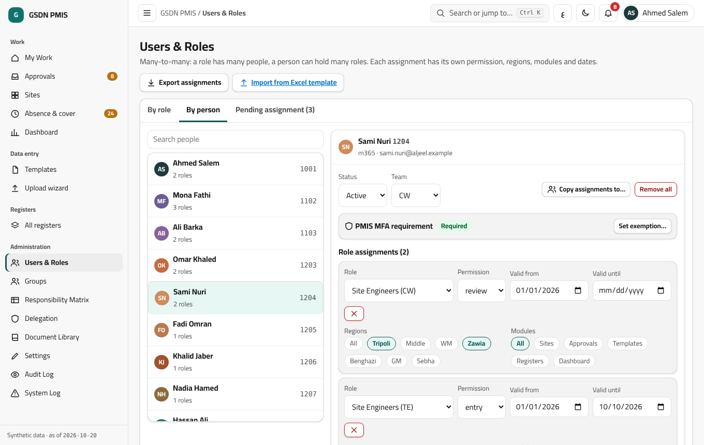

*(لقطة من النموذج الأولي، بيانات تجريبية.)*

## 3. المراحل العشر والبوابات التسع

الترتيب الافتراضي (النسخة 1 من تعريف سير العمل): **Site Release ← PRE-CW Completion ← CW Completion ← Site RFI ← TE Completion ← On-Air ← TE PAC ← KPI Acceptance ← HOTO ← Final Closure.** بينها **9 بوابات**. (CLAUDE.md؛ rules.md §2)

- **تاريخ البوابة** = تاريخ المرحلة السابقة. وبعض البوابات تضيف شروط تصاريح أو تاريخ تشغيل الطاقة (مثلاً CW Readiness وTE Installation Readiness وOn-Air Readiness)، فيصير تاريخها الأحدث بين المرحلة السابقة وتلك الشروط. وهذا تحسين على صياغة CLAUDE.md مسجَّل في Q9 ويحتاج تأكيد المالك. (rules.md §2.2، open-questions Q9)
- **تاريخ المرحلة يُحسب ولا يُكتب يدوياً**: يساوي أحدث تواريخ شروطها بعد فتح بوابتها. **استثناء Site RFI:** يعمل كمهمة؛ يُفتح حقل تاريخه عند تحقق شروطه، ويُعبَّأ مسبقاً بأحدث تاريخ شرط، ويمكن تعديله، ثم يمر بالمراجعة والاعتماد، وليس له مستند. (CLAUDE.md؛ rules.md §2.1)
- **إيقاف/استئناف في Change Control:** كل Suspension ثم Resumption معتمدين يزيحان البوابة. وتصير حالة الموقع On Hold أثناء الإيقاف. (CLAUDE.md؛ rules.md §2.3–2.4)
- **تقويم SLA:** أيام العمل، وعطلة الأسبوع الجمعة والسبت، والعطل الرسمية من جدول. (CLAUDE.md)
- **المراحل والبوابات قابلة للتعديل من المدير:** *تعديلات خفيفة تسري فوراً* (تسمية EN/AR، حقول مخصصة، شروط البوابة، SLA البوابة، هل تُحسب المرحلة في Project Status)، و*تعديلات هيكلية* (إضافة/حذف/إعادة ترتيب مرحلة أو بوابة، أو نقل مهام بين المراحل) تُنشر كنسخة جديدة من تعريف سير العمل بسبب وتحقق إضافي (step-up). المواقع الجديدة تستخدم النسخة الجديدة، والمفتوحة لا تنتقل إلا باختيار المدير بعد معاينة، ولا يتغير موقع بصمت. لكل مرحلة وبوابة رمز داخلي ثابت لا يتغير بإعادة التسمية، وعمود تصدير بصيغة Master. (CLAUDE.md، ADR 0010)
- **تجميد B9:** تُمنع التعديلات الهيكلية من بدء التجربة حتى نهاية شهر التشغيل الموازي؛ يرفع التجميد مدير النظام فقط بسبب مكتوب وstep-up ويُسجَّل. التعديلات الخفيفة والمهام المضافة داخل مرحلة (B8) تبقى متاحة. (CLAUDE.md)
- **مهام قابلة للتعديل (B8):** يضيف المدير مهمة أو خطوة داخل أي مرحلة. لكل مهمة خيار «تُحسب ضمن مرحلتها» (افتراضياً نعم). عند إضافة مهمة تُحسب يحذّر النظام من أن تاريخ المرحلة قد يتأخر عن الـMaster، ويُطلب تأكيد صريح خلال التشغيل الموازي، ويُعلَّم الفرق في تقرير المقارنة «بسبب مهمة مضافة» فلا يُحسب خطأ نقل. (CLAUDE.md)

**قواعد السيناريوهات:** (CLAUDE.md؛ rules.md §4)
- *Expansion:* يبقى في Site Release مستندا TSSR وLLD فقط؛ PRE-CW وCW يسريان عند وجود أعمال تكييف فقط؛ Power-On واختبار TX عند الحاجة لطاقة أو ألياف جديدة؛ ومن TE حتى Final Closure كلها تسري. الشروط تحددها أعلام النطاق في الـMaster (AA:AF).
- *Hot/Cold Swap وRelocation:* القواعد في rules.md §4. وهناك تعارض بين المخطط والـMaster حول Site RFI في الـSwap، والتوصية الحالية اتباع صيغة الـMaster؛ **يُؤكَّد لاحقاً** (Q3, Q15).
- *العنقود (Cluster):* بوابة التحسين لكل موقع من TE PAC الخاص به، وKPI Acceptance تُسجَّل مرة للعنقود وتُطبَّق على كل مواقعه، ويظهر على صفحة الموقع «6 من 9 مواقع عند TE PAC» للعلم فقط.

## 4. دورة الاعتماد: إدخال ← مراجعة ← اعتماد

- كل مهمة تمر بـ**إدخال ثم مراجعة ثم اعتماد**؛ الافتراضي **3 مستويات** لكل مرحلة ويمكن ضبطه (1 إلى 3) لكل مرحلة. **وحدة الاعتماد هي المهمة كاملة: التواريخ والمستندات معاً.** زر «إرسال للمراجعة» معطَّل حتى تُملأ كل خانات المستندات الإلزامية. (CLAUDE.md؛ rules.md §10)
- **مصفوفة المسؤوليات** (قابلة للتعديل من الواجهة) تحدد من يحمل كل مستوى لكل مرحلة. الخلية تقبل مستخدمين أو أدواراً أو مجموعات أو مزيجاً. **المعتمد الافتراضي (B2):** الدور الرئيسي للمرحلة، وProject Manager يعتمد Final Closure؛ بيانات أولية قابلة للتعديل. (CLAUDE.md)
- **صفوف المصفوفة للسجلات والتفكيك (B11):** صف لكل سجل (المشتريات PR/PO/WO وGECOL وHLC والتصاريح وHSE والمخزن والجودة وسجل المشاكل والمخاطر وChange Control والجاهزية والتسليم وAs-Built والاجتماعات والمقاولون) وصف للتفكيك (Dismantle)، لكلٍّ أصحاب مستوياته وعدد مستوياته (1–3) يحددها المدير. (CLAUDE.md)
- **التخطّي التلقائي:** إذا حمل شخص واحد مستويين متتاليين يُتخطّى الثاني تلقائياً ويُسجَّل التخطّي. (CLAUDE.md)
- **الاعتماد الذاتي (B5):** إذا حمل شخص واحد كل المستويات يصير إرساله هو الاعتماد النهائي؛ يتطلب step-up، ويُعلَّم «اعتماد ذاتي» في المؤشرات وسجل التدقيق، وتعرض شاشة المصفوفة الحالة مسبقاً. (CLAUDE.md)
- **الرفض (B6 وما قبلها):** يرجع مستوى واحداً للخلف (معتمد ← مراجع ← مُدخل) **وبملاحظة إلزامية**، ولكل مهمة سلسلة تعليقات. إذا كان المستوى السابق قد تُخطّي فإن الرفض يعود إلى **من تصرّف فعلاً** في المستوى السابق؛ يرى الملاحظة ويصحح ويعيد الإرسال، ويتكرر التخطّي ويُسجَّل. (CLAUDE.md)
- **تغيير عدد المستويات (B7):** يسري على المهام الجديدة وعلى المفتوحة غير المُرسَلة. المهمة تحفظ مسارها عند أول إرسال وتكمله حتى لو رُفضت وعادت للإدخال. (CLAUDE.md)
- **مهمة بلا صاحب (B10):** إذا لم يوجد من يحق له تنفيذ مستوى (مثلاً انتهى إسناد بلا بديل) تذهب إلى صندوق مديري النظام مع تنبيه فوري وتظهر في اللوحة «بلا صاحب» ولا تُتخطّى. في خلية «كل الأعضاء يجب أن يعتمدوا» رفض عضو واحد يرفض المهمة. في المجموعات الافتراضي «أي عضو»، وأول من يتصرف يستلم المهمة. (CLAUDE.md)
- **الغياب وإعادة الإسناد (B12b):** لا شيء ينتقل تلقائياً. يبقى المكلّف حتى يقرر قائد الفريق (أو صاحب صلاحية `reassign` أو مدير النظام) لكل مهمة أو موقع أو لكل مهام الشخص المفتوحة: (1) إبقاؤه، (2) إسنادها لشخص آخر مؤهل (تغيير حامل على مستوى المهمة دون تغيير المصفوفة)، (3) أن يعمل القائد بنفسه «نيابةً عن المكلَّف». إعادة الإسناد تتطلب سبباً قصيراً وتُدقَّق، وتحفظ البيانات والمستندات والتعليقات، و**لا تصفّر ولا توقف الـSLA ولا تغيّر نسبة الإنجاز**. تسجيل الغياب اختياري ومعلوماتي (شارة «غائب» وتنبيه للقائد)، وتنبيه منفصل لأي مهمة متوقفة N يوم عمل (الافتراضي 2، قابل للتعديل). (CLAUDE.md)
- **الرفع بالجملة:** يمكن اعتماد صفوف الدفعة صفاً صفاً أو كلها دفعة واحدة. (CLAUDE.md)
- **تجاوزات المدير:** فتح مرحلة/مهمة، التخطي أو N/A، القبول بلا مستند أو بلا مسار، إعادة فتح مهمة معتمدة، تعديل أي تاريخ، وتغيير القواعد من شاشات الإعدادات. كل تجاوز يحتاج سبباً وstep-up، ويُسجَّل بالقيم قبل/بعد، ويحمل شارة «تجاوز مدير»، ويمكن عكسه، ويُستثنى من المؤشرات أو يُعلَّم فيها. (CLAUDE.md)

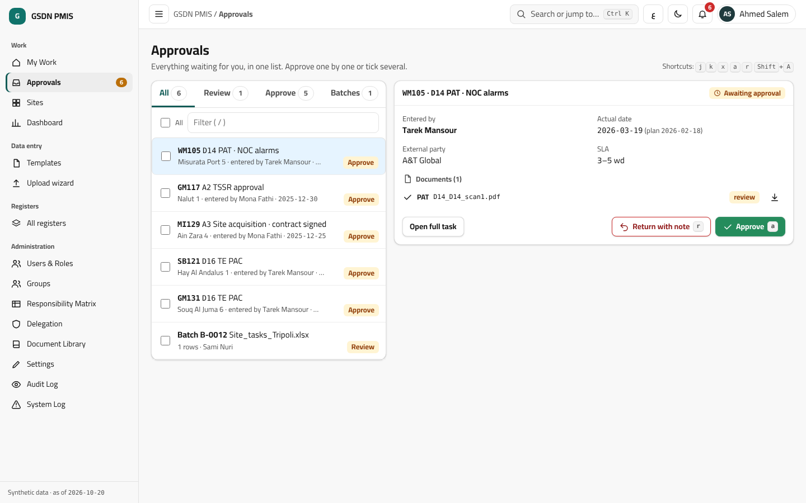
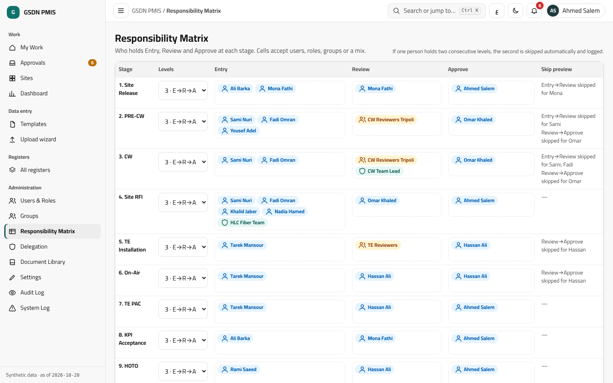

## 5. الرؤية والصلاحيات

- **الافتراضي: يرى المستخدم كل شيء**، ويمكن حصره لكل مستخدم في منطقة أو أكثر من المناطق السبع ووحدات مختارة. (CLAUDE.md)
- **B3 — من يحمل أكثر من دور:** صلاحيته مجموع أدواره، وكل دور محصور في مناطقه ووحداته؛ النطاقات لا تتقاطع (دور CW في طرابلس مع مراجع في الزاوية يعني CW في طرابلس ومهام المراجعة في الزاوية، وليس CW في الزاوية). (CLAUDE.md)
- **شبكة الصلاحيات** لكل وحدة وشاشة: عرض، إنشاء، تعديل، حذف، اعتماد، تصدير، استيراد، تنزيل مستندات، الاطلاع على سجل التدقيق، إدارة. ويمكن حفظ مجموعات منها كـ«ملفات صلاحيات» تُطبَّق على إسنادات كثيرة. وقواعد **على مستوى الحقل** لإخفاء أو جعل حقول (منها المخصصة) للقراءة فقط. القائمة الجانبية تُظهر ما يحق للشخص فقط. (CLAUDE.md، ADR 0003)
- **التفويض صلاحية عادية في الشبكة**، وتتحقق قاعدة البيانات نفسها من كل كتابة إعدادات مقابل الصلاحية الفعلية للفاعل لا مقابل علامة «مدير» ثابتة. (CLAUDE.md)
- **سجل التدقيق (B4):** مديرو النظام وProject Manager يرون كامله؛ كل قائد فريق يرى قيود وحداته ومناطقه فقط؛ غيرهم عبر صلاحية `view_audit` بنفس النطاقات. وكل اطلاع على السجل يُسجَّل بدوره. (CLAUDE.md)
- الموقع خارج نطاق المستخدم يُرجع «غير موجود» (404) لا «ممنوع». (openapi.yaml)

## 6. السجلات (Registers)

وحدات منفصلة لكلٍّ منها قائمته: **المشتريات (PR/PO/WO)، المقاولون، طاقة GECOL، ألياف HLC، التصاريح وHSE، المخزن، الجودة، سجل المشاكل (عدة مشاكل للموقع)، سجل المخاطر، Change Control، الجاهزية والتسليم، As-Built، الاجتماعات.** (CLAUDE.md؛ ERD)

- لكل سجل صف في المصفوفة (B11) وحقول مخصصة يضيفها المدير (انظر القسم 12).
- **المخزن:** تُحسب حاجة كل موقع TE من التصميم: قطاعات (Cambium أو Intracom حسب مورد المنطقة)، وأنصاف وصلات MW، وLPU Kit = 2، وRouter = 1، وCabinet = 1، وBattery = 2. ويُحسب «تاريخ اكتمال إرسال TE» حين تغطي الكميات المرسلة الحاجة لكل وحدة. (rules.md §7). *حالة مواقع IP Router Only: الحاجة المقترحة Router = 1 فقط، وتنتظر تأكيد المالك (Q6).*
- **إصدار DN يحجز المخزون** («قيد الصرف») ويُرحَّل الصرف عند الاعتماد، والإرجاع RN كذلك. بيانات أصناف المخزن (أسماء، وحدات، فئات، قواعد الحاجة) يعدلها مدير النظام، ومشرف المخزون بتفويض منه فقط. (CLAUDE.md)
- **حقول الاجتماعات** لا مصدر لها في الـMaster؛ الحقول الدنيا المقترحة بانتظار تأكيد المالك (Q12). (open-questions)

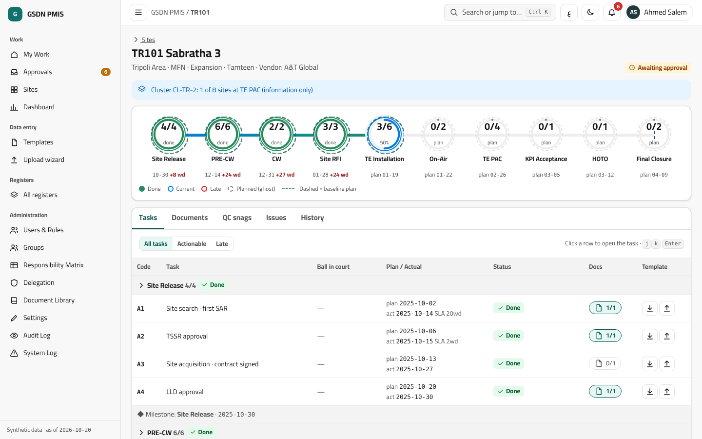
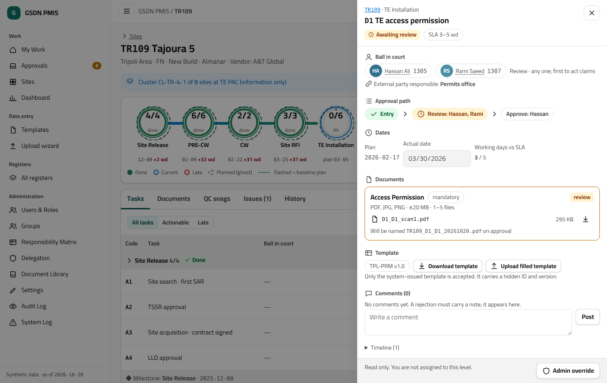

## 7. المستندات وضبط الجودة والنماذج المولَّدة وفترة الضمان

- **مستندات القبول** (TE PAC وSSV وCW FAC وTE FAC وHOTO…) نماذج رسمية تُملأ وتُوقَّع وتُمسح وتُرفع، وتغلق مهمتها عبر مسار الاعتماد. **صور QC** صور لعيب تم إصلاحه: يرفع مهندس الموقع صوراً جديدة، يراجعها المراجع ويعتمدها المعتمد فيُغلق العيب (Snag). شيئان مختلفان. (CLAUDE.md)
- **قبول أولي (مثل CW PAC) لا يُعتمد ما دام أي عيب مفتوحاً في الموقع**، وسبب القفل يعرض العدد. شروط صور QC تُضبط لكل نوع عيب (حد أدنى للعدد، لقطات مطلوبة، الصيغ JPG/PNG/HEIC، حجم أقصى)، وتُرفض الصور الملتقطة قبل تسجيل العيب بحسب تاريخ EXIF، وغياب التاريخ يُقبل بعلامة «تاريخ غير معروف». (CLAUDE.md)
- **مكتبة المستندات (للمدير):** كل مستند يُعرَّف كبيانات لا كود: الاسم، النوع، المكان (مهمة أو أكثر أو QC أو سجل)، إلزامي أو مشروط، الصيغ والحجم، الحد الأدنى/الأقصى للملفات، تاريخ الانتهاء، ونموذج فارغ للتنزيل. عند النشر يختار المدير أن يسري على المهام الجديدة فقط أو على المفتوحة أيضاً، والمعتمدة لا تتغير أبداً. الافتراضي: PDF أو صورة، 20 ميجابايت، ملفات متعددة. **مستندات المراحل 4 إلى 10 مبذورة مبدئياً وتنتظر مراجعة المالك.** (CLAUDE.md؛ open-questions S1)
- **الرفع:** خانة مسماة لكل مستند مطلوب بحالتها (ناقص، مرفوع، قيد المراجعة، معتمد، مرفوض مع السبب)، بالسحب أو النقر أو كاميرا الهاتف. **التنزيل** من المهمة أو من تبويب مستندات الموقع أو بالجملة كملف zip؛ النسخ القديمة تُحفظ وتُنزَّل؛ الاسم تلقائي `SITE_TASK_DOC_APPROVEDDATE.ext`؛ وكل تنزيل يُسجَّل في سجل التدقيق. (CLAUDE.md)
- **نماذج CW يصدرها النظام (B2 وما بعده):** CW DN (تسليم مواد) وCW RN (إرجاع) وCW PAC وCW FAC وقائمة العيوب. كل نموذج قالب HTML يعدّله المدير ويُحوَّل إلى PDF على الخادم، بترقيم تسلسلي قابل للضبط (مثل `DN-CW-TR-2026-0001`) ورمز QR يعيد إلى السجل. التدفق: يجهّز المسؤول السجل ← يولّد النظام PDF مرقماً ← يُطبع ويُوقَّع ورقياً ← يُرفع المسح في الخانة نفسها ← يمر بالاعتماد. جداول الأصناف تأتي من حركات المخزن لا من النموذج، ويملأ النظام كل بيانات الحقول وأسماء الموقّعين من المصفوفة، وتبقى التواقيع والأختام للتوقيع اليدوي. لا يُولَّد PAC وفي الموقع عيب مفتوح، والأرقام لا تُعاد ولا تُحذف (الخاطئ يُلغى بسبب ويُصدر برقم جديد). **نماذج TE مؤجلة.** (CLAUDE.md)
- **فترة ضمان العيوب (DLP):** CW = 3 أشهر وTE = 12 شهراً من تاريخ PAC، كإعدادين يعدّلهما المدير (`dlp.months.cw` و`dlp.months.te`) بنسخ، وتحتفظ كل PAC بالقيمة السارية وقت إصدارها. (CLAUDE.md)
- **القوالب المعتمدة فقط:** يصدر النظام كل قالب برقم ونسخة مضمّنين في ورقة مخفية؛ تُرفض أي ملفات بلا رقم ونسخة صالحين (والرفض يُسجَّل في سجل النظام)، وتُرفض النسخ القديمة بعد تغيّر الحقول. كل رفع يمر بـ دفعة ← مراجعة ← اعتماد مع معاينة الفروق. (CLAUDE.md، ADR 0005) *رفع الـMaster الحالي (لا يحوي ورقة القالب) له مسار مؤقت مقترح للمدير فقط؛ ينتظر قرار المالك (Q1).*

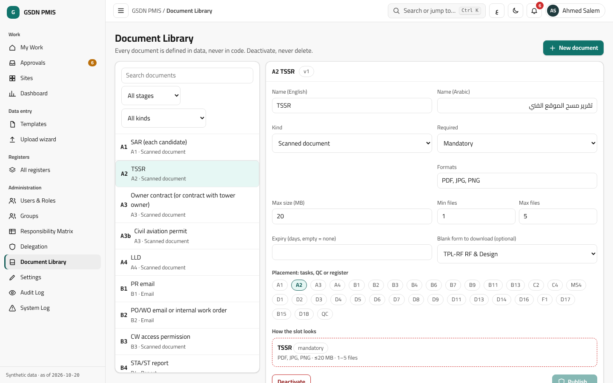

## 8. سجل الموظفين وبطاقة الموظف

- سجل لموظفي Aljeel: الرقم الوظيفي (4 أرقام)، الاسم EN/AR، الهاتف، البريد، المنصب، الفريق، المنطقة. هو القائمة المفحوصة عند أول دخول (الرقم موجود وغير مرتبط بحساب آخر). يُبذر مسودة ببيانات وهمية وتُستبدل بالحقيقية لاحقاً. (CLAUDE.md)
- يظهر الرقم الوظيفي بجانب اسم كل مكلّف (شبكة المهام والدرج والموافقات وعملي والمصفوفة)، وبالمرور أو التركيز تفتح **بطاقة صغيرة** ببيانات السجل. ظهور الهاتف والبريد: افتراضياً لكل موظف مسجَّل الدخول، ويمكن للمدير تحديد من يرى كل حقل أو إخفاؤه لموظف بعينه. التحديث بالتعديل أو الاستيراد من قالب معتمد، مع تدقيق، **ولا حذف نهائي**. (CLAUDE.md)

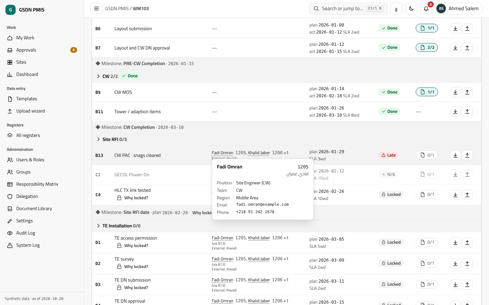

## 9. الدخول

- **خانة واحدة (قرار المالك 2026-10-25):** يكتب الموظف بريده أو رقمه الوظيفي أو هاتفه المسجَّل. تبحث المنظومة في سجل الموظفين وتحوّل المتصفح إلى Microsoft 365 مع بريد الشخص كتلميح (`login_hint`)، و**Microsoft هو من يُجري الدخول فعلياً** (كلمة المرور وMFA والوصول المشروط). **لا تخزّن المنظومة كلمات مرور.** تتصرف الشاشة بالطريقة نفسها سواء وُجد تطابق أم لا حتى لا تكشف من هو مسجَّل. بعد العودة يجب أن يطابق حساب الرمز صفّ السجل. (CLAUDE.md، ADR 0002 §9b)
- **أول دخول:** يُنشأ الحساب «بانتظار الإسناد» ولا يرى شيئاً حتى يسند المدير الدور والفريق (CW/TE/كلاهما) ومستوى الصلاحية والمناطق والوحدات. الرقم الوظيفي يُدخل مرة واحدة. (CLAUDE.md، ADR 0002)
- **الدخول المحلي** (رقم وظيفي أو هاتف + كلمة مرور) **مؤجل لمرحلة لاحقة**؛ التصميم المقترح محفوظ في ADR 0002 §10 وسجل الموظفين يُستخدم الآن كي لا يلزم إعادة عمل. (CLAUDE.md)
- **التحقق الثنائي (MFA):** يُفرض عبر Conditional Access في Entra. وتتحقق الواجهة الخلفية من `amr` عبر مفتاح يديره المدير، **مُطفأ حتى تفعّله IT**. التحقق الإضافي (step-up) مطلوب للاعتماد النهائي وتغيير الأدوار والمصفوفة والمجموعات والتفويض والحذف وتجاوزات المدير. حساب طوارئ محلي واحد (break-glass) بـTOTP من الشبكة الداخلية فقط، وكل استخدام يُسجَّل ويُرسل بالبريد. (CLAUDE.md)
- **إعفاء مستخدم من MFA (طلب المالك 2026-10-25):** يزيل مدير النظام (أو مفوَّض) شرط MFA داخل PMIS عن مستخدم مسجَّل، إلى أن يُلغى أو إلى تاريخ نهاية، بسبب وstep-up للمدير نفسه؛ لا أحد يعفي نفسه، ويُدقَّق، ويصله بريد، وتظهر شارة «معفى من MFA». **لا يغيّر MFA المفروض من Entra** (تغييره عند IT). (CLAUDE.md)
- اللغة: إنجليزية افتراضياً مع العربية (RTL) بتبديل فوري؛ وضعان فاتح وداكن؛ خط Cairo؛ ألوان ERPNext (frappe-ui) دون شعار ERPNext ولا اسمه. الهوية النهائية لـAljeel **تُؤكَّد لاحقاً**. (CLAUDE.md)

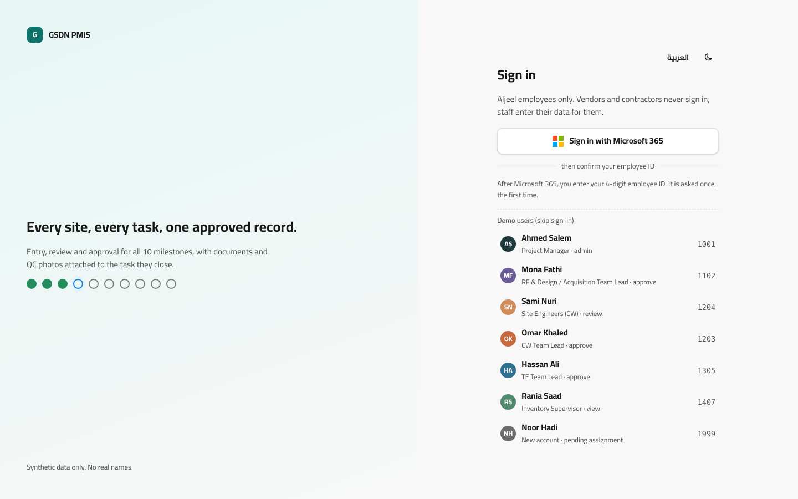
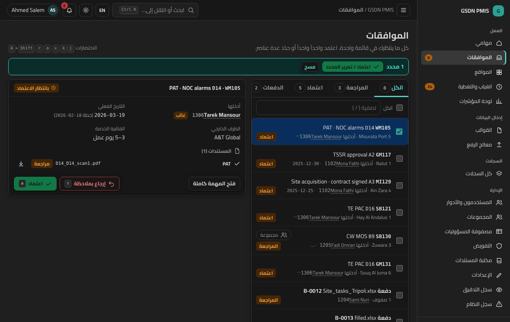

## 10. الإعدادات التي يملكها مدير النظام (أو من يفوّضه)

كل إنشاء أو إعادة تسمية أو تعديل أو تعطيل أو حذف لإعداد هو إجراء مدير النظام أو من فوّضه. كل تغيير: **سبب + قيم قبل/بعد + نسخة**، وما ارتبط ببيانات يُعطَّل لا يُحذف. (CLAUDE.md)

| الإعداد | ما يمكن ضبطه بلا كود | المصدر |
|---|---|---|
| **SLA** | لكل مهمة حد أدنى (هدف/أخضر) وأقصى (حد) بأيام العمل، وحدث البداية، والتقويم، وتجاوزات حسب السيناريو أو المنطقة. بنسخ وتاريخ سريان؛ والمهمة تحتفظ بنسخة SLA وقت فتحها فلا يُعاد كتابة الماضي. عند النشر يختار المدير تطبيقه على المفتوحة. | CLAUDE.md |
| **الأوزان** | أوزان الأنشطة الثمانية (الافتراضي 12/8/5/25/20/12/13/5) وأوزان 45 بنداً ووحدة وطريقة قياس كل بند، وصيغ المؤشر الصحي ونسب التأخير. يتحقق النظام أن المجموع 100% في كل مستوى قبل النشر. اللقطات الأسبوعية المحفوظة لا تتغير. | CLAUDE.md، rules.md §6 |
| **العطل (B12)** | شاشة «إعدادات ← تقويم العمل»: إضافة وتعديل وحذف واستيراد العطل (التاريخ، الاسم EN/AR، وطنية/دينية، علامة «تقريبية») وأيام نهاية الأسبوع. مسودة 2026–2027؛ الدينية تقريبية حتى يؤكدها المدير، وتذكير قبل 14 يوماً. التغيير يعيد حساب المهام المفتوحة فقط ويُدقَّق بسبب. لافتة تظهر عند خلو جدول السنة القادمة. | CLAUDE.md |
| **نسخ سير العمل** | المراحل والبوابات (القسم 3)، وتعريف المهام ومؤشر «تُحسب ضمن المرحلة». | CLAUDE.md، ADR 0009, 0010 |
| **التجميد (B9)** | منع التعديلات الهيكلية خلال التجربة والتشغيل الموازي، يرفعه المدير فقط. | CLAUDE.md |
| **الحقول المخصصة** | إضافة حقول إلى أي سجل وإلى المواقع والمهام (كما تُضاف أعمدة للـMaster): تسمية EN/AR، النوع (نص، رقم، تاريخ، قائمة، قائمة متعددة، نعم/لا، مستخدم، جهة خارجية، ملف)، إلزامي، تحقق، قيم القوائم، الافتراضي، الترتيب، من يرى ومن يعدّل، الظهور في القوالب والتصدير وتصدير Master. تُعطَّل ولا تُحذف، وتُصدر القوالب بنسخة جديدة. | CLAUDE.md، ADR 0009 |
| **التفويض** | أي إجراء في الشبكة لأي شخص أو دور أو مجموعة (القسم 2). | CLAUDE.md |
| **أخرى** | مكتبة المستندات، القوالب، قواعد صور QC، DLP، مفتاح MFA، أنصاف قطر السياج الجغرافي `geofence_radius_m` (الافتراضي 300 م)، والأدوار وملفات الصلاحيات. | CLAUDE.md، ADR 0008 |

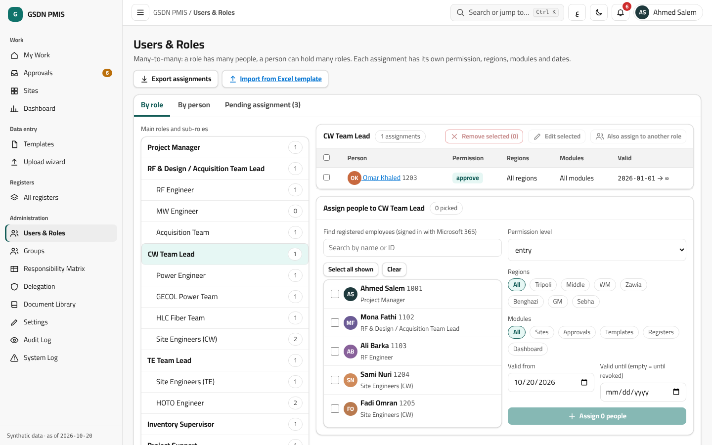

## 11. السجلات (الدخول/التدقيق) والتنبيهات

- **سجل التدقيق (Audit Log):** يسجّل كل إجراء مستخدم بالقيم قبل وبعد، ولا يُعدَّل ولا يُحذف (يُمنع في قاعدة البيانات). **سجل النظام/الأخطاء (System Log)** منفصل. (CLAUDE.md، ADR 0006)
- التنبيهات داخل النظام وبالبريد. (CLAUDE.md)

## 12. لوحة المتابعة والتقدم

- **لوحة المتابعة تأتي في المرحلة P3** وتتبع مؤشرات اللوحة القديمة (المرجع للقراءة فقط): جدول تسليم المراحل (النطاق، المنجز، المعلّق، غير المستحق، التأخير)، والتقدم حسب المنطقة، ونقاط التفتيش، والاستثناءات والتنبيهات، ووحدات المخزن الكاملة، والـSwap/Relocation. (stories-dashboard)
- **Project Status:** يقيس التقدم حتى HOTO بـ8 أنشطة و**45 بنداً** بأوزان 12/8/5/25/20/12/13/5 قابلة للتعديل، ويعرض الفعلي والمخطط وSPI وتغطية الخطة. **Final Closure** مؤشر منفصل: المواقع المغلقة والنسبة وCW FAC/TE FAC المعلّقة بأعمارها. **تأخير حسب الجهة** و**مؤشر صحة المشروع** ضمن النسخة 1، لكن **صيغتاهما مسودة بانتظار مراجعة المالك** (Q16). لقطات أسبوعية تحفظ القيم ولا تُعاد حسابها. (CLAUDE.md؛ rules.md §6–§9)

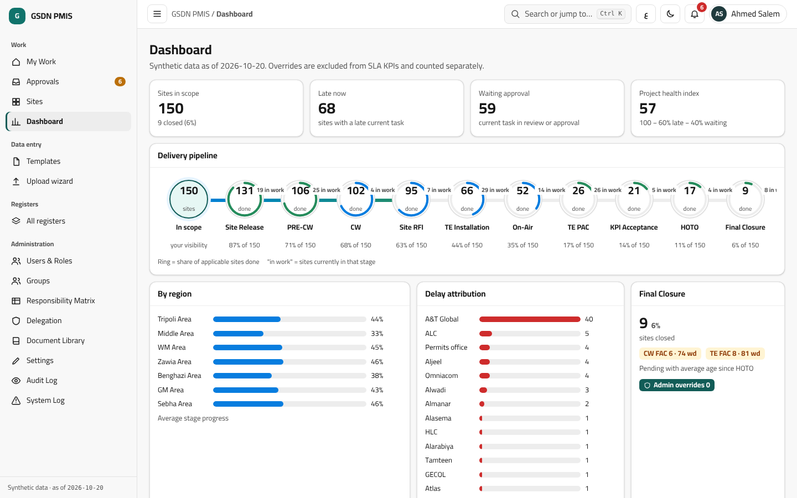
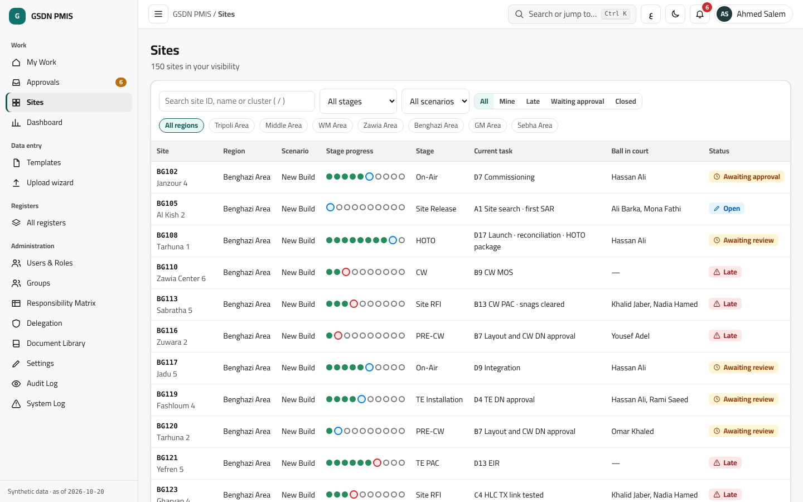
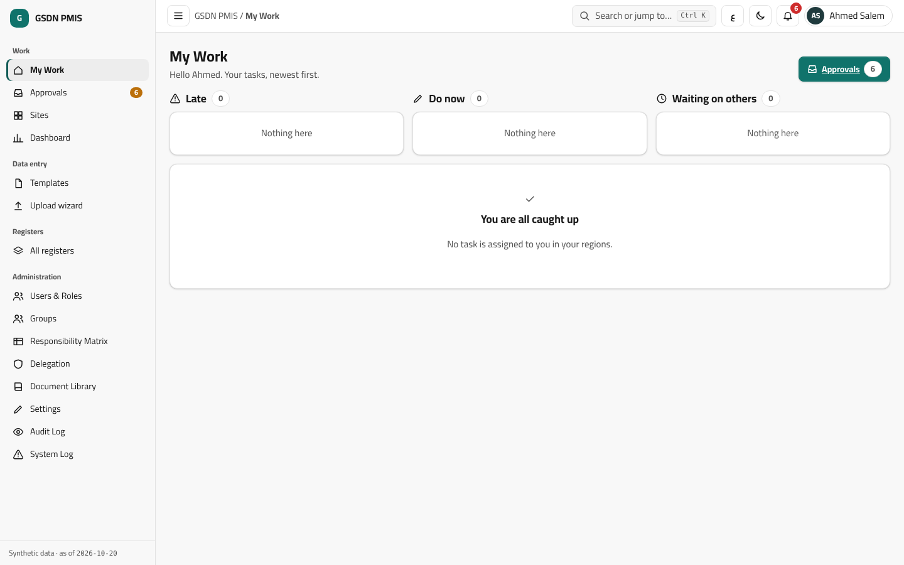

## 13. المتطلبات غير الوظيفية

| البند | القيمة | المصدر |
|---|---|---|
| أقصى فقد للبيانات (RPO) | 15 دقيقة (أرشفة WAL كل 15 دقيقة + نسخة كاملة ليلية) | CLAUDE.md |
| أقصى توقف (RTO) | 4 ساعات في أوقات العمل، مع خادم احتياطي وتجربة استعادة كل ربع سنة | CLAUDE.md |
| الاحتفاظ بالنسخ الاحتياطية | 14 يومية، 8 أسبوعية، 12 شهرية، ونسخة في مبنى آخر | CLAUDE.md |
| بيانات المشروع والمستندات | عمر المشروع + 10 سنوات، وأرشيف للقراءة فقط بعد الإغلاق. *افتراض يحتاج مطابقة العقد وسياسة أمن Aljeel — يُؤكَّد لاحقاً* | CLAUDE.md |
| سجل التدقيق | 10 سنوات، لا يُحذف، للإضافة فقط بفرض من قاعدة البيانات | CLAUDE.md |
| سجل النظام/الأخطاء | 12 شهراً ثم يُحذف تلقائياً | CLAUDE.md |
| الأداء | صفحات أقل من ثانيتين مع 1000 موقع و100 مستخدم متزامن | CLAUDE.md |
| الأمان | TLS على الشبكة الداخلية؛ نسخ احتياطية مشفرة | CLAUDE.md |

## 14. الإطلاق

(CLAUDE.md)
1. **تجربة في منطقة واحدة (طرابلس) لأسبوعين.**
2. **تشغيل موازٍ شهراً:** يصدّر PMIS ملفاً بصيغة Master ويقارنه تلقائياً بالـMaster الحي. **يُتقاعد الـMaster بعد شهر بلا فروقات جوهرية.**
3. **التدريب لكل دور:** فيديوهات عربية قصيرة، ودليل داخل التطبيق عند أول استخدام، وجلسة حية لكل مجموعة أدوار، وبطل دعم من Project Support.
4. **معايير القبول:** نجاح اختبارات المسار الحرج الشاملة (E2E)، ومطابقة 100% لتواريخ المراحل في استيراد الـMaster الحقيقي، ولا أعطال حرجة مفتوحة، وتحقيق أهداف الأداء.
5. البيانات الحقيقية تُرفع عبر النظام بعد اكتمالها؛ حتى ذلك الحين بيانات اصطناعية فقط.

**مراحل التنفيذ** (ORCHESTRATION.md): **P1** الدخول والمستخدمون والرؤية والمواقع ومحرك الاعتماد والمصفوفة وسجل التدقيق؛ **P2** القوالب والاستيراد والسجلات وسجل النظام والإشعارات؛ **P3** اللوحات والأداء ومراجعة الأمان والنسخ الاحتياطي وإجراءات التشغيل والقبول ببيانات حقيقية.

## 15. بنود تنتظر القرار أو التأكيد

- تسجيل تطبيق Entra لدى IT (B1)، والخادم والنطاق وTLS والنسخ الاحتياطي. (HANDOVER.md)
- تأكيد تواريخ العطل الدينية وعدد أيام العيد. (HANDOVER.md)
- السجل الحقيقي للموظفين وبيانات الـMaster الحقيقية. (HANDOVER.md)
- مستندات المراحل 4–10، وأسماء الأشخاص لكل دور، والهوية النهائية. (CLAUDE.md «Still open»)
- الأسئلة Q1–Q18 في `docs/spec/open-questions.md` لكلٍّ منها افتراض مقترح قابل للضبط.

---

# English section

## 1. Purpose and scope

- **GSDN PMIS** manages the GSDN site-delivery project (telecom sites across 7 Libyan regions). It replaces the Excel Site Master as the system of record and puts a **3-level approval workflow** on every task. (CLAUDE.md)
- **Regions:** Tripoli, Middle, WM, Zawia, Benghazi, GM, Sebha. **Delivery scenarios:** New Build, Expansion, Hot Swap, Cold Swap, Relocation. **Overall status:** Not Started, In Progress, On Hold, Completed, Cancelled. (CLAUDE.md)
- **Hosting:** an internal company server, never cloud. (CLAUDE.md, ADR 0001)
- **Out of scope for now:** the mobile app (later, designed for now), HSE incidents and clock-in (deferred to mobile), team capacity and certificates (dropped), generated TE forms (deferred), local password sign-in (deferred). (CLAUDE.md)

## 2. Who uses it

- **Only Aljeel employees** sign in, through Microsoft 365. **Vendors, contractors, GECOL, HLC and suppliers never sign in**; staff enter their data and upload their documents, and every task shows the responsible external party (for example A&T Global) so delays are attributed correctly. (CLAUDE.md)
- **Six main roles:** Project Manager; RF & Design / Acquisition Team Lead; CW Team Lead; TE Team Lead; Inventory Supervisor; Project Support. (CLAUDE.md)
- **Sub-roles** (seed data, editable in the UI): RF Engineer, MW Engineer, Acquisition Team under RF & Design; Power Engineer, GECOL Power Team, HLC Fiber Team, Site Engineers (CW) under CW TL; Site Engineers (TE), HOTO Engineer under TE TL; Project Procurement Team under Project Support. *Note: the source says "9 sub-roles" but its written list has 10 names; the final count is to be confirmed.* (CLAUDE.md)
- **Aljeel supervising engineers (AAT SE)** only supervise; TE installation steps through On-Air are the TE vendor's (A&T Global) responsibility. (CLAUDE.md)
- **Roles are fully admin-defined.** The six and the sub-roles are seed data. The admin can create a role with an EN/AR name and duties, a parent role (for a sub-role), a default permission profile, default regions and modules, and whether it may hold matrix levels (entry/review/approve). **Example, a Management role:** view the dashboard and progress reports only, read-only on all modules and regions, no entry or approval, never offered in a matrix cell. Roles are deactivated, never deleted while assigned. (CLAUDE.md, ADR 0003)
- **System Admin** is a group of one or more people with full control. The admin can **delegate** any right to any person, role or group, for all regions or selected ones, time-bound or until revoked. Safeguards: nobody grants rights to themselves; a delegate cannot re-delegate unless explicitly allowed; a delegate cannot remove an admin; at least one active admin always exists; every delegated action is logged "X on behalf of System Admin". (CLAUDE.md)
- **Role assignment is many-to-many in both directions:** by role (select many employees at once) or by person (several roles). Each assignment carries its own permission level (view/entry/review/approve/admin), regions, modules and validity dates. (CLAUDE.md)

*(Prototype screenshot, synthetic data.)*

## 3. The 10 milestones and 9 gates

Default order (workflow definition version 1): **Site Release → PRE-CW Completion → CW Completion → Site RFI → TE Completion → On-Air → TE PAC → KPI Acceptance → HOTO → Final Closure**, with **9 gates** between them. (CLAUDE.md; rules.md §2)

- **A gate date equals the previous milestone date.** Some gates also wait for permit dates or the commissioning-power date (for example CW Readiness, TE Installation Readiness, On-Air Readiness), so their date is the latest of the previous milestone and those conditions. This refines the CLAUDE.md wording and is recorded as Q9, pending owner confirmation. (rules.md §2.2, open-questions Q9)
- **A milestone date is calculated, never typed**: the latest of its condition dates once its gate is open. **Exception, Site RFI:** it works like a task. Its date field unlocks when its conditions are met, is pre-filled with the latest condition date, can be edited, then goes through review and approval. It has no document. (CLAUDE.md; rules.md §2.1)
- **Change Control:** each approved Suspension followed by a Resumption shifts the gate. The site is On Hold during the suspension. (CLAUDE.md; rules.md §2.3–2.4)
- **SLA calendar:** working days; the weekend is Friday and Saturday; public holidays come from a table. (CLAUDE.md)
- **Milestones and gates are configurable by the admin.** *Light changes apply at once:* EN/AR names, custom fields, gate conditions, gate SLA, whether a milestone counts in Project Status. *Structural changes* (add, remove or reorder a milestone or gate, or move tasks between stages) publish a new workflow-definition version with a reason and step-up. New sites use the new version; open sites migrate only when the admin chooses, after a preview; a site never changes version silently. Each milestone and gate has a stable internal code that renames never change, and a Master export column. (CLAUDE.md, ADR 0010)
- **Freeze (B9):** structural changes are blocked from the pilot start to the end of the parallel-run month. Only a System Admin can lift it, with a written reason and step-up, and it is audited. Light changes and tasks added inside a stage (B8) stay allowed. (CLAUDE.md)
- **Editable tasks (B8):** the admin can add tasks or sub-steps inside any stage. Each task has a flag "counts toward the stage milestone" (default yes). Adding a counting task warns that the milestone date may move later than the Master; during the parallel run the admin must confirm explicitly, and the comparison report tags the difference "caused by an added task" so it is not counted as an import error. (CLAUDE.md)

**Scenario rules:** (CLAUDE.md; rules.md §4)
- *Expansion:* Site Release keeps TSSR and LLD only; PRE-CW and CW apply only when adaption work exists; Power-On and TX test only if new power or fiber is needed; TE through Final Closure all apply. Conditions follow the Master scope flags (AA:AF).
- *Hot/Cold Swap and Relocation:* see rules.md §4. The blueprint and the Master disagree on Site RFI for Swap sites; the current proposal follows the Master formula, **to be confirmed** (Q3, Q15).
- *Cluster:* each site's optimization gate opens from its own TE PAC; KPI Acceptance is recorded once per cluster and applied to all its sites; the site page shows "6 of 9 sites at TE PAC" as information only.

## 4. The approval flow: Entry → Review → Approve

- Every task goes through **Entry, Review, Approve**. The default is **3 levels** per stage, configurable from 1 to 3. **The unit of approval is the whole task: dates plus documents.** "Submit for review" stays disabled until every mandatory document slot is filled. (CLAUDE.md; rules.md §10)
- The **Responsibility Matrix** (editable in the UI) decides who holds each level per stage. A cell accepts users, roles, groups or a mix. **Default approver (B2):** the stage's main role; the Project Manager approves Final Closure; seed data, editable. (CLAUDE.md)
- **Matrix rows for registers and Dismantle (B11):** one row per register (Procurement PR/PO/WO, GECOL, HLC, Permits & HSE, Warehouse, Quality, Issue, Risk, Change Control, Readiness & Handover, As-Built, Meetings, Contractors) and one row for Dismantle, each with its own Entry/Review/Approve holders and its own number of levels (1 to 3). (CLAUDE.md)
- **Skip:** if one person holds two consecutive levels, the second is skipped automatically and the skip is logged. (CLAUDE.md)
- **Self-approval (B5):** if one person holds every level, their submission is the final approval. It needs step-up, is flagged "self-approval" in KPIs and the audit log, and the matrix screen shows the case in advance. (CLAUDE.md)
- **Rejection (B6):** it goes back one level (approver → reviewer → entry) **and must carry a note**; every task has a comment thread. When the previous level was skipped, the rejection returns to **the person who actually acted**; they see the note, correct and resubmit, and the skip is applied and logged again. (CLAUDE.md)
- **Level changes (B7):** a new level count applies to new tasks and to open tasks not yet submitted. A task snapshots its level path at first submission and finishes on it, even after a rejection. (CLAUDE.md)
- **Task with no holder (B10):** if a level has no eligible holder (for example an expired assignment with no replacement), the task goes to the System Admins' inbox with an immediate alert, shows on the dashboard as "no holder", and is never skipped. Under "all members must approve", one rejection rejects the task. Groups default to "any one member"; the first to act claims the task. (CLAUDE.md)
- **Absence and reassignment (B12b):** nothing moves automatically. The person stays on the task until their Team Lead (or anyone with the `reassign` grant, or a System Admin) decides, per task, per site or for all the person's open tasks: (1) keep them, (2) reassign to another eligible person (a task-level holder change; the Matrix is unchanged), or (3) act on it themselves, logged "lead on behalf of the assignee". Reassignment needs a short reason, is audited, keeps data, documents and comments, and **does not reset or pause the SLA or change progress**. Absence records are optional and informational ("absent" badge, alert to the lead); a separate alert fires when a task is idle for N working days (default 2, a setting). (CLAUDE.md)
- **Batch uploads** can be approved row by row or all at once. (CLAUDE.md)
- **Admin overrides:** unlock a stage or task, skip or mark N/A, accept without document or workflow, reopen an approved task, edit any date, change the rules from settings. Each needs a reason and step-up, is audited with before/after values, shows an "Admin override" badge, is reversible, and is excluded from or flagged in KPIs. (CLAUDE.md)

## 5. Visibility and permissions

- **Default: everything is visible.** It can be limited per user to one or more of the 7 regions and to selected modules. (CLAUDE.md)
- **B3 — several roles:** effective permission is the union of the person's active assignments, each limited to its own regions and modules. Scopes never cross: CW in Tripoli plus a reviewer group in Zawia shows CW in Tripoli and review work in Zawia, not CW in Zawia. (CLAUDE.md)
- **Permission grid** per module and screen: view, create, edit, delete, approve, export, import, download documents, see the audit log, administer. Grids can be saved as named profiles and applied to many assignments. **Field-level rules** hide or make specific fields (including custom fields) read-only. Navigation shows only what the person may use. (CLAUDE.md, ADR 0003)
- **Delegation is a plain permission grant**, and the database checks every configuration write against the actor's effective permission, not a fixed admin flag. (CLAUDE.md)
- **Audit Log readers (B4):** System Admins and the Project Manager see all of it; each Team Lead sees entries for their own modules and regions; anyone else needs the `view_audit` grant, scoped like any other grant. Every read of the Audit Log is itself audited. (CLAUDE.md)
- A site outside the user's scope answers "not found" (404), not "forbidden". (openapi.yaml)

## 6. Registers

Separate modules, each with its own menu: **Procurement (PR/PO/WO), Contractors, GECOL power, HLC fiber, Permits & HSE, Warehouse, Quality, Issue Log (several issues per site), Risk Register, Change Control, Readiness & Handover, As-Built, Meetings.** (CLAUDE.md; ERD)

- Each register has its Matrix row (B11) and admin-defined custom fields (section 10).
- **Warehouse:** the need of each TE site is computed from the design: sectors (Cambium or Intracom by the region's vendor), MW half-links, LPU Kit = 2, Router = 1, Cabinet = 1, Battery = 2. The TE Dispatch Complete date is reached when dispatched quantities cover the need of every unit. (rules.md §7). *IP Router Only sites: the proposal is Router = 1 only, awaiting owner confirmation (Q6).*
- **An approved CW DN posts the stock issue** and an approved RN posts the return; until approval the quantities show as "pending" and stock is reserved. Warehouse item master data is edited by the System Admin, and by the Inventory Supervisor only through delegation. (CLAUDE.md)
- **Meetings register fields** have no Master source; the minimal proposed fields await owner confirmation (Q12). (open-questions)

## 7. Documents, QC, generated CW forms and DLP

- **Acceptance documents** (TE PAC, SSV, CW FAC, TE FAC, HOTO and so on) are official forms, filled, signed, scanned and uploaded; they close their task through the approval workflow. **QC photos** are photos of a fixed defect: the site engineer uploads fresh photos, the reviewer reviews, the approver approves, and the snag closes. They are different things. (CLAUDE.md)
- **A preliminary acceptance (for example CW PAC) cannot be approved while any snag on the site is open**; the lock reason shows the count. QC photo rules are set per snag type (minimum count, required shots, JPG/PNG/HEIC, maximum size). Photos taken before the snag was raised are rejected by EXIF date; a missing EXIF date is accepted with an "unknown capture date" flag. (CLAUDE.md)
- **Document Library (admin):** each document is defined in data, not code: name, kind, placement (tasks, QC or a register), mandatory or conditional, formats and size, min/max files, expiry, and an optional blank form. On publish the admin chooses new tasks only or open tasks too; approved tasks never change. Default: PDF or image, 20 MB, multiple files. **Documents for stages 4 to 10 are seeded drafts awaiting the owner's review.** (CLAUDE.md; open-questions S1)
- **Upload and download:** one named slot per required document with its status (missing, uploaded, in review, approved, rejected with reason), by drag, click or phone camera. Download from the task, the site Documents tab, or in bulk as a zip; superseded versions are kept; files are named `SITE_TASK_DOC_APPROVEDDATE.ext`; every download is audited. (CLAUDE.md)
- **CW forms are issued by the system:** CW DN (material delivery), CW RN (return), CW PAC, CW FAC and the Snag list. Each form is an HTML template the admin can edit, rendered to PDF on the server, with a configurable numbering sequence (for example `DN-CW-TR-2026-0001`) and a QR code linking to the record. Flow: the responsible person prepares the record → the system generates the numbered PDF → it is printed and signed on paper → the signed scan is uploaded into the same slot → it goes through approval. Item tables come from warehouse movements, not the form; the system fills every data field and the signatories' names from the Matrix; signatures and stamps stay for wet signature. CW PAC cannot be generated while a snag is open; numbers are never reused or deleted (a wrong form is voided with a reason and reissued). **TE forms are deferred.** (CLAUDE.md)
- **Defects Liability Period (DLP):** CW 3 months, TE 12 months from the PAC date, as admin settings (`dlp.months.cw`, `dlp.months.te`), versioned; each PAC keeps the value in force when it was issued. (CLAUDE.md)
- **Approved templates only:** the system issues each template with an ID and version embedded in a hidden sheet; uploads without a valid ID and version are rejected (and written to the System Log), as are old versions after fields change. Every upload goes batch → review → approve with a diff preview. (CLAUDE.md, ADR 0005) *Uploading today's Master (which has no template sheet) has a proposed admin-only temporary path, pending the owner's decision (Q1).*

## 8. Staff registry and employee card

- A registry of Aljeel staff holds the 4-digit employee ID, name EN/AR, phone, email, position, team and region. It is the list checked at first sign-in (the ID must exist and not be linked to another account). A draft with synthetic rows is seeded and replaced with real data later. (CLAUDE.md)
- The employee ID appears beside the name wherever a person holds a task (task grid, drawer, Approvals, My Work, Matrix); hovering or focusing it opens a **small card** with the registry data. Phone and email default to visible to every signed-in Aljeel employee; the admin can choose who sees each field or hide it for one employee. Maintained by edit or import from an approved template, audited, **never hard-deleted**. (CLAUDE.md)

## 9. Sign-in

- **One box (owner decision 2026-10-25):** the employee types their email, employee ID or registered phone. The PMIS looks it up in the staff registry and sends the browser to Microsoft 365 with that person's email as `login_hint`; **Microsoft performs the actual sign-in** (password, MFA, Conditional Access). **The PMIS never stores passwords.** The screen behaves the same whether or not a match is found, so it does not reveal who is registered. After the callback, the token's account must match the registry row. (CLAUDE.md, ADR 0002 §9b)
- **First sign-in:** the account is created as "Pending assignment" and sees nothing until an admin assigns the role, team (CW/TE/both), permission level, regions and modules. The employee ID is entered once. (CLAUDE.md, ADR 0002)
- **Local sign-in** (employee ID or phone + PMIS password) is **deferred to a later phase**; the proposed design is kept in ADR 0002 §10, and the staff registry is used now so no rework is needed. (CLAUDE.md)
- **MFA:** enforced through Entra Conditional Access. The API checks the token's `amr` claim behind an admin toggle that is **off until IT enables MFA**. Step-up re-authentication is required for final approval, role/matrix/group changes, delegation, deletes and admin overrides. One break-glass local admin account (TOTP, internal network only) exists; every use is logged and emailed. (CLAUDE.md)
- **Per-user MFA exemption (owner request 2026-10-25):** a System Admin (or delegate) can remove the PMIS MFA requirement for a registered user, until revoked or until an end date, with a reason and the admin's own step-up. Nobody exempts themselves; it is audited, the user is emailed, and an "MFA exempt" badge shows. **It does not change MFA enforced by Entra**, which IT changes in Entra. (CLAUDE.md)
- UI language: English by default, Arabic (RTL) as an instant switch; light and dark themes; Cairo font; ERPNext (frappe-ui) colours without the ERPNext logo or name. The final Aljeel brand is **to be confirmed**. (CLAUDE.md)

## 10. Configuration owned by the admin (or a delegate)

Every create, rename, edit, deactivate or delete of configuration is a System Admin action or that of a delegate. Each change carries a **reason, before/after values and a version**; anything referenced by data is deactivated, never deleted. (CLAUDE.md)

| Setting | What can be changed without code | Source |
|---|---|---|
| **SLA** | Per task: a minimum (target/green) and maximum (limit) in working days, the start event, the calendar, and overrides by scenario or region. Versioned with an effective date; a task keeps the SLA version in force when it opened, so past KPIs are never rewritten. On publish the admin may apply the change to open tasks. | CLAUDE.md |
| **Weights** | The 8 activity weights (default 12/8/5/25/20/12/13/5), the weights of the 45 items, each item's unit and measure, the health index and delay attribution. The screen validates that weights sum to 100% at each level. Saved weekly snapshots keep their values. | CLAUDE.md, rules.md §6 |
| **Holidays (B12)** | Settings → Work calendar: add, edit, delete and import holidays (date, EN/AR name, national/religious, "tentative" flag) and the weekend days. Seed 2026–2027; religious dates are tentative until confirmed, with a reminder 14 days ahead. A change recalculates open tasks only and is audited with a reason. A banner shows when next year's table is empty. | CLAUDE.md |
| **Workflow versions** | Milestones and gates (section 3), task definitions, and the "counts toward milestone" flag. | CLAUDE.md, ADR 0009, 0010 |
| **Freeze (B9)** | Blocks structural changes during pilot and parallel run; only an admin can lift it. | CLAUDE.md |
| **Custom fields** | Add fields to any register, to sites and to tasks (like adding a column to the Master): EN/AR label, type (text, number, date, list, multi-list, yes/no, user, external party, file), required, validation, list values, default, order, who sees and edits, appearance in templates, exports and the Master-format export. Deactivated, never deleted; templates regenerate with a new version. | CLAUDE.md, ADR 0009 |
| **Delegation** | Any action in the permission grid to anyone (section 2). | CLAUDE.md |
| **Other** | Document Library, templates, QC photo rules, DLP, the MFA toggle, the geofence radius `geofence_radius_m` (default 300 m), roles and permission profiles. | CLAUDE.md, ADR 0008 |

## 11. Logs and notifications

- **Audit Log:** records every user action with before and after values; append-only, nobody can edit it (enforced in the database). The **System/Error Log** is separate. (CLAUDE.md, ADR 0006)
- Notifications are in-app and by email. (CLAUDE.md)

## 12. Dashboard and progress

- **The dashboard comes in phase P3** and follows the KPIs of the previous dashboard (kept read-only as a reference): milestone delivery (scope, done, pending, not due, overdue), progress by region, project checkpoints, exceptions and alerts, warehouse complete units, and Swap/Relocation. (stories-dashboard)
- **Project Status** measures progress to HOTO with 8 activities and **45 items** at the editable weights 12/8/5/25/20/12/13/5, and shows Actual, Planned, SPI and Plan Coverage. **Final Closure** is a separate KPI: sites closed, % closed, and pending CW FAC / TE FAC with their age. **Delay by party** and the **project health index** are in version 1, but **their formulas are drafts awaiting owner review** (Q16). Weekly snapshots store values and are never recalculated. (CLAUDE.md; rules.md §6–§9)

## 13. Non-functional requirements

| Item | Value | Source |
|---|---|---|
| Max data loss (RPO) | 15 minutes (WAL archiving every 15 min plus a nightly full backup) | CLAUDE.md |
| Max downtime (RTO) | 4 hours in working hours, with a standby server and a restore drill every quarter | CLAUDE.md |
| Backup retention | 14 daily, 8 weekly, 12 monthly, with one copy in another building | CLAUDE.md |
| Project data and documents | Life of the project plus 10 years, read-only archive after closure. *Assumption to confirm against the contract and Aljeel security policy — to be confirmed* | CLAUDE.md |
| Audit log | 10 years, never deleted, append-only enforced in the database | CLAUDE.md |
| System/error log | 12 months, then purged automatically | CLAUDE.md |
| Performance | Pages under 2 s with 1000 sites and 100 concurrent users | CLAUDE.md |
| Security | TLS on the internal network; encrypted backups | CLAUDE.md |

## 14. Rollout

(CLAUDE.md)
1. **Pilot on one region (Tripoli) for 2 weeks.**
2. **Parallel run for 1 month:** the PMIS exports a Master-format file and compares it automatically with the live Master. **The Master is retired after one month without material differences.**
3. **Training per role:** short Arabic videos, an in-app guide on first use, one live session per role group, and a Project Support champion.
4. **Acceptance criteria:** critical-path E2E tests pass, the real Master import matches 100% of milestone dates, no open critical bugs, and the performance targets are met.
5. Real data is uploaded through the system once complete; until then, synthetic data only.

**Delivery phases** (ORCHESTRATION.md): **P1** sign-in, users, visibility, sites, approval engine, Matrix and Audit Log; **P2** templates and import, registers, System Log and notifications; **P3** dashboards, performance, security review, backup and restore, runbook, and acceptance testing with real data.

## 15. Items awaiting a decision or confirmation

- Entra app registration by IT (B1), plus the server, domain, TLS and backups. (HANDOVER.md)
- Confirmation of religious holiday dates and the number of Eid days. (HANDOVER.md)
- The real staff registry and real Master data. (HANDOVER.md)
- Documents for stages 4–10, real names per role, and the final brand. (CLAUDE.md "Still open")
- Questions Q1–Q18 in `docs/spec/open-questions.md`, each with a proposed configurable default.
