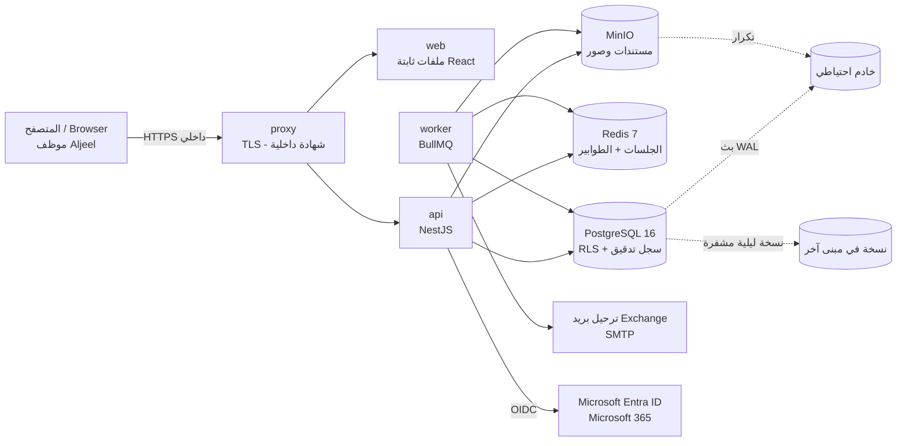
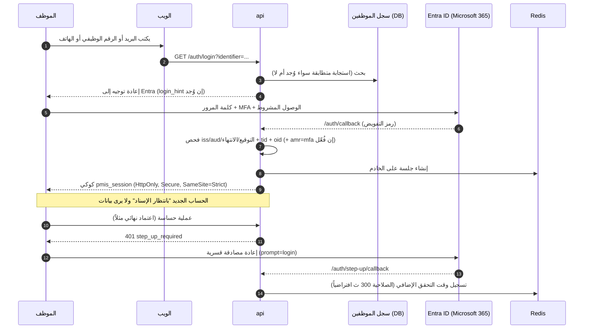
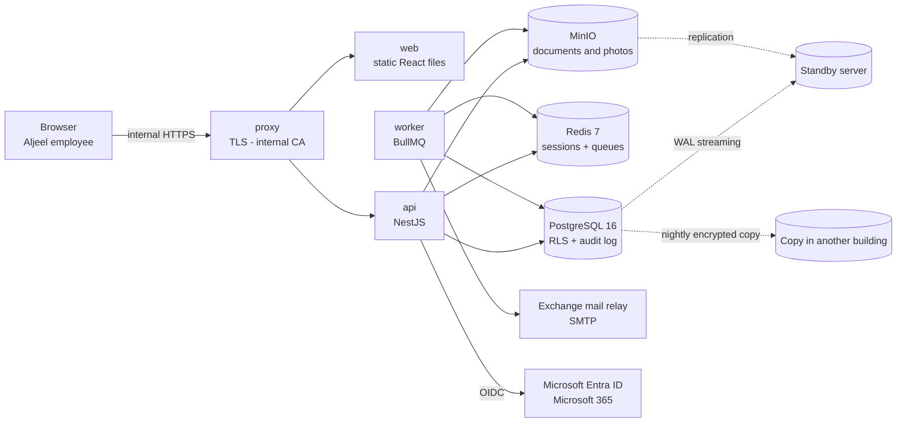
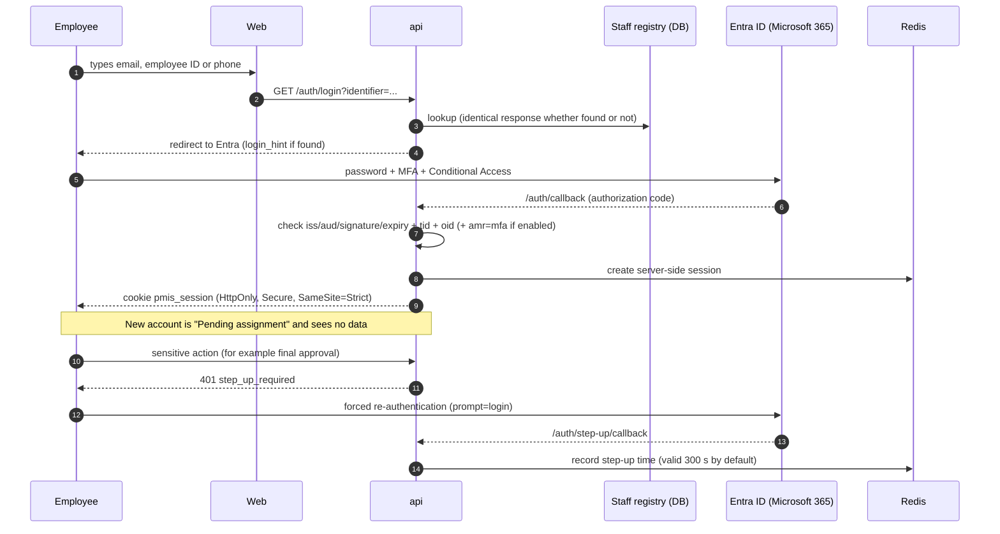

# 03 — البنية ومخطط البيانات | Architecture and Data

> **حالة الوثيقة:** النظام في **نهاية المرحلة P0** (التصميم مكتمل) و**التنفيذ يبدأ في P1**. لا توجد بعد شيفرة خادم أو واجهة أو بنية تشغيل (`apps/api/src` و`apps/web` و`infra/` لم تبدأ)؛ ما يصفه هذا المستند **تصميم معتمد** (ADR 0001–0010 ومخطط البيانات وعقد API 0.1) وليس نظاماً قائماً. الشاشات المشار إليها من **النموذج الأولي** ببيانات **تجريبية مصطنعة**. ما لم تحدده المصادر مكتوب فيه «يُؤكَّد لاحقاً».
>
> **Document status:** the system is at the **end of phase P0** (design complete) and **implementation starts in P1**. The server code, web app and infrastructure are not started (`apps/api/src`, `apps/web`, `infra/`); this document describes the **approved design** (ADR 0001–0010, the data model and API contract 0.1), not a running system. Screens referred to come from the **prototype** with **synthetic data**. Anything the sources do not define is marked "to be confirmed".

---

# القسم العربي

## 1. التقنيات والنشر

| الطبقة | الاختيار | المصدر |
|---|---|---|
| الواجهة | React 18 وTypeScript وVite وTailwind (Radix/shadcn) وTanStack Query وTable وreact-i18next (عربي/إنجليزي، RTL) وECharts | CLAUDE.md، ADR 0001 |
| الخادم | NestJS (TypeScript) على Node.js 22 LTS، وواجهة REST بصيغة JSON على المسار `/api/v1` | ADR 0001 |
| قاعدة البيانات | PostgreSQL 16 عبر Prisma، وما لا يعبّر عنه Prisma (أمان الصفوف، المحفزات، الدوال) بـSQL خام | ADR 0001 |
| المهام الخلفية | BullMQ على Redis 7 (تصدير zip، استيراد الملفات، الإشعارات، المهام الليلية) | ADR 0001 |
| الملفات | MinIO (متوافق مع S3) داخل الشركة | ADR 0008 |
| الدخول | MSAL / Entra ID OIDC | CLAUDE.md |
| الاختبار | Vitest وSupertest وPlaywright | CLAUDE.md |
| النشر | **Docker Compose على الخادم الداخلي**، **بلا خدمات سحابية** | CLAUDE.md، ADR 0001 |

**الحاويات (Services):** `proxy` (TLS من جهة الشهادات الداخلية) و`web` (ملفات ثابتة) و`api` و`worker` و`postgres` و`redis` و`minio`. الـ`api` والـ`worker` صورة واحدة بنقطتي دخول. يستقبل **الخادم الاحتياطي** بث WAL وتكرار MinIO. (ADR 0001)

**ملاحظة عقدية:** العقد `contracts/openapi.yaml` هو المصدر الوحيد لواجهة HTTP، ولا تُبنى نقطة قبل أن توجد فيه ("contract first"). الإصدار 0.1.0 يغطي ما تحتاجه P1: الدخول، المستخدمون والأدوار، الرؤية، المواقع، المهام ومحرك الاعتماد، المصفوفة، نسخ سير العمل، سجل التدقيق، وقراءة الإعدادات. (openapi.yaml)

## 2. مخطط المكونات

الخطوط المتقطعة هي النسخ الاحتياطي والتكرار (ADR 0001، ADR 0008، CLAUDE.md).

## 3. تدفق الدخول

(ADR 0002) **تفاصيل:**
- المتصفح **لا يحمل رموز Entra**؛ الجلسة على الخادم في Redis، بمهلة خمول 8 ساعات وحد أقصى 12 ساعة، ورأس `X-CSRF-Token` لكل طلب كتابة.
- يُطابَق المستخدم على `oid` لا على البريد، ويجب أن يكون `tid` هو مستأجر Aljeel، وإلا يُرفض الدخول ويُسجَّل في سجل النظام.
- مفتاح `require_mfa` مُطفأ حتى تفعّله IT. ويمكن إعفاء مستخدم بعينه داخل PMIS فقط (لا يغيّر Entra).
- حساب الطوارئ (break-glass): اسم مستخدم وكلمة مرور وTOTP، من الشبكة الداخلية فقط، جلسة حتى 60 دقيقة، وقفل 15 دقيقة بعد 5 محاولات فاشلة، ويُرسل بريد لكل المديرين.
- فقدان Redis يعني تسجيل خروج الجميع دون فقد بيانات.
- **الدخول المحلي بكلمة مرور مؤجل** (ADR 0002 §10).

## 4. الصلاحيات وأمان الصفوف (RLS) بلغة مبسطة

- **ماذا يرى الشخص؟** صلاحيته = مجموع إسناداته الفعّالة، **كل إسناد محصور في مناطقه ووحداته** (B3). الموقع خارج نطاقه يُرجع «غير موجود» (404). (ADR 0003)
- **ما الذي يستطيع فعله؟** شبكة صلاحيات (عرض، إنشاء، تعديل، حذف، اعتماد، تصدير، استيراد، تنزيل مستندات، سجل التدقيق، إدارة) تُطبَّق على الوحدة والمنطقة، ثم **أهلية المصفوفة** لإجراءات سير العمل، ثم قواعد **الحقول** (إخفاء أو قراءة فقط). (ADR 0003)
- **RLS = أمان على مستوى الصف في PostgreSQL:** يحدد الخادم المناطق المسموحة لكل معاملة، فتعيد قاعدة البيانات نفسها الصفوف المسموحة فقط، وتفشل «مغلقة» (بلا صفوف) إن لم يُحدَّد شيء. وهي طبقة ثانية تحمي من خطأ في منطق الخادم. (ADR 0003؛ erd.md)
- **كتابات الهوية** (المستخدمون، الإسنادات، المجموعات، التفويض، الملفات الصلاحية) لا تُكتب مباشرة بل عبر دوال في قاعدة البيانات تتحقق من: عدم منح النفس، وعدم منح ما يفوق صلاحية الفاعل، وعدم إعادة التفويض، وبقاء مدير فعّال واحد على الأقل، وتكتب سجل التدقيق في المعاملة نفسها. (ADR 0003 §7)
- **حد معروف:** حتى الآن يعرّف الخادم هوية الفاعل بإعداد جلسة؛ فتحمي هذه الطبقة من أخطاء الخادم ومن الكتابة المباشرة لكنها لا تحمي من حقن SQL أو من خادم مخترق كلياً. الحل المعتمد (سياق جلسة موقّع بـHMAC) **يُنفَّذ في P1 قبل التجربة**، والتجربة لا تبدأ قبله، والبيانات اصطناعية حتى ذلك الحين. (ADR 0003 §6)
- **جانب تنفيذي معلّق:** مناطق مختلفة لكل وحدة (B3) مقرر في التصميم لكنه غير منفّذ بعد في قاعدة البيانات اليوم (اتحاد مناطق واحد لكل مستخدم). (CHANGELOG)

## 5. كيانات البيانات الرئيسية (75 نموذجاً في Prisma)

المصدر: `db/erd.md` وPrisma. أسماء الحقول snake_case ومشتركة مع مخطط استيراد الـMaster (187 عموداً).

| المجال | الكيانات الرئيسية |
|---|---|
| **الهوية والصلاحيات** | `users`, `roles`, `sub_roles`, `user_role_assignments` (+ مناطق/وحدات/ملفات صلاحيات)، `groups`, `group_members`, `delegations` (+ grants/regions)، `permission_profiles`, `permission_grants`, `field_permissions`, `regions` |
| **المواقع والعناقيد** | `sites`, `clusters`, `rf_design_records`, `acquisition_candidates` |
| **سير العمل والمهام** | `workflow_definitions` (نسخ)، `stage_definitions` (المراحل)، `phase_gate_rules` (البوابات)، `task_definitions`, `task_predecessors`, `task_instances`, `workflow_steps`, `comments`, `external_parties`, `external_teams` |
| **المصفوفة** | `matrix_cells`, `matrix_cell_assignees` |
| **المستندات وضبط الجودة** | `document_types`, `document_type_placements`, `document_slots`, `document_files` (كل النسخ)، `snag_types`, `snags`, `snag_photos` |
| **القوالب والاستيراد** | `template_definitions`, `template_versions`, `import_batches`, `import_batch_rows` |
| **الخط الأساسي والتغيير** | `baseline_versions`, `baseline_entries`, `change_requests` (الإيقاف/الاستئناف) |
| **السجلات** | `procurement_records`, `gecol_records`, `hlc_records`, `permit_records`, `warehouse_items`, `warehouse_serials`, `warehouse_site_qty`, `quality_inspections`, `issues`, `risks`, `readiness_handover`, `as_built_records`, `meetings`, `meeting_actions` |
| **الإعدادات بنسخ** | `work_calendars`, `holidays`, `sla_rules`, `weight_sets`, `weight_activities`, `weight_items`, `progress_snapshots`, `field_definitions`, `field_list_values`, `settings` |
| **السجلات والإشعارات** | `audit_log`, `system_log`, `notifications` |

**نقاط تصميم تهم العميل:**
- المراحل والبوابات لها **رمز ثابت** وعمود تصدير بصيغة Master؛ والمواقع تحمل نسخة سير عمل ولا تغيّرها بصمت. (ADR 0010)
- مهمة تحتفظ بنسخة SLA ومجموعة المستندات والحقول وقت فتحها. (ADR 0007)
- الحقول المخصصة تُخزَّن في عمود JSONB مع مدقّق، وتُعطَّل ولا تُحذف. (erd.md، ADR 0009)
- نسخ الأوزان تتحقق قاعدة البيانات أن مجموعها 100% قبل النشر، واللقطات الأسبوعية تحفظ النسخة المستخدمة. (erd.md)
- السجلات ذات المنطقة تحمل `region_id` لتطبيق RLS؛ الصفوف العامة تُعلَّم صراحة. لا حذف لموقع يترك صفوفاً يتيمة. (erd.md)
- لا مفاتيح أجنبية على `audit_log` و`system_log` عمداً حتى لا يمس حذف أو تعطيل سجلاً تاريخياً. (erd.md)

## 6. التدقيق والسجلات

- **سجل التدقيق `audit_log`:** يُكتب في **المعاملة نفسها** مع التغيير؛ إن فشل الإدخال فشل التغيير. يشمل كل تغيير حالة، وكذلك تنزيل الملفات وتصديرها، والدخول والخروج والتحقق الإضافي، واستخدام حساب الطوارئ. قيم قبل/بعد للحقول المتغيرة فقط. (ADR 0006)
- **لا يُعدَّل ولا يُحذف:** محفزات تمنع UPDATE/DELETE/TRUNCATE، وسحب الصلاحيات من حساب التطبيق، ومالك مختلف للجدول، وتقسيم سنوي. **سلسلة تجزئة (hash chain)** تكشف العبث، وفحص ليلي يكتب آخر تجزئة في سجل النظام وبيان النسخ الاحتياطي، وكسر السلسلة ينبّه المديرين بالبريد. يُحفظ **10 سنوات**. (ADR 0006)
- **القراءة:** تتطلب صلاحية `view_audit` وتُرشَّح بمناطق القارئ (B4)؛ لا نقطة تعديل أو حذف ولن تُضاف. وتصدير CSV يسجّل نفسه. (ADR 0006)
- **سجل النظام `system_log`:** أحداث تقنية (رفض قوالب، رفض دخول وMFA، محاولات حساب الطوارئ، فشل مهام وبريد، أخطاء الواجهة، فحص السلسلة)، مع رقم طلب `X-Request-Id`، وتُنظَّف الرموز وكلمات المرور. يُقسَّم شهرياً ويُحذف ما تجاوز **12 شهراً** تلقائياً بحساب لا يملك صلاحية على سجل التدقيق. السجلان لا يشتركان إلا في `request_id`. (ADR 0006)

## 7. النسخ الاحتياطي والاستعادة

| البند | القيمة | المصدر |
|---|---|---|
| RPO | 15 دقيقة (أرشفة WAL كل 15 دقيقة + نسخة كاملة ليلية) | CLAUDE.md |
| RTO | 4 ساعات في أوقات العمل، خادم احتياطي، وتجربة استعادة **كل ربع سنة** | CLAUDE.md |
| الاحتفاظ | 14 يومية و8 أسبوعية و12 شهرية، ونسخة في مبنى آخر | CLAUDE.md |
| التشفير | نسخ مشفرة؛ تشفير MinIO بمفتاح KES على الخادم نفسه ونسخة مفتاح غير متصلة | CLAUDE.md، ADR 0008 |
| الملفات | تكرار MinIO للاحتياطي + نسخة ليلية مشفرة للمبنى الآخر | ADR 0008 |
| بيانات المشروع | عمر المشروع + 10 سنوات (افتراض يُؤكَّد لاحقاً مع العقد وسياسة الأمن) | CLAUDE.md |

سكربتات النسخ والاستعادة ودليل التشغيل **لم تُكتب بعد** (دليل التشغيل مخطط في P3).

## 8. التكاملات

| التكامل | الوصف | الحالة |
|---|---|---|
| **Entra ID / Microsoft 365** | تسجيل تطبيق لدى مدير M365: عناوين العودة `/api/v1/auth/callback` و`/api/v1/auth/step-up/callback` والنطاقات `openid profile email`، وتسليم tenant ID وclient ID وclient secret. يُطوَّر بمزود دخول وهمي ريثما يتم. Graph `User.Read.All` مطلوب فقط عند تفعيل الدخول المحلي لاحقاً. | بانتظار IT (B1) |
| **البريد الإلكتروني** | عبر ترحيل Exchange (SMTP) في الشركة، لا خدمة سحابية. يُستخدم للإشعارات وتنبيهات الأمان (حساب الطوارئ، تغيير المديرين، إعفاء MFA). | يُضبط من فريق التشغيل؛ تفاصيل الخادم والمنفذ **تُؤكَّد لاحقاً** |
| **MinIO** | أربع حاويات: `pmis-docs` (مستندات القبول)، `pmis-photos` (صور QC ومصغرات)، `pmis-imports` (قوالب وملفات Master، سنتان)، `pmis-exports` (zip وCSV، تُحذف بعد 7 أيام). مفاتيح الكائنات مبهمة وثابتة، ولا تُستبدل الكائنات، **وقفل الكائنات (governance)** بمدة عمر المشروع + 10 سنوات. الرفع والتنزيل عبر الـAPI فقط (لا روابط موقّعة)، فيمر كل تنزيل بسجل تدقيق. فحص الصيغة بالبايتات الأولى، وماسح فيروسات ClamAV اختياري (قرار تشغيل). | تصميم معتمد |
| **تطبيق الجوال** | لاحقاً: MSAL كعميل عام ورموز وصول لنطاق API منفصل؛ العقد يعرّف `bearerAuth` لكنه غير مفعّل في 0.1. | مؤجل |

## 9. ما يجب أن توفره IT

(HANDOVER.md، ADR 0001/0002/0008، ORCHESTRATION.md)
1. **خادم داخلي** للتشغيل **وخادم احتياطي**، ونطاق داخلي (مثل `pmis.aljeel.internal` في العقد) وشهادة TLS من جهة الشهادات الداخلية.
2. **تسجيل تطبيق Entra** وتسليم tenant/client ID والسر؛ وعند الجاهزية تحديد سياق مصادقة Conditional Access للتحقق الإضافي، وتأكيد هل يُصدر المستأجر `auth_time`، وتفعيل MFA حين يُقرَّر.
3. **ترحيل البريد (SMTP)** من Exchange.
4. **النسخ الاحتياطي:** مساحة وجدولة (WAL كل 15 دقيقة + ليلي)، ونسخة في مبنى آخر، وتجربة استعادة ربع سنوية.
5. **سياسة الأمن:** تأكيد مدة الاحتفاظ ببيانات المشروع، وقرار ماسح الفيروسات، وحفظ مفاتيح التشفير والتوقيع (تُدوَّر سنوياً) خارج الخادم.
6. **حساب طوارئ** وشبكة داخلية محددة (`internal_cidrs`) لاستخدامه.
7. مقاييس الحجم المستهدفة للتخطيط: 1000 موقع و100 مستخدم متزامن وصفحات أقل من ثانيتين. (CLAUDE.md)

*تفاصيل مواصفات الخادم (المعالج، الذاكرة، التخزين) غير محددة في المصادر؛ **تُؤكَّد لاحقاً**.*

---

# English section

## 1. Stack and deployment

| Layer | Choice | Source |
|---|---|---|
| Web | React 18, TypeScript, Vite, Tailwind (Radix/shadcn), TanStack Query and Table, react-i18next (EN/AR, RTL), ECharts | CLAUDE.md, ADR 0001 |
| API | NestJS (TypeScript) on Node.js 22 LTS; REST over JSON under `/api/v1` | ADR 0001 |
| Database | PostgreSQL 16 through Prisma; what Prisma cannot express (row-level security, triggers, functions) is raw SQL | ADR 0001 |
| Background jobs | BullMQ on Redis 7 (zip export, file import, notifications, nightly jobs) | ADR 0001 |
| Files | MinIO (S3-compatible), on premises | ADR 0008 |
| Sign-in | MSAL / Entra ID OIDC | CLAUDE.md |
| Tests | Vitest, Supertest, Playwright | CLAUDE.md |
| Deployment | **Docker Compose on the internal server**, **no cloud services** | CLAUDE.md, ADR 0001 |

**Services:** `proxy` (TLS from the internal CA), `web` (static files), `api`, `worker`, `postgres`, `redis`, `minio`. The `api` and `worker` are one image with two entry points. The **standby server** receives WAL streaming and MinIO replication. (ADR 0001)

**Contract note:** `contracts/openapi.yaml` is the only source of truth for the HTTP API and no endpoint is built before it exists there ("contract first"). Version 0.1.0 covers what P1 needs: sign-in, users and roles, visibility, sites, tasks and the approval engine, the Matrix, workflow versions, the Audit Log, and reading settings. (openapi.yaml)

## 2. Component diagram

Dotted lines are backup and replication (ADR 0001, ADR 0008, CLAUDE.md).

## 3. Authentication flow

(ADR 0002) **Details:**
- The browser **holds no Entra tokens**; the session lives on the server in Redis, with an 8-hour idle timeout and a 12-hour maximum, and an `X-CSRF-Token` header on every write request.
- The user is matched on `oid`, never on email; `tid` must be the Aljeel tenant, otherwise sign-in is refused and written to the System Log.
- The `require_mfa` toggle is off until IT enables it. A single user can be exempted inside the PMIS only (it does not change Entra).
- Break-glass account: username, password and TOTP, internal network only, session up to 60 minutes, locked for 15 minutes after 5 failures, and an email to all admins on use.
- Losing Redis signs everyone out but loses no data.
- **Local password sign-in is deferred** (ADR 0002 §10).

## 4. Authorization and row-level security (RLS) in plain terms

- **What can a person see?** Their permission is the union of their active assignments, **each limited to its own regions and modules** (B3). A site outside their scope answers "not found" (404). (ADR 0003)
- **What can they do?** A permission grid (view, create, edit, delete, approve, export, import, download documents, audit log, administer) applied per module and region; then **Matrix eligibility** for workflow actions; then **field** rules (hidden or read-only). (ADR 0003)
- **RLS = row-level security in PostgreSQL:** the server sets the allowed regions for each transaction and the database itself returns only permitted rows, failing "closed" (no rows) if nothing is set. It is a second layer protecting against a bug in the server logic. (ADR 0003; erd.md)
- **Identity writes** (users, assignments, groups, delegations, permission profiles) are never written directly; they go through database functions that check: no self-granting, nothing wider than the actor's own rights, no re-delegation, at least one active admin always, and they write the audit row in the same transaction. (ADR 0003 §7)
- **Known limit:** today the server states the actor's identity through a session setting; this layer protects against server bugs and direct table writes, but not against SQL injection or a fully compromised server. The approved fix (an HMAC-signed session context) is **implemented in P1 before the pilot**; the pilot does not start before it, and data is synthetic until then. (ADR 0003 §6)
- **Pending implementation:** per-module region sets (B3) are decided in the design but not yet implemented in the database (today it uses one region union per user). (CHANGELOG)

## 5. Main data entities (75 Prisma models)

Source: `db/erd.md` and Prisma. Field names are snake_case and shared with the Master import mapping (187 columns).

| Area | Main entities |
|---|---|
| **Identity and permissions** | `users`, `roles`, `sub_roles`, `user_role_assignments` (+ regions/modules/profiles), `groups`, `group_members`, `delegations` (+ grants/regions), `permission_profiles`, `permission_grants`, `field_permissions`, `regions` |
| **Sites and clusters** | `sites`, `clusters`, `rf_design_records`, `acquisition_candidates` |
| **Workflow and tasks** | `workflow_definitions` (versions), `stage_definitions` (milestones), `phase_gate_rules` (gates), `task_definitions`, `task_predecessors`, `task_instances`, `workflow_steps`, `comments`, `external_parties`, `external_teams` |
| **Matrix** | `matrix_cells`, `matrix_cell_assignees` |
| **Documents and QC** | `document_types`, `document_type_placements`, `document_slots`, `document_files` (all versions), `snag_types`, `snags`, `snag_photos` |
| **Templates and import** | `template_definitions`, `template_versions`, `import_batches`, `import_batch_rows` |
| **Baseline and change** | `baseline_versions`, `baseline_entries`, `change_requests` (suspension/resumption) |
| **Registers** | `procurement_records`, `gecol_records`, `hlc_records`, `permit_records`, `warehouse_items`, `warehouse_serials`, `warehouse_site_qty`, `quality_inspections`, `issues`, `risks`, `readiness_handover`, `as_built_records`, `meetings`, `meeting_actions` |
| **Versioned settings** | `work_calendars`, `holidays`, `sla_rules`, `weight_sets`, `weight_activities`, `weight_items`, `progress_snapshots`, `field_definitions`, `field_list_values`, `settings` |
| **Logs and notifications** | `audit_log`, `system_log`, `notifications` |

**Design points that matter to the customer:**
- Milestones and gates have a **stable code** and a Master export column; sites carry a workflow version and never change it silently. (ADR 0010)
- A task keeps the SLA version, document slot set and field set that applied when it opened. (ADR 0007)
- Custom fields are stored in a JSONB column with a validator, and are deactivated, never deleted. (erd.md, ADR 0009)
- Weight sets are checked by the database to total 100% before publishing, and weekly snapshots record the set used. (erd.md)
- Region-bearing registers carry `region_id` for RLS; global rows are marked explicitly. A site cannot be deleted in a way that orphans rows. (erd.md)
- `audit_log` and `system_log` deliberately have no foreign keys, so deleting or deactivating a row can never touch history. (erd.md)

## 6. Audit and logs

- **Audit log (`audit_log`):** written in the **same transaction** as the change; if the insert fails, the change fails. It covers every state change, plus file downloads and exports, sign-in/out and step-up, and break-glass use. Before/after values hold only the changed fields. (ADR 0006)
- **Never edited or deleted:** triggers block UPDATE/DELETE/TRUNCATE, privileges are revoked from the application account, the table has a different owner, and it is partitioned by year. A **hash chain** exposes tampering; a nightly check writes the last hash to the System Log and the backup manifest, and a broken chain emails the admins. Kept **10 years**. (ADR 0006)
- **Reading:** needs the `view_audit` grant and is filtered by the reader's regions (B4); there is no edit or delete endpoint and none will be added. A CSV export records itself. (ADR 0006)
- **System log (`system_log`):** technical events (rejected templates, sign-in and MFA refusals, break-glass attempts, job and email failures, UI errors, chain checks), with a request id `X-Request-Id`; tokens and passwords are scrubbed. Partitioned monthly; anything older than **12 months** is dropped automatically by an account that has no rights on the audit log. The two logs share only `request_id`. (ADR 0006)

## 7. Backups, RPO and RTO

| Item | Value | Source |
|---|---|---|
| RPO | 15 minutes (WAL archiving every 15 min plus a nightly full backup) | CLAUDE.md |
| RTO | 4 hours in working hours, standby server, and a restore drill **every quarter** | CLAUDE.md |
| Retention | 14 daily, 8 weekly, 12 monthly, plus a copy in another building | CLAUDE.md |
| Encryption | Encrypted backups; MinIO encryption with a KES key on the same server and an offline key backup | CLAUDE.md, ADR 0008 |
| Files | MinIO replication to the standby plus a nightly encrypted copy to the other building | ADR 0008 |
| Project data | Life of the project plus 10 years (assumption, to be confirmed against the contract and security policy) | CLAUDE.md |

Backup and restore scripts and the operations runbook are **not written yet** (the runbook is planned for P3).

## 8. Integrations

| Integration | Description | Status |
|---|---|---|
| **Entra ID / Microsoft 365** | App registration by the M365 admin: redirect URIs `/api/v1/auth/callback` and `/api/v1/auth/step-up/callback`, scopes `openid profile email`, and delivery of tenant ID, client ID and client secret. Development uses a mock sign-in provider meanwhile. Graph `User.Read.All` is needed only if local sign-in is enabled later. | Waiting for IT (B1) |
| **Email** | Through the company Exchange SMTP relay, no cloud service. Used for notifications and security alerts (break-glass, admin changes, MFA exemption). | Configured by operations; server and port details **to be confirmed** |
| **MinIO** | Four buckets: `pmis-docs` (acceptance documents), `pmis-photos` (QC photos and thumbnails), `pmis-imports` (templates and Master files, 2 years), `pmis-exports` (zip and CSV, deleted after 7 days). Object keys are opaque and immutable, objects are never overwritten, and **object lock (governance mode)** applies for project life plus 10 years. Uploads and downloads go through the API only (no presigned links), so every download has an audit row. File type is checked by magic bytes; a ClamAV scan is optional (an operations decision). | Approved design |
| **Mobile app** | Later: MSAL as a public client with access tokens for a separate API scope; the contract declares `bearerAuth` but it is not enabled in 0.1. | Deferred |

## 9. What IT must provide

(HANDOVER.md, ADR 0001/0002/0008, ORCHESTRATION.md)
1. **An internal production server and a standby server**, an internal domain (the contract uses `pmis.aljeel.internal`), and a TLS certificate from the internal CA.
2. **The Entra app registration** with tenant/client ID and secret; when ready, a Conditional Access authentication context for step-up, confirmation of whether the tenant emits `auth_time`, and MFA enabled when decided.
3. **A mail relay (SMTP)** from Exchange.
4. **Backups:** storage and schedule (WAL every 15 minutes plus nightly), a copy in another building, and a quarterly restore drill.
5. **Security policy:** confirm retention of project data, the antivirus-scan decision, and keep the encryption and signing keys (rotated yearly) off the server.
6. **A break-glass account** and a defined internal network range (`internal_cidrs`) for its use.
7. Sizing targets for planning: 1000 sites, 100 concurrent users, pages under 2 seconds. (CLAUDE.md)

*Server specifications (CPU, memory, storage) are not defined in the sources and are **to be confirmed**.*
