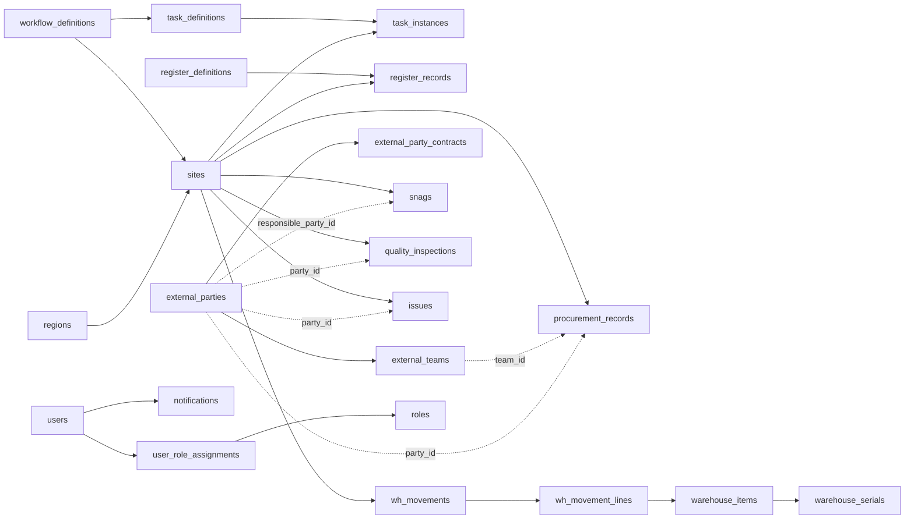

# Relations map (data links between registers and tables)

Status: reference, generated from the database on 2026-11-26 (all migrations up to 0172 applied locally, read together with 0173 and 0180 and the code). It changes nothing.
Where a link is missing or typed by hand, section 4 lists it as a proposal (the owner principle: registers feed each other, settings are editable, a value is typed once).
The state of the GECOL and HLC links is the state on main when this was written; the build agent that owns the Procurement to GECOL / HLC flow may change it.

## 1. Two kinds of link

1. **Foreign keys.** A real `REFERENCES` constraint (appendix, section 5: 300 of them). The database refuses a dangling id.
2. **Register links.** Registers share the generic tables `register_records` (one row per version) and `register_definitions`. Their data lives in the JSON
   column `data`, so a link between two registers is a field in `data` that holds the id of the other record (for example `procurement_record_id`), kept by a
   database function, not by a constraint. A field marked *derived* in `register_fields` is written by the database and cannot be typed: the value is stored
   once, in its source.

## 2. The spine



A dotted arrow is an id column with no `REFERENCES` constraint (the id is checked by the writing function, not by a constraint; confirmed from `\d` of `snags`, `issues`, `quality_inspections`, `procurement_records`). Every site-scoped table carries `site_id` and `region_id` together (composite key to `sites(id, region_id)`), which row-level security reads.

## 3. Links that exist today

| From | To | Kind | Field | Typed or derived |
|---|---|---|---|---|
| HLC record | Procurement records of the site | register link, many (`hlc_pr_links`, Q150) | `pr_no`, `hlc_approval_date`, `procurement_record_id` | derived |
| Dismantle part (outsourced) | Procurement order | register link | `procurement_order_id`, contractor | contractor derived from the order |
| Register records, task instances, task delay periods, contractor teams and contracts | Contractor company (`external_parties`) | foreign key | `external_party_id`, `party_id` | chosen |
| Procurement, snags, quality inspections, issues | Contractor company | foreign key (0182, `_idfk`) | `party_id`, `responsible_party_id` | chosen |
| Procurement | Contractor team (`external_teams`) | foreign key (0182, `_idfk`) | `team_id` | chosen |
| Quality inspection | Snag | foreign key (0182, `_idfk`, ON DELETE SET NULL) | `quality_inspections.snag_id` | not checked in the catalogue |
| Car dispatcher, Financial advances | Procurement order | register link | `procurement_record_id` | typed (text) |
| Financial advances (expense, settlement) | Advance | register link | `advance_id` | checked in entry (approved advance of the same site, 0407); disbursed rule at submit; picker `advance-options` |
| Financial advances (advance page) | Expense / settlement draft | prefilled create (D59) | `advance_id`, site, today, balance to return | web buttons on an approved, disbursed advance; the draft goes through the normal create and the 0407 check |
| Alert rules (Settings > Security > Alerts) | Advances, invoices | notification kinds (0408) | `advance_unsettled`, `invoice_due_soon` | weekly per open advance, once per invoice and due date; days default to the Finance hub `settle_warn_days` |
| Alert rules (Settings > Security > Alerts) | Any register with a date field: permits (`valid_to`), contractors (`contract_end`, team `safety_cert_expiry`), invoices (`due_date`), C4 calibration due when it exists | notification kind (0700) | `date_approaching` {register_key, date_field, days_before} | once per record and date for approved records from today to N days ahead; past dates do not fire; the form lists date fields from `register_fields`, so a new date field needs no code |
| Invoices | Procurement record | register link | `procurement_record_id` | checked in entry (0407); picker `invoices/order-options`; listed in `record_related` |
| Invoices | Contractor company | register link | `supplier_party_id` | optional, checked against active `external_parties` (0407); fills `supplier` when empty; picker `invoices/supplier-options` |
| Invoices | Procurement record | register link | `procurement_record_id` | checked in entry (0407); PR No. and PO / WO No. read from the order (`order_pr_no`, `order_po_wo_no`, 0430); required when Settings > Register rules says so (`order_required`); picker `invoices/order-options`; listed in `record_related` |
| Invoices | Contractor company | register link | `supplier_party_id` | optional, checked against active `external_parties` (0407); fills `supplier` when empty; required when Settings > Register rules says so (`supplier_required`, 0430); picker `invoices/supplier-options` |
| HLC record | Procurement record | register link, listed in `record_related` (0407) | `procurement_record_id` (id of the Procurement version row) | derived |
| Issues, snags, quality, orders, contract end | Contractor performance view (0180) | computed on read, no stored value | thresholds in setting `contractors.performance` | derived |
| Warehouse DN / RN documents | Stock, per-site quantity, serials | posted by approved documents | `wh_movement_lines`, `warehouse_site_qty`, `warehouse_serials` | derived |
| Register records (procurement, warehouse, dismantle, issues, quality, car dispatcher, financial advances, risks) | Related records panel (0324) | computed on read, no stored value | `record_related(register, entity)`; the link list is the setting `registers.links` (0431, Settings > Register links) | derived |
| Change Control | Procurement order, task | register link, typed by pick-list | `procurement_order_id`, `affected_task_code` (0325); the order shows the change-pending mark through `record_related` | chosen |
| Issues | Task | text field filled by a task picker | `blocked_gate_or_task` (the task code) | chosen |
| Register decisions, task approvals, snags | Notifications | `x_notify_watchers`, policy in setting `notifications.policy` | `notifications` | derived |

**Declared links (0409, D60 phase 1).** Every register link field is declared once in `register_links` (register, field, target register, target record type, same site, label fields, `enforce`). `record_related()` reads the declaration, `GET /registers/{key}/links` and `GET /registers/{key}/link-options/{field}` serve the web (generic `RecordLinkSelect`, used for any declared field without a hand-coded picker), and a link with `enforce = true` is checked in entry (the id is a current approved record of the target that the caller can see, of the same site when `same_site`). The links above are declared with the check off (declared only, so no old row is refused); `register_link_orphans()` reports the ids that point nowhere, to decide when to switch a link on. A new link is one row. Phase 2 (0410) adds the filters `data_in` and `data_not_like` and the label tokens (`a|b`, `field>key`, `@party`), so the generic picker replaces the hand-coded order and advance pickers in the drawer (the Dismantle order and RN pickers, the risk picker and the supplier picker stay: they filter by part, by status or read another table).

**Orphans alert (0650, D60 follow-up).** `register_link_orphans()` (0409) counts, per declared link, the current rows whose id is no current record of the target. The alert kind `link_orphans` of the generic alert rules (`Settings > Alerts > Rules`; params `register_key`, `field_code`, `min_rows`) sends one in-app notification per link at or above `min_rows`, once per working week while it keeps dangling, to the rule's audience. `GET /settings/alert-rules/link-orphans` (System Admin) returns the same counts with up to 20 example record ids per link. Nothing is changed or cleared by the alert (hide, never delete), and no `enforce` value moves: the report is what the owner checks before switching a link on. The Settings editor of the links (#359) is not on main yet, so the per-link badge and the warning when switching `enforce` on are for that editor to add.

## 4. Gaps and proposals

1. **Warehouse receipt to Procurement order.** A PL / OPEN receipt (stock coming in) names no order, so what arrived against a PO is not visible in
   Procurement. Proposal: an optional order picker on the receipt, PR / PO / supplier shown read-only from the order, and a received-against list on the order.
2. **GECOL record to Procurement.** `gecol.pr_no` and `gecol.contractor` are typed fields on main, while the owner decision (2026-11-26) is that GECOL and HLC
   read them from Procurement by Site ID. Owned by the build agent of the Procurement to GECOL / HLC flow.
3. **Car dispatcher and Financial advances to Procurement.** `procurement_record_id` is a typed text field; a picker over the orders of the site would
   remove the typing.
4. **Contract end.** *(done, migration 0212)* `external_party_contracts` is the single source of the contract dates; `external_parties.contract_start` / `contract_end` are a mirror the database rebuilds on every contract change (earliest start, latest end of the active contracts; an open-ended contract leaves the end empty). The performance view reads the contracts first.
5. **Constraints.** *(done, migration 0182)* The six id columns that had no `REFERENCES` constraint got one after an orphan check (added NOT VALID, then validated when the column holds no orphan; `fk_orphan_report()` re-checks later). Still without a constraint: `team_scope_checks.team_id`, a snapshot of the team that matched when the check ran, kept as history.
6. **Notifications.** Each module raises its own notice; no single function applies the policy (channel, digest, escalation).

7. **One link catalogue.** *(done, D60 0409/0410, screen 0713)* The table `register_links` is the single list of the links (register, field, target register and record type, required state, same site, check on save, on or off). It draws the form picker of any link field, feeds the Related records panel, drives the check on save (entry only) and the orphan report. Settings > Register links (0713) switches a link on or off, sets the check and same site, and declares a new link, with a reason and the audit; nothing is deleted and the register, field and target of a link never change. HLC's many-to-many `hlc_pr_links` stays its own mechanism.

## 5. Appendix: every foreign key (parent, then children)

Generated from `pg_constraint`; the part in brackets is the referencing column(s). Regenerate with the query at the end of this file.

- **admin_overrides**: `site_gate_state` (historical_open_override)
- **announcement_recipients**: `announcement_responses` (announcement_id,user_id)
- **announcements**: `announcement_recipients` (announcement_id), `announcement_targets` (announcement_id)
- **audit_log**: `audit_field_changes` (audit_id), `audit_log_chain` (audit_id)
- **baseline_versions**: `baseline_entries` (version_id)
- **change_requests**: `site_scope_exceptions` (change_request_id)
- **clusters**: `sites` (cluster_id)
- **comments**: `comment_mentions` (comment_id)
- **daily_plans**: `daily_plan_rows` (plan_id)
- **data_reset_requests**: `data_reset_request_files` (request_id)
- **delegations**: `delegation_grants` (delegation_id), `delegation_regions` (delegation_id), `delegations` (parent_delegation_id)
- **departments**: `user_invitations` (department_id), `users` (department_id)
- **doc_sequences**: `doc_number_issues` (seq_key), `doc_sequence_counters` (seq_key)
- **document_files**: `document_files` (superseded_by)
- **document_slots**: `document_files` (slot_id)
- **document_type_versions**: `document_slots` (doc_type_version_id)
- **document_types**: `document_blank_forms` (doc_type_id), `document_site_overrides` (doc_type_id), `document_slots` (doc_type_id), `document_type_drafts` (doc_type_id), `document_type_placements` (doc_type_id), `document_type_versions` (doc_type_id), `library_form_templates` (doc_type_id), `library_generated_docs` (doc_type_id)
- **external_parties**: `external_party_contracts` (party_id), `external_teams` (party_id), `register_records` (external_party_id), `task_delay_periods` (external_party_id), `task_instances` (external_party_id)
- **external_teams**: `external_team_specializations` (team_id)
- **field_definitions**: `field_list_values` (field_id), `field_permissions` (field_id), `master_columns` (source_field_id)
- **groups**: `delegations` (target_group_id), `group_members` (group_id)
- **import_batch_rows**: `site_drafts` (batch_row_id)
- **import_batches**: `import_batch_jobs` (batch_id), `import_batch_rows` (batch_id), `register_records` (historical_direct_batch_id), `site_drafts` (batch_id), `task_instances` (admin_approve_batch_id), `task_instances` (historical_batch_id), `task_instances` (historical_direct_batch_id)
- **job_runs**: `log_integrity_runs` (job_run_id)
- **library_form_templates**: `library_generated_docs` (template_id)
- **list_catalogues**: `list_catalogues` (parent_catalogue), `list_values` (catalogue_code), `master_columns` (list_catalogue), `register_fields` (list_catalogue), `template_task_fields` (list_catalogue)
- **list_values**: `list_values` (parent_value_id)
- **master_columns**: `master_header_aliases` (letter), `template_task_fields` (master_col)
- **master_reconciliation_runs**: `hrf_stage_marks` (run_id), `import_uploads` (run_id), `master_reconciliation_diffs` (run_id), `master_reconciliation_rows` (run_id), `mi_apply_jobs` (run_id)
- **matrix_cells**: `matrix_cell_assignees` (cell_id)
- **meetings**: `meeting_actions` (meeting_id)
- **message_threads**: `message_participants` (thread_id), `messages` (thread_id)
- **permission_profiles**: `field_permissions` (profile_id), `permission_grants` (profile_id), `roles` (default_profile_id), `user_role_assignment_profiles` (profile_id)
- **regions**: `daily_plan_rows` (region_id), `daily_plans` (region_id), `delegation_regions` (region_id), `doc_sequences` (region_id), `notifications` (region_id), `progress_snapshots` (region_id), `region_aliases` (region_id), `role_default_regions` (region_id), `saved_view_region_targets` (region_id), `site_drafts` (region_id), `site_snapshots` (region_id), `sites` (region_id), `sla_rules` (region_id), `status_updates` (region_id), `task_cover_decisions` (region_id), `task_delay_periods` (region_id), `user_role_assignment_regions` (region_id), `warehouse_region_vendors` (region_id), `watches` (region_id)
- **register_definitions**: `import_batches` (register_key), `matrix_cells` (register_key), `register_fields` (register_key), `register_records` (register_key), `register_sections` (register_key), `register_task_sources` (register_key), `task_field_sources` (register_key), `template_definitions` (register_key), `template_parts` (register_key)
- **register_fields**: `register_column_locks` (register_key,field_code)
- **register_records**: `hlc_pr_links` (hlc_record_id), `register_level_actors` (record_id), `register_level_voters` (record_id), `register_record_locks` (record_id), `register_records` (supersedes_id), `register_steps` (record_id), `team_scope_checks` (record_id)
- **roles**: `delegations` (target_role_id), `field_permissions` (role_id), `role_aliases` (role_id), `role_default_modules` (role_id), `role_default_regions` (role_id), `user_role_assignments` (role_id)
- **saved_views**: `saved_view_region_targets` (view_id), `saved_view_targets` (view_id), `saved_view_versions` (view_id)
- **site_drafts**: `import_batch_rows` (site_draft_id)
- **sites**: `acquisition_candidates` (site_id,region_id), `admin_overrides` (site_id), `as_built_records` (site_id,region_id), `baseline_entries` (region_id,site_id), `change_requests` (region_id,site_id), `daily_plan_rows` (site_id), `document_site_overrides` (site_id), `document_slots` (site_id,region_id), `gecol_records` (region_id,site_id), `hlc_records` (site_id,region_id), `issues` (region_id,site_id), `library_generated_docs` (region_id,site_id), `permit_records` (site_id,region_id), `procurement_records` (region_id,site_id), `quality_inspections` (site_id,region_id), `readiness_handover` (site_id,region_id), `register_records` (site_id,region_id), `rf_design_records` (site_id,region_id), `site_drafts` (site_id), `site_gate_events` (site_id), `site_gate_state` (site_id), `site_scope_exceptions` (site_id), `site_snapshots` (site_id), `site_workflow_migrations` (site_id), `snags` (region_id,site_id), `task_delay_periods` (site_id), `task_instances` (site_id,region_id), `warehouse_serials` (site_id,region_id), `warehouse_site_qty` (region_id,site_id), `watches` (site_id), `wh_movements` (site_id,region_id)
- **sla_rule_sets**: `sla_rule_set_items` (set_id), `sla_rules` (rule_set_id)
- **sla_rules**: `task_instances` (sla_rule_id)
- **snag_types**: `document_type_placements` (snag_type_id), `snags` (snag_type_id)
- **snags**: `snag_level_voters` (snag_id), `snag_photos` (snag_id)
- **staff_registry_visibility_fields**: `staff_registry_visibility_entries` (field)
- **stage_definitions**: `matrix_cells` (stage_id), `task_definitions` (workflow_id,stage_id)
- **task_definitions**: `document_type_placements` (task_def_id), `matrix_cells` (task_def_id), `sla_rule_set_items` (task_def_id), `sla_rules` (task_def_id), `task_instances` (task_def_id), `task_predecessors` (predecessor_id), `task_predecessors` (task_def_id)
- **task_instances**: `admin_overrides` (task_id), `comments` (task_id,region_id), `document_slots` (task_id), `document_task_snapshots` (task_id), `library_generated_docs` (task_id), `register_records` (task_id), `snags` (task_id), `task_cover_decisions` (task_id), `task_delay_periods` (task_id), `task_level_actors` (task_id), `task_level_voters` (task_id), `workflow_steps` (task_id)
- **team_scope_match_scopes**: `team_scope_match` (scope), `team_scope_match_groups` (scope)
- **team_specializations**: `external_team_specializations` (code)
- **template_definitions**: `template_parts` (template_id), `template_versions` (template_def_id)
- **template_versions**: `import_batches` (template_version_id)
- **user_role_assignments**: `user_role_assignment_modules` (assignment_id), `user_role_assignment_profiles` (assignment_id), `user_role_assignment_regions` (assignment_id)
- **users**: `absences` (recorded_by), `absences` (user_id), `admin_overrides` (acted_by), `admin_overrides` (reverted_by), `announcement_recipients` (user_id), `announcements` (created_by), `auth_pending` (user_id), `contractor_rules` (updated_by), `daily_plan_rows` (updated_by), `daily_plans` (created_by), `daily_plans` (locked_by), `daily_plans` (unlocked_by), `daily_plans` (updated_by), `data_reset_requests` (approved_by), `data_reset_requests` (cancelled_by), `data_reset_requests` (requested_by), `data_reset_requests` (run_by), `delegations` (from_user_id), `delegations` (target_user_id), `dlp_versions` (changed_by), `document_grid_views` (user_id), `email_change_requests` (decided_by), `email_change_requests` (user_id), `external_teams` (lead_user_id), `group_members` (user_id), `hrf_stage_marks` (actor_id), `import_batch_jobs` (actor_id), `import_batches` (historical_marked_by), `import_uploads` (actor_id), `library_form_templates` (approved_by), `library_form_templates` (created_by), `library_form_templates` (retired_by), `library_generated_docs` (generated_by), `library_generated_docs` (voided_by), `local_credentials` (set_by), `local_credentials` (user_id), `master_reconciliation_diffs` (resolved_by), `master_reconciliation_runs` (applied_by), `master_reconciliation_runs` (created_by), `me_admin_requests` (user_id), `message_participants` (user_id), `message_threads` (created_by), `messages` (author_id), `mi_apply_jobs` (actor_id), `phone_change_requests` (decided_by), `phone_change_requests` (user_id), `ps_manual_plans` (entered_by), `ps_manual_values` (entered_by), `saved_view_versions` (changed_by), `saved_views` (created_by), `saved_views` (deactivated_by), `saved_views` (owner_id), `saved_views` (updated_by), `site_drafts` (created_by), `site_drafts` (decided_by), `site_drafts` (submitted_by), `site_workflow_migrations` (migrated_by), `sites` (workflow_locks_changed_by), `snag_level_voters` (user_id), `snags` (approved_by), `snags` (fixed_by), `snags` (found_by), `staff_registry` (updated_by), `staff_registry_visibility_state` (updated_by), `status_updates` (author_id), `task_delay_periods` (created_by), `task_delay_periods` (decided_by), `task_delay_periods` (voided_by), `task_instances` (admin_approved_by), `team_scope_match_meta` (updated_by), `user_drafts` (user_id), `user_invitations` (accepted_user_id), `user_invitations` (invited_by), `user_invitations` (manager_id), `user_invitations` (revoked_by), `user_invitations` (sent_by), `user_mfa_exemptions` (granted_by), `user_mfa_exemptions` (revoked_by), `user_mfa_exemptions` (user_id), `user_recovery_codes` (user_id), `user_role_assignments` (assigned_by), `user_role_assignments` (user_id), `user_sessions` (revoked_by), `user_sessions` (user_id), `user_totp` (set_by), `user_totp` (user_id), `users` (deleted_by), `users` (manager_id), `users` (purged_by), `watches` (user_id)
- **warehouse_items**: `as_built_items` (warehouse_item_id), `warehouse_item_need_rules` (item_id), `warehouse_serials` (item_id), `wh_movement_lines` (item_id)
- **weight_activities**: `weight_items` (activity_id)
- **weight_sets**: `progress_snapshots` (weight_set_id), `site_snapshots` (weight_set_id), `weight_activities` (weight_set_id)
- **wh_movements**: `wh_movement_lines` (movement_id)
- **work_calendars**: `holidays` (calendar_id), `sla_rule_set_items` (calendar_id), `sla_rules` (calendar_id)
- **workflow_definitions**: `phase_gate_rules` (workflow_id), `scenario_task_rules` (workflow_id), `site_workflow_migrations` (from_version_id), `site_workflow_migrations` (to_version_id), `sites` (workflow_version_id), `stage_definitions` (workflow_id), `task_definitions` (workflow_id), `workflow_streams` (workflow_id), `workflow_views` (workflow_id)
- **workflow_streams**: `stage_definitions` (workflow_id,stream_code)
- **workflow_views**: `workflow_view_members` (view_code,workflow_id)

Query:

```sql
SELECT cl.relname AS child, cf.relname AS parent, string_agg(a.attname, ',') AS columns
FROM pg_constraint k JOIN pg_class cl ON cl.oid = k.conrelid JOIN pg_class cf ON cf.oid = k.confrelid
JOIN pg_namespace n ON n.oid = cl.relnamespace JOIN pg_attribute a ON a.attrelid = k.conrelid AND a.attnum = ANY (k.conkey)
WHERE k.contype = 'f' AND n.nspname = 'public' GROUP BY k.oid, cl.relname, cf.relname ORDER BY 2, 1;
```
