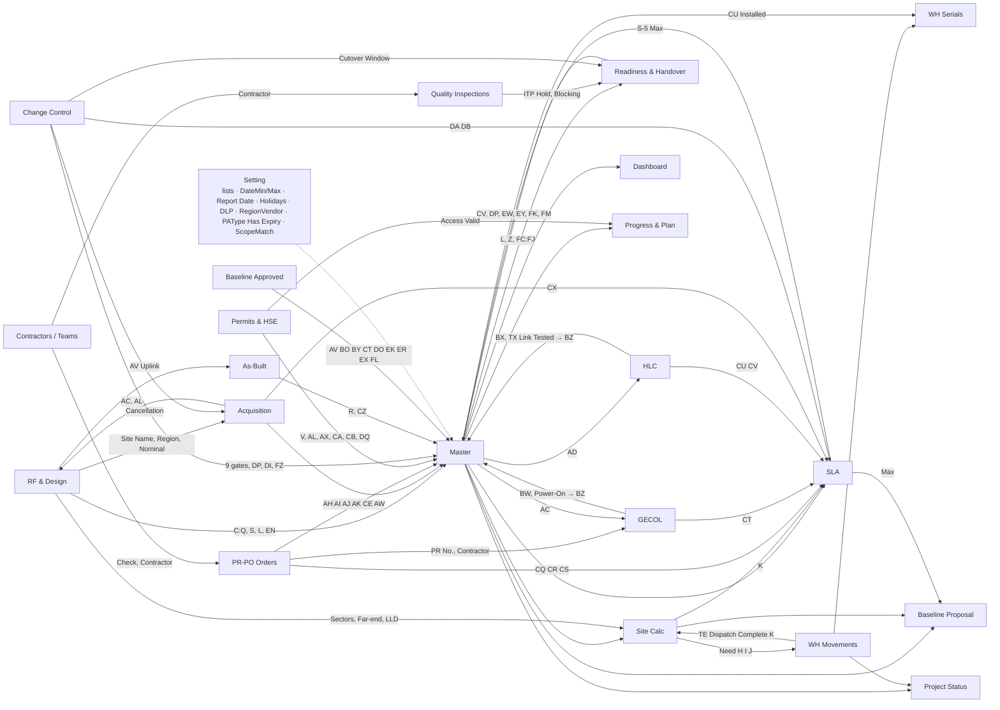

# Registers and streams (P1)

Owner request of 2026-10-29 (CLAUDE.md "Site Register and streams" and "Two entry ways everywhere"):
1. The Sites module is the **Site Register** (سجل المواقع). The other registers are separate sections.
2. The Site Register has a **stream filter** and one **sub-section per stream**. A sub-section shows and works on the sites' status in that stream only.
3. Every register, and the Site Register, accepts **manual entry** or an **approved template** (download, fill, upload the same file). Both go through Entry → Review → Approve.

Sources and how they are cited:
- **CLAUDE.md**: the binding owner decisions.
- **BP §nn**: Blueprint v1.1, `docs/reference/GSDN_PMIS_Blueprint_v1.1.html`.
- **Dnn**: the decisions log, `docs/reference/GSDN_Rebuild_Decisions.md`.
- **Sheet!Col**: a column of `GSDN_Site_Master.xlsx` (repository root). Formulas were read with openpyxl without `data_only`. Master data starts on row 5 and register data on row 3 (D45, D81).
- **cat**: `task-catalogue.csv`. **seed**: `db/sql/012_reference_seed.sql`.

Rules for this file:
- Precedence is the same as `rules.md`: CLAUDE.md > Master formulas > BP text.
- Anything inferred is marked **ASSUMPTION**. A gap that needs the owner points to a question (Q37–Q74) in `open-questions.md`.

Field type codes:
- `text`, `number` (decimal), `int` (whole), `date`, `yes_no`, `file`;
- `list:Name`: the Setting list of that name (D7, D15);
- `user`: a staff registry person (Setting `StaffNames`);
- `party`: an external party from the Contractors register (`ContractorNames`);
- `ref:X`: a key of another register;
- **calc**: a grey Master column (D16). It is calculated, never entered, and never read on upload (BP §17).

These map to the contract field types (`text, number, date, list, multi_list, yes_no, user, external_party, file`).

---

## 1. Rules shared by every register

### 1.1 Entry, approval and templates
| # | Rule | Source |
|---|---|---|
| R1 | There are two entry ways: a manual form, or an approved template that is downloaded, filled and uploaded again. Both create the same record versions and follow the same approval. | CLAUDE.md "Two entry ways everywhere" |
| R2 | Each record goes through Entry → Review → Approve with the levels of its Responsibility Matrix row. Every register and Dismantle has its own row with 1 to 3 levels. Self-skip, rejection one level back with a note, and self-approval work as for tasks. | CLAUDE.md B11, B5, B6; `stories-workflow.md` WF-01..WF-06 |
| R3 | **Which matrix row approves a record that closes a task** is open (Q43). *Default:* the task's stage row approves a record that is the source of a task (for example the first CW order for B1/B2), in one approval with the task. The register row approves every other record (a second order, a renewal, a contractor). | ASSUMPTION; BP §02 "the data is one, entered from either side" |
| R4 | A template is issued with a hidden sheet `_tpl` that holds `template_id`, `version` and `register_key` (plus `stream` for Site Register templates). Its header row repeats the Master header names in Master column order, so it looks like the Master sheet. Headers are locked, and drop-downs come from the Setting lists. | CLAUDE.md "Approved templates only"; `stories-templates-and-import.md` TI-01 |
| R5 | Grey (calc) columns may be shown in a pre-filled copy. They are locked, greyed and ignored on upload. | D16; BP §17; TI-03 |
| R6 | Every upload is validated row by row with the manual-entry rules, then shown as a diff preview (new, changed, identical). It becomes a batch that is reviewed and approved row by row or all at once. | CLAUDE.md; TI-04, TI-05, WF-08 |
| R7 | A row is matched to an existing record by the register's **natural key** (§3). A key that does not match creates a new record. A hidden `record_id` column in pre-filled copies takes precedence over the natural key. | ASSUMPTION |
| R8 | A file without a valid `_tpl`, with an unknown ID or with a retired version is rejected and written to the System Log. | CLAUDE.md; TI-02 |
| R9 | Approved values are never overwritten silently. A later change is a new version that goes through approval again. A change to an approved Site Register value that drives a gate or milestone needs Change Control when it is a scope change (AA:AF, Z, relocation). | BP §03 "scope change"; D53 |
| R10 | Registers keep the CLAUDE.md custom-field rules: an admin-added field can appear in templates and exports with a Master export column. A field change issues a new template version, and old versions are rejected with a clear message. | CLAUDE.md "Custom fields" |

### 1.2 Validation applied to every register
| # | Check | Source |
|---|---|---|
| V1 | The Site ID must exist in the Site Register. A register row with an unknown site is refused. | DQ02 (`Data Quality!E5`); `PR-PO!O` "Site not in Master"; list `SiteIDs` = `tblRF[Site ID]` |
| V2 | A date must lie between DateMin (2020-01-01) and DateMax (2035-12-31). An actual date may not be in the future. | D13; Setting B6:B7; BP §03 alert 11 |
| V3 | A list value must be in its Setting list. | DQ26; D15 |
| V4 | Required fields must be filled. "Blank never means N/A": N/A is an explicit value. | DQ06 "How to fix" |
| V5 | An N/A needs a reason and an approver wherever the register has N/A fields (Permits, Quality, Readiness). | D36; DQ17 |
| V6 | The row's own **Check** column (where the Master has one) becomes a blocking validation. The DQ check that counts it is kept as a dashboard alert. | D68 ("rules of WH / Serials / PR-PO / contracts / teams → Check columns") |
| V7 | A calc value is never accepted from the user. | D16; R5 |

### 1.3 Visibility
- Records with a Site ID inherit the site's region. B3 scoping (region × module) applies (CLAUDE.md "Visibility", B3).
- Records without a site key (Risk Register, Contractors and Teams, WH item master, PL / OPEN / ADJ movements, Deliverables Log, Meetings) have no region. See Q69. *Default (ASSUMPTION):* anyone holding the module sees them.

---

## 2. Site Register (Master sheet) and streams

### 2.1 What the Site Register is
- There is one row per site, and its key is **Site ID** (Master B). Duplicates are refused (DQ01).
- **Identity** (Master C:Q, S) is read from RF & Design by Site ID (D46, BP §02 item 4). R is read from As-Built (`Master!R` = `cAB_Configuration`). T is read from Acquisition (`Master!T` = Acquisition Completed Date of the selected candidate).
- **Scope** is typed on the site: Project Phase X, Delivery Batch Y, Delivery Scenario Z, scope flags AA:AF and CW Delivery Model AG. These columns are mandatory (DQ06, `rules.md` §1).
- **Workflow columns** U:FW are the task dates and statuses of the 10 stages and of Dismantle. They are entered through the tasks (cat `master_columns`). Gates and milestones are calc (`rules.md` §2).
- **Status** FX:FZ is calc (`rules.md` §2.4). **Issue** GA:GE is replaced by the Issue Log register (§3.12).
- Where a new site is created (Site Register or RF & Design) is open (Q46). *Default:* the Site Register "New site" form has an Identity section whose fields are stored in the RF & Design record of the same site.

### 2.2 Streams (default seed, admin-configurable, versioned with the workflow)
Source: CLAUDE.md "Site Register and streams". Stage numbers and tasks: cat; seed `stage_definitions`.

| Stream code | Name EN / AR | Stages | Milestones | Gates | Tasks (cat) |
|---|---|---|---|---|---|
| `DESIGN_ACQ` | Design & Acquisition / التصميم والاستحواذ | 1 | MS1 Site Release (V) | none | A1, A2, A3, A4, A5 |
| `CW` | Civil Works / الأعمال المدنية | 2–4 | MS2 PRE-CW Completion (AW), MS3 CW Completion (BP), MS4 Site RFI (BZ) | G2 (W), G3 (AX), G4 (BQ) | B1–B7, B8–B11, B13, C1–C4 |
| `TE` | Installation (TE) / التركيبات | 5–8 | MS5 TE Completion (CU), MS6 On-Air (DP), MS7 TE PAC (EL), MS8 KPI Acceptance (ES) | G5 (CA), G6 (CV), G7 (DQ), G8 (EM) | D1–D4, D4b, D5, D6, D7–D9, D10a, D10b, D10, D11–D16, F1, F2 (stage 8: Q39) |
| `CLOSURE` | Handover & Closure / التسليم والإغلاق | 9–10 | MS9 HOTO (EY), MS10 Final Closure (FM) | G9 (ET), G10 (EZ) | D17, B14, B15, D18, Z1 (FAC holders: Q40); E1–E3 by seed placement (Q41) |

Rules:
- **SR-R1:** each stage belongs to exactly one stream in a workflow version. Changing the mapping is a light change, applied without migrating sites, because it changes the display only and not the gates (ASSUMPTION; CLAUDE.md "Milestones and phase gates are configurable": light vs structural). A gate is shown in the stream of the stage it opens (cat `stage_no` of the gate row).
- **SR-R2, which sites a sub-section lists** (ASSUMPTION, see Q42):
  - DESIGN_ACQ and CLOSURE list every active site;
  - CW lists the sites where RFI applies (any of AA:AD = Yes, `Site Calc!F`), so a site with only GECOL or HLC appears for C1–C4;
  - TE lists the sites where TE applies (`Site Calc!E`).
  - A toggle shows the sites where the stream is N/A, greyed.
  - Cancelled sites are hidden unless the status filter asks for them (BP §06 "active site").
- **SR-R3, the stream status of a site** (ASSUMPTION, derived from cat and `rules.md` §2):
  - `N/A`: the stream does not apply (SR-R2).
  - `Not due`: the stream's first gate is not open. For DESIGN_ACQ this status does not exist.
  - `In progress`: the gate is open and the stream's last applicable milestone is not achieved.
  - `Done`: the stream's last applicable milestone is achieved. CW ends at MS4, or at MS2 when RFI is N/A and CW is N/A. TE ends at MS8. CLOSURE ends at MS10.
  - `On Hold` and `Cancelled` from Overall Status (FZ) show as an overlay.
- **SR-R4, the current step** is the first task of the stream that applies and is not approved, in catalogue order. Its state is one of Locked, Pending, Ongoing, Submitted, In review, Rejected (BP §03 "step states").
- **SR-R5, editing in a sub-section** is limited to the stream's tasks. Fields of other streams appear read-only (identity, scope, the entry milestone of the previous stream). A matrix holder edits only the tasks of the stages they hold (CLAUDE.md Matrix; MX-01).
- **SR-R6, the stream filter** in the main Site Register view keeps the columns of the chosen streams, plus Identity, Scope and Status. With no filter, all Master column groups show in Master order (BP §07 "site grid").
- **Entry milestone of the next stream:** the TE sub-section shows the Site RFI date (or Site Release where RFI is N/A) read-only as its start condition. G5 opens from it (Master CA; D-1 SLA start, CLAUDE.md).
- **Dashboard independence:** the Dashboard keeps its D67 blocks (CW block of 7 milestones; TE block of 6 milestones including HOTO and Final Closure) whatever the stream mapping. The stream KPIs below are sub-section headers, not the D67 tables.

### 2.3 Site Register fields (Master sheet)
In the grid the columns are grouped as in Master row 1. "Task" names the task (cat) whose approval writes the column.

**Identity (all streams, read-only in sub-sections)**

| Col | Field | Type | Source |
|---|---|---|---|
| A | # | calc | row number |
| B | Site ID | text, key | typed; list `SiteIDs` = RF & Design Site ID |
| C, D, E, F, G | Site Owner ID, Site Name, Region, Sub Region, Cluster ID | calc | RF & Design C, D, E, F, W |
| H, I | Latitude, Longitude | calc | RF & Design G, H |
| J, K, L | Site Type, Site Scenario (Indoor / Outdoor), Site Uplink | calc | RF & Design I, J, K (K = MW Far-end, D30) |
| M, N, O, P, Q | Tower Owner, Existing or New, RT or GF, Tower Type, Tower Height | calc | RF & Design L, M, N, O, P |
| R | Configuration (WL/MW/IP/PWR) | calc | As-Built AI |
| S | RF Survey Date | calc | RF & Design AB |
| T | Acquisition Date | calc | Acquisition AD of the selected candidate |

**Scope (all streams; entered with the site through the stage-1 Matrix row (ASSUMPTION); changed after approval only through Change Control, BP §03)**

| Col | Field | Type | Rule |
|---|---|---|---|
| X | Project Phase | list:ProjectPhases | mandatory (DQ06) |
| Y | Delivery Batch | list:DeliveryBatches | mandatory |
| Z | Delivery Scenario | list:DeliveryScenario | mandatory; drives scenario rules (`rules.md` §4) |
| AA:AD | Tower Erection, Site Adaption, GECOL Power, HLC Fiber | list:YesNA | mandatory; AW is blank while any of AA:AF is blank (Master AW) |
| AE:AF | TE Full Scope, IP Router Only | list:YesNA | mandatory |
| AG | CW Delivery Model | list:DeliveryModel (In-House / Outsourced) | mandatory; In-House makes PR Status N/A (Master AH) |

**DESIGN_ACQ stream**

| Col | Field | Type | Source / task |
|---|---|---|---|
| U | Baseline Site Release | date | typed in Master (data validation DateMin); see Q47 |
| V | Milestone Site Release | calc | D32 conditions (Master V) |
| W | Gate Pre-CW Readiness | calc | V + suspension shift (Master W). Shown in CW (SR-R1) |
| (no Master column) | stage-1 task states | — | A1–A5 from RF & Design and Acquisition (§3.1, §3.2) |

**CW stream**

| Col | Field | Type | Source / task |
|---|---|---|---|
| AH, AI | PR Status, PO / WO Status | calc | Procurement orders (Master AH, AI) → B1, B2 |
| AJ, AK | Contractor Name, Contractor Team | calc | first active CW order (Master AJ, AK) → B2 |
| AL | CW Access Date | calc | first approved Access - CW Valid From (Master AL) → B3 |
| AM | AAT SE Name | user | B4 (supervisor only, CLAUDE.md) |
| AN, AO | CW Survey Planned, Actual | date | B4 |
| AP, AQ | Analysis Type, Analysis Result | list:AnalysisType, list:AnalysisResult | B5 |
| AR, AS | Report / Layout Submitted, Approved | date | B5/B6, B7 (D47) |
| AT, AU | CW DN Submitted, Approved | date | B7 (Q19, Q49) |
| AV | Baseline PRE-CW Completion | calc | Baseline › Approved Current |
| AW | Milestone PRE-CW Completion | calc | Master AW |
| AX | Gate CW Readiness | calc | Master AX (permits, PTW, stop work, suspension) |
| AY, AZ | CW MOS Planned, Actual | date | B8 / B9 |
| BA:BC | Tower Foundation, Steel Erection, Lightning & Grounding | list:CompletionStatus | B10 |
| BD:BJ | Cabinet Foundation, Mounting Pole, Cable Tray, Indoor Rack, Site Optical Fiber, AC / DC Box, Site GND | list:CompletionStatus | B11 |
| BK:BN | CW Planned / Actual Start, Planned / Actual End | date | B10 / B11 |
| BO | Baseline CW Completion | calc | Baseline |
| BP | Milestone CW Completion | calc | Master BP |
| BQ | Gate RFI Readiness | calc | Master BQ |
| BR | CW PAC Planned | date | B13 |
| BS, BT | Snags Found, Snags Cleared | list:YesNA | B13 (Q58) |
| BU | CW As-Built Submitted | list:YesNA | B13 (Q68) |
| BV | CW PAC Actual | date | B13 |
| BW | GECOL Status | calc | GECOL Status (Master BW) → C2 |
| BX | HLC Fiber Status | calc | HLC Status (Master BX) → C4 |
| BY | Baseline Site RFI | calc | Baseline |
| BZ | Milestone Site RFI | calc in the Master; task MS4 in the PMIS (CLAUDE.md; WF-11) | Master BZ |
| CA | Gate TE Installation Readiness | calc | Master CA. Shown in TE (SR-R1) |

**TE stream**

| Col | Field | Type | Source / task |
|---|---|---|---|
| CB | TE Access Date | calc | first approved Access - TE Valid From → D1 |
| CC | TE Survey Date | date | D2 |
| CD | Vendor Name | party (typed in the Master; Q51) | D2 |
| CE | Vendor Team | calc | PR-PO order Scope = TE Installation |
| CF | AAT SE Name | user | D2 |
| CG, CH | TE DN Submitted, Approved | date | D3, D4 (Q49) |
| (Site Calc K) | TE Dispatch Complete Date | calc | WH movements → D4b (D59; Q65) |
| CI, CJ | TE MOS Planned, Actual | date | D5 |
| CK:CO | MTS Cabinet, Indoor IP Router, RF Antenna, MW Antenna, DC / OF Cable | list:CompletionStatus | D6 |
| CP:CS | TE Planned / Actual Start, Planned / Actual End | date | D6 |
| CT, CU | Baseline, Milestone TE Completion | calc | Master CU |
| CV | Gate On-Air Readiness | calc | MS5 + Commissioning Power Safe Date (Readiness E) |
| CW | Commissioning Date | date | D7 |
| CX, CY | MW Alignment Date, Measured RSL | date, number | D8 |
| CZ | RSL Deviation | calc | CY − As-Built RSL (AU) |
| DA | Integration Date | date | D9 |
| DB, DC | MOP Submitted, Approved | date | D10a (Swap only) |
| DD, DE | Window Start, End | date | D10 (D27) |
| DF | Cutover Result | list:CutoverResult | D10 |
| DG | Outage Duration (wd) | calc | DD → DE |
| DH | Legacy Dismantle Due | calc | Cold Swap: WORKDAY(DP, S-5 max) |
| DI | Rollback Count | calc | Change Control "Cutover Rollback" approved |
| DJ, DK, DL | Pre-Swap KPI Baseline, Post-Swap KPI Check, Post-Swap KPI Result | date, date, list:KPIResult | D10 (Swap); DQ23 |
| DM, DN | On-Air Planned, Actual | date | D10 |
| DO, DP | Baseline, Milestone On-Air | calc | Master DP |
| DQ | Gate TE PAC Readiness | calc | Master DQ |
| DR, DS | SSV Date, Result | date, list:SSVResult | D11 |
| DT | HWID Date | date | D12 |
| DU:DX, DY | EIR PWR / WL / MW / IP, EIR Date | list:CompletionStatus, date | D13 |
| DZ:ED, EE | PAT PWR / WL / MW / IP, NOC Alarm Verification, PAT Date | list:CompletionStatus, date | D14 |
| EF | As-Built Date | date | D15 (Q68) |
| EG, EH | TE Snags Found, Cleared | list:YesNA | D16 (Q58) |
| EI, EJ | TE PAC Planned, Actual | date | D16 |
| EK, EL | Baseline, Milestone TE PAC | calc | Master EL |
| EM | Gate Cluster Optimization Readiness | calc | Master EM |
| EN | Cluster ID | calc | = G (RF & Design W) |
| EO | Cluster Optimization Date | date | F1 |
| EP | KPI Acceptance Source Date | date (once per cluster, CLAUDE.md) | F2 |
| EQ | KPI Source Validation | calc | Master EQ |
| ER, ES | Baseline, Milestone KPI Acceptance | calc | Master ES |
| ET | Gate HOTO Readiness | calc | Shown in CLOSURE (SR-R1) |

**CLOSURE stream**

| Col | Field | Type | Source / task |
|---|---|---|---|
| EU | Launch Date | date | D17 |
| EV | Material Reconciliation Date | date | D17 (manual comparison, BP §10) |
| EW | HOTO Package Date | calc | Readiness O (HOTO Package Valid Date) |
| EX, EY | Baseline, Milestone HOTO | calc | Master EY (Readiness L) |
| EZ | Gate Final Closure Readiness | calc | Master EZ |
| FA, FB | CW DLP Start, End | calc | BV; BV + CW DLP (Q27) → B14 |
| FC, FD, FE | CW FAC Snags Found, Cleared, CW FAC Date | list:YesNA, list:YesNA, date | B15 |
| FF, FG | TE DLP Start, End | calc | EL; EDATE(EL, 12) |
| FH, FI, FJ | TE FAC Snags Found, Cleared, TE FAC Date | list:YesNA, list:YesNA, date | D18 |
| FK | Contractual Obligations Closure Date | calc | Readiness Q → Z1 |
| FL, FM | Baseline, Milestone Final Closure | calc | Readiness U (Final Closure) |

**Dismantle (Track E; stream placement open, Q41)**

| Col | Field | Type | Task |
|---|---|---|---|
| FN, FO, FP, FQ, FR | Site CW RFD, Contractor / Vendor, Planned, Actual, CW RN Date | list:YesNA, party, date, date, date | E1, E2, E3 |
| FS, FT, FU, FV, FW | Site TE RFD, Contractor / Vendor, Planned, Actual, TE RN Date | same | E1, E2, E3 |

**Status:** FX Current Milestone, FY Next Milestone and FZ Overall Status are calc (`rules.md` §2).

### 2.4 Status columns shown in each stream sub-section
Every sub-section starts with Site ID, Name, Region, Site Type, Delivery Scenario, Stream status (SR-R3), Current step and its state (SR-R4), the holder with their employee ID (CLAUDE.md staff registry), SLA colour of the current step (`rules.md` §3), days in step, behind-baseline days, and open issues count (Issue Log). The stream-specific columns follow. The list is ASSUMPTION, built from the legacy "site register" tab per section (`dashboard-kpis.md` SC-35) and the Master columns above.

| Stream | Stream-specific status columns |
|---|---|
| DESIGN_ACQ | Search Ring Received (RF U), candidates count and first SAR (Acquisition K), Selected candidate (RF AC), Acquisition Status (Acquisition AE), Contract Sign-off (Acquisition X), Lease Expiry (Acquisition Y), TSSR Status / Approved (RF AH, AG), LLD Approved (RF AY), Civil Aviation permit validity (Permits I), LOS Result and Link Budget (HUB / Terminal), Baseline U, Site Release V |
| CW | Gate W, PR / PO Status (AH, AI), Contractor and Team (AJ, AK), CW Access (AL), AAT SE (AM), Survey (AO), Analysis (AP, AQ), Layout (AR, AS), CW DN (AU), PRE-CW (AV / AW), Gate AX with its lock reason (permit, PTW, stop work, suspension), CW MOS (AZ), CW items done / applicable (BA:BJ), CW Actual End (BN), CW Completion (BO / BP), Gate BQ, open snags count (Quality), CW PAC (BV), GECOL (BW, Power-On), HLC (BX, TX Link Tested), Site RFI (BY / BZ) |
| TE | Entry date (BZ or V), Gate CA with its lock reason, TE Access (CB), Vendor and Team (CD, CE), TE DN (CH), TE Dispatch Complete (Site Calc K) with its shortfall, TE MOS (CJ), TE items done / applicable (CK:CO), TE Completion (CT / CU), Gate CV (Power Safe), Commissioning (CW), MW alignment and RSL deviation (CX, CZ), Integration (DA), Swap: MOP, window, cutover result, rollbacks (DB:DI), On-Air (DO / DP), SSV (DS), HWID (DT), EIR / PAT (DY, EE), As-Built (EF), TE snags (EG, EH), TE PAC (EK / EL), Cluster ID and cluster progress "n of m at TE PAC" (CLAUDE.md), KPI source (EP, EQ), KPI Acceptance (ER / ES) |
| CLOSURE | Gate ET, Launch (EU), Material Reconciliation (EV), HOTO Package (EW), Readiness Open Controls (Readiness D), HOTO (EX / EY), Gate EZ, CW DLP End (FB) and CW FAC (FE) with age, TE DLP End (FG) and TE FAC (FJ) with age, Obligations (FK), Closure Ready (Readiness T), Final Closure (FL / FM), Overall Status (FZ) |

### 2.5 Stream KPIs (header cards of each sub-section)
Pattern for counts (D67): Scope = Done + Pending (its turn has come, including under way) + Not Due, and % Done. "Done" means approved (`dashboard-kpis.md` DF-01). The filters Phase, Batch, Scenario and Region apply.

| Stream | KPI | Source |
|---|---|---|
| DESIGN_ACQ | Site Release Scope / Done / Pending / Not Due / % | Dashboard row 8 (Milestone Delivery) |
| | Released late (V after U), Avg delay (wd) | D67 Milestone columns "Achieved Late · Avg Delay" |
| | A-1 and A-3 within Max % | SLA sheet D10, E10 |
| | Leases expiring / expired | Dashboard rows 25–26 |
| | Project Status activities 1 and 2 (Actual %, Planned %, SPI) | Project Status rows 18–19; D65 |
| CW | PRE-CW Completion, CW Completion, CW PAC, GECOL Power, HLC Fiber, Site RFI: Scope / Done / Pending / Not Due / % | Dashboard rows 71–81 (CW block). Site Release is shown as the entry count (Q38) |
| | CW checkpoint (17 steps, RF Survey → Site RFI) | Dashboard row 96 (D67) |
| | SLA within Max % and over Max for B-, C-, RFI and E2E-B steps | SLA sheet rows 10–11; `dashboard-kpis.md` SC-06 |
| | CW sites released without PO / WO; PR → PO over B-2 Max; GECOL open over C-2 Max; Fiber open over C-4 Max; Fiber status conflicts; CW PAC dated with open conditions | Dashboard rows 29–37, 49 |
| | Open blocking snags (CW) | Quality W; Dashboard row 46 |
| | Project Status activity 4 (25%) | Project Status row 21 |
| TE | TE Completion, On-Air, TE PAC, KPI Acceptance: Scope / Done / Pending / Not Due / % | Dashboard rows 83–93 (TE block, first 4 milestones) |
| | TE checkpoint (TE Access → KPI Acceptance) | Dashboard row 103 |
| | SLA within Max % for D-, E2E-D1 and S- steps | SLA sheet; SC-06 |
| | WH Complete Units: Need, Dispatched, Remaining, Available, Shortfall (project-wide, D72) | Dashboard section 5; `rules.md` §7 |
| | TE PAC dated but milestone not achieved; MW links outside RSL tolerance | Dashboard rows 50–51 |
| | Swap & Relocation: First-time success, Rollbacks, Window over Max, Post-Swap KPI degraded | Dashboard row 118 |
| | Project Status activities 5, 6, 7 | Project Status rows 22–24 |
| CLOSURE | HOTO and Final Closure: Scope / Done / Pending / Not Due / % | Dashboard rows 16–17 |
| | Post-HOTO checkpoint (CW FAC, TE FAC, Final Closure) | Dashboard row 110 |
| | Final Closure KPI: sites closed, % closed, pending CW FAC / TE FAC with age | CLAUDE.md; `rules.md` §6.1 |
| | D-17 and E2E-D2 within Max %; B06, B07 planning links | SLA sheet AO, AQ; D39 |
| | Project Status activity 8 (HOTO item 8.2) | Project Status row 25 |
| | DLP ending in the next 30 days (ASSUMPTION, uses the Expiring alert of D13) | Setting B8 |

---

## 3. Registers

The order follows the Master sheet order (D74). Each register has these sections:
- **Sheet**: the Master sheet and its table.
- **Key / rows per site**: the natural key and how many rows a site may have.
- **Links**: what the register feeds (tasks, Master columns, gates) and what it reads.
- **Fields**: Master column, field name and type. Calc fields are marked.
- **Template**: the template columns.
- **Form**: the sections of the manual form.
- **Validation**: on top of §1.2.

Template IDs follow the existing `TPL-*` codes (`rules.md` §10). New codes are **ASSUMPTION** until the Templates page issues them.

### 3.1 RF & Design (`rf_design`) — sheet RF & Design, `tblRF` (52 columns, D46)
- **Key:** Site ID. **One row per site** (Guide row 12; DQ01).
- **Links:**
  - Source of Master C:Q and S (D46), of the Site ID list of every register (`SiteIDs`), and of Site Name and Region in every register.
  - Feeds A1 (U Search Ring Received → SLA A-1), A2 (AF, AG, AH, AI → SLA A-3), A4 (AY → Site Calc G, Project Status 1.4) and A5 (AK, AL, AN; D32 conditions 7–8).
  - Feeds D8 / MS6 (AO Frequency License Date, needed when MW applies, Master DP) and F1 / F2 (W Cluster ID → Master G, EN).
  - Feeds the WH need (Y Sectors → Site Calc H/I; AM MW Far-end → Site Calc J, D58) and As-Built AV (Uplink).
  - It reads Acquisition (AC Approved Candidate, AL LOS Result of the selected candidate; D28, D30).
- **Fields:**

| Col | Field | Type |
|---|---|---|
| B | Site ID | text, key (unique) |
| C, D | Site Owner ID, Site Name | text |
| E, F | Region, Sub Region | list:Region, text |
| G, H | Latitude, Longitude | number (−90..90, −180..180) |
| I, J | Site Type, Site Scenario | list:SiteType, list:Scenario |
| K | Uplink Site | calc (= AM, D30) |
| L, M, N, O, P | Tower Owner, Existing or New, RT or GF, Tower Type, Tower Height (m) | list:RefRFDesignTowerOwner, list:ExistNew, list:RTGF, list:TowerType, number ≥ 0 |
| Q, R, S, T, U | Nominal Plan Issue Date, Nominal Latitude, Nominal Longitude, Search Ring Radius (m), Search Ring Received Date | date, number, number, int ≥ 0, date |
| V | Deviation from Nominal (m) | calc (haversine G/H to R/S) |
| W, X, Y, Z, AA | Cluster ID, Antenna Height, Sectors, Azimuths, M-Tilt / E-Tilt | text, number, int ≥ 0, text, text |
| AB | RF Survey Actual Date | date |
| AC | Approved Candidate | calc (Acquisition, D28) |
| AD, AE, AF, AG | TSS Plan, TSS Actual, TSSR Submitted, TSSR Approved | date |
| AH, AI | TSSR Status, TSSR Rev No. | list:ReviewStatus, int |
| AJ, AK | RF Data Sheet Issued, MW LOS Survey Date | date |
| AL | LOS Result | calc (Acquisition MW LOS Check of the selected candidate, D30) |
| AM | MW Far-end Site | ref:Site ID or `N/A` (D31) |
| AN, AO, AP | Link Budget Date, Frequency License Date, Frequency License Ref | date, date, text |
| AQ, AR, AS | Building Height, Cabinet Foundation (Existing / New), Cabinet Foundation Dimensions | number, list:ExistNew, text |
| AT, AU, AV, AW | Backup Site, Belong to FN, Primary MFN, Secondary MFN | text (topology, D46) |
| AX, AY, AZ | HLD Ref #, LLD Approved Date, Remark | text, date, text |

- **Template:** `TPL-RF`. Columns B:AZ without K, V, AC, AL.
- **Matrix row:** Q44.
- **Form sections:** Identity (B:J) · Tower (L:P) · Nominal and search ring (Q:V) · RF design (W:AB) · TSS / TSSR (AD:AI) · MW (AJ:AP) · Civil inputs (AQ:AS) · Topology (AT:AW) · LLD and remark (AX:AZ).
- **Validation:**
  - DQ01: a duplicate Site ID is refused.
  - DQ04 (D31): HUB / Terminal need an MW Far-end Site that is neither blank nor N/A. Core / MFN / FN must have N/A. The Far-end must be an existing site other than itself.
  - The region must have a WL Vendor in Setting (DQ27).
  - TSSR Approved may not be earlier than TSSR Submitted (DQ10, negative A-3).

### 3.2 Acquisition (`acquisition`) — sheet Acquisition, `tblCandidates` (34 columns, D48)
- **Key:** Site ID + Candidate (list:Candidate A–D). **Several rows per site** (one per candidate, at most 4 by the list). **Exactly one Selected = Yes per site** (DQ05).
- **Links:**
  - Feeds A1 (K first SAR → SLA CX, A-1 end) and A3 (O Selected, P Selection Date, X Contract Sign-off → AD → Master T).
  - Feeds MS1 conditions 2–3 (Master V: `COUNTIFS(Selected = Yes) = 1` and T valid), RF & Design AC and AL, Project Status 2.1 (P) and 2.2 (T), and the Dashboard "leases expiring / expired" (Y).
  - It reads RF & Design (Site Name, Region, Nominal coordinates, Search Ring Radius) and Change Control (Cancellation → Acquisition Status).
- **Fields:**

| Col | Field | Type |
|---|---|---|
| B | Site ID | ref:Site ID |
| C, D | Site Name, Region | calc |
| E | Candidate | list:Candidate |
| F, G, H | Latitude, Longitude, Address | number, number, text |
| I, J | Distance to Nominal (m), Within Search Ring | calc |
| K | Candidate Submitted Date (SAR) | date |
| L, M | MW LOS Check, Test Pit Result | list:PassFail, list:TestPit |
| N | TSS Date | date |
| O, P | Selected, Selection Date | list:YesNo, date |
| Q, R, S, T, U | Owner / Landlord, Ownership Type, Contact Person, Phone, E-mail | text, list:Ownership, text, text, text |
| V, W, X, Y | Negotiation Start Date, Contract No., Contract Sign-off Date, Lease Expiry Date | date, text, date, date |
| Z, AA, AB | Title Verified, Lease Termination Notice Date, Site Handback Date (Restored) | list:YesNo, date, date |
| AC, AD, AE | Feeds Master, Acquisition Completed Date, Acquisition Status | calc (D35) |
| AF | Remark | text |
| AG, AH | RF Row, Select Key (helpers) | not carried into the PMIS (D10 helpers) |

- **Template:** `TPL-ACQ`. Columns B, E:H, K:AB, AF.
- **Form sections:** Candidate (E:J) · Survey (K:N) · Selection (O:P) · Owner and contact (Q:U) · Contract and lease (V:AB) · Remark.
- **Validation:**
  - A second Selected = Yes for the same site is refused.
  - Selected = Yes needs a Selection Date.
  - Contract Sign-off needs Selected = Yes for "Done" (D35).
  - For HUB / Terminal sites the selected candidate needs MW LOS Check = Pass before Site Release (D32-7).
  - The phone and e-mail fields follow the staff-registry style of field visibility rules (ASSUMPTION; personal data of external owners).

### 3.3 Procurement — Orders (`procurement`) — sheet PR-PO, `tblOrders` (15 columns, D26)
- **Key:** none in the Master (one row per order). *Natural key (ASSUMPTION):* Site ID + Scope + PR No., or Site ID + Scope + PO / WO No. when there is no PR (In-House). **Several rows per site** (one per order and scope).
- **Links:**
  - CW scopes (CW, Tower Erection, Site Adaption) feed B1 (G PR Date → Master AH, SLA CQ = MIN PR), B2 (I PO / WO Date → Master AI, AW = MAX PO / WO, SLA CR; J Contractor, K Team → Master AJ, AK, the first matching order), B01 and E2E-B (start = PR if Outsourced, else PO / WO, SLA DC).
  - Scope GECOL feeds C1 (PR Date → SLA CS, C-2 start; GECOL sheet E, F), and B02 / B03 start from the CW PR / WO (D38).
  - Scope TE Installation feeds D2 (Team → Master CE).
  - Scopes CW Dismantle and TE Dismantle feed E2 (Q52).
  - Scopes STA and ST (the analysis provider) belong to B5. They are excluded from AJ, AK and AW.
  - Several CW orders for one site: Q53. Who enters the GECOL PR: Q56.
  - It reads Contractors (J, K, the Check column) and Setting ScopeMatch.
- **Fields:** B Site ID ref · C Site Name calc · D Scope list:ProcScope · E Delivery list:Delivery (Outsourced / In-House / TE Vendor) · F PR No. text · G PR Date date · H PO / WO No. text · I PO / WO Date date · J Contractor party · K Team ref:Team · L Order Status list:ProcStatus · M Remark text · N PR→PO (wd) calc · O Check calc.
- **Template:** `TPL-PO`. Columns B, D:M.
- **Form sections:** Site and scope (B:E) · Request (F:G) · Order (H:I) · Assignment (J:K) · Status and remark (L:M).
- **Validation** (`PR-PO!O`, blocking per V6):
  - Site not in Master; Scope missing; Status missing.
  - In-House with a PR; Outsourced PO without a PR; PO before PR.
  - Unknown contractor; unknown team; team of another contractor; team specialization against ScopeMatch (D37: CW scopes and GECOL need CW; TE Installation needs TE; TE Dismantle accepts TE or CW).
  - ProcScope "TE Installation" has PR / PO / WO = No (Setting CG10): the PR and PO fields stay empty for it (ASSUMPTION from the list column).

### 3.4 Contractors (`contractors`) — sheet PR-PO, `tblContractors` and `tblTeams` (D26, D22)
- **Key:** Contractor (company name) for companies, Team for teams. **No site key** (§1.3).
- **Links:**
  - Lists for PR-PO J / K, Master CD, FO and FT (ContractorNames), and HLC I and Quality K (TeamNames).
  - Quality L (Contractor) is read from the Team.
  - Assigned Sites count (X).
  - Dashboard "contractor contracts expiring / expired" (row 27).
- **Fields, companies:** Q Contractor text, key · R Company Type list:CompanyType · S Contract Ref text · T Contract Start date · U Contract End date · V Status list:CoStatus · W Contract Validity calc · X Assigned Sites calc.
- **Fields, teams:** Z Team text, key · AA Team Type list:TeamType · AB Contractor party · AC Specialization list:TeamSpecialization · AD Status list:TeamStatus.
- **Template:** `TPL-CON` (ASSUMPTION). Two sheets, "Contractors" (Q:V) and "Teams" (Z:AD).
- **Form sections:** Company (Q:R) · Contract (S:V) · Teams (child list Z:AD).
- **Validation:**
  - One contract per company (D26 simplification 1).
  - Contract End before Start: "Date error". A missing Start: "Missing start" (`PR-PO!W`, DQ21).
  - A team's contractor must exist (DQ21).
  - No capacity, licence or certificate checks (D26 simplification 3; CLAUDE.md drops team capacity).

### 3.5 GECOL power (`gecol`) — sheet GECOL, `tblPower` (19 columns, D50)
- **Key:** Site ID. **One row per site with AC = Yes** (Guide row 15). Status is Done only when the site has exactly one row (`GECOL!R`; Q55).
- **Links:**
  - C1 reads PR No. and Contractor from PR-PO (Scope GECOL).
  - C2 uses L Installation Finish (SLA C-2 end, SLA CT) and P Power-On Date (RFI condition, Master BZ). R Status → Master BW.
  - Project Status 4.4 (BW = Done).
  - Dashboard: "GECOL open", "meter installed, not powered", "open over C-2 Max" (rows 32–34).
  - It reads Master AC (Status N/A).
- **Fields:** B Site ID ref · C, D Site Name, Region calc · E GECOL PR No. calc · F GECOL Contractor calc · G Survey Date · H Layout Received · I Layout Approved · J GECOL Notice Date · K MOS Date · L Installation Finish Date · M AAT Acceptance Date · N GECOL Docs Approval Date (all date) · O Meter No. text · P Power-On Date (Meter Charging) date · Q Billing Conversion Date date · R Status calc · S Remark text.
- **Template:** `TPL-GECOL`. Columns B, G:Q, S.
- **Form sections:** Survey and layout (G:I) · Notice and works (J:L) · Acceptance (M:N) · Meter and power-on (O:Q) · Remark.
- **Validation:**
  - A row for a site with AC = N/A is refused (DQ07, scope conflict).
  - A second row for the same site is refused (default of Q55).
  - The dates follow the order of the steps; a negative C-2 is refused (DQ10).

### 3.6 HLC fiber (`hlc`) — sheet HLC, `tblFiber` (13 columns, D52)
- **Key:** Site ID. **One row per site with AD = Yes** (Guide row 16; Status needs exactly one row, `HLC!L`).
- **Links:**
  - C3 uses F Request Date (SLA C-4 start, SLA CU). C4 uses J Installation Date (C-4 end, SLA CV; Status Done) and K TX Link Tested Date (RFI condition, Master BZ). See Q54.
  - L Status → Master BX. Project Status 4.6.
  - It reads Master AD.
- **Fields:** B Site ID ref · C, D Site Name, Region calc · E HLC Request No. text · F Request Date date · G Fiber Uplink (Exchange / Post) text (D52) · H Fiber Status list:FiberStatus · I Internal Fiber Team ref:Team · J Installation Date date · K TX Link Tested Date date · L Status calc · M Remark text.
- **Template:** `TPL-HLC`. Columns B, E:K, M.
- **Form sections:** Request (E:G) · Status and team (H:I) · Installation and test (J:K) · Remark.
- **Validation:**
  - A row for a site with AD = N/A is refused (DQ07).
  - Fiber Status = No Fiber or Through MW Link with AD = Yes raises a scope-conflict alert (D52, DQ07).
  - TX Link Tested may not be earlier than the Installation Date (ASSUMPTION, chronology).

### 3.7 Permits & HSE (`permits_hse`) — sheet Permits & HSE, `tblPermits` (22 columns, D49)
- **Key:** none in the Master. *Natural key (ASSUMPTION):* Site ID + Type + Valid From. **Several rows per site** (one per permit, including renewals).
- **Links:**
  - Civil Aviation Authority Permit → MS1 condition 6 (Master V), task A3.
  - Access - CW → B3 (Master AL = first approved Valid From) and gate G3 (AX). PTW - CW → G3 (HSE Valid Date; an active Stop Work blocks).
  - Access - TE → D1 (Master CB) and G5 (CA). PTW - TE → G5 and G7 (DQ, stop work).
  - Access - Dismantle and PTW - Dismantle → E2 (no Master formula reads them; Q64).
  - Access - Survey and Access - QC / Maintenance are not read by any formula.
  - Progress & Plan L "Access Valid" (valid on tomorrow's date).
  - Dashboard "permits expiring / expired" (rows 23–24).
- **Fields:** B Site ID ref · C Site Name calc · D Type list:PAType · E Applied / Requested date · F Status list:PAStatus (Applied / Approved / Rejected / N/A) · G Valid From date · H Valid To date · I Validity calc · J N/A Reason text · K N/A Approved By user · L Remark text · PTW rows only: M JSA TRA, N Toolbox Talk, O Work at Height, P Lifting Plan, Q LOTO, R Rescue Plan (list:EHSCheck), S Stop Work list:YesNo, T Stop Lifted Date date · U HSE Valid Date calc · V Stop End (helper, not carried).
- **Template:** `TPL-PRM`. Columns B, D:H, J:T. The PTW columns are greyed on non-PTW rows (D49 conditional shading).
- **Form sections:** Permit (D:F) · Validity (G:I) · N/A (J:K) · PTW checks (M:R, shown only for PTW types) · Stop work (S:T) · Remark.
- **Validation:**
  - Status N/A needs J and K (D36). Otherwise Validity = "N/A (incomplete)" (DQ17).
  - Approved needs Valid From. A type with Has Expiry = Yes needs Valid To. A type with Has Expiry blank is "not valid" (D36, DQ16; Q63).
  - Valid To ≥ Valid From.
  - Stop Work = Yes without a Stop Lifted Date keeps the PTW's HSE Valid Date empty and blocks the gate (`Permits!U`, Master AX / CA / DQ).
  - Gate use of validity (first Valid From vs valid on the gate date) is open: Q62. Renewals: Q57.

### 3.8 Warehouse (`warehouse`) — sheet WH (items header, summary, `tblWHMovements`) and WH Serials, `tblWHSerials` (D57–D62)
Three record kinds, with one matrix row "Warehouse" (CLAUDE.md B11):

**a) Item master** (WH rows 2–12, one column per item; 49 items: 21 TE and 28 CW, BP §10). It is configuration, edited by the System Admin or the Inventory Supervisor by delegation (CLAUDE.md "Warehouse item master data").
- **Key:** Item Code (row 5).
- **Fields:** Group list:ItemCat, Item Name text, Manufacturer text, Item Code text, UoM list:UoM, Tracking list:TrackType, Contract Qty int, Planned Delivery Date date (D65), Progress Item Code list (Project Status codes), As-Built Item list:AsBuiltItems, Need Unit list:NeedUnit (D60).

**b) Movements** (`tblWHMovements`, one row per document, D61):
- **Key:** Doc No. (unique; `WH!K` "Duplicate Doc No."). **Several rows per site**. PL, OPEN and ADJ rows have no site.
- **Links:**
  - CW DN → B7 (Q19, Q49). TE DN → D3, D4 (Q49).
  - Dispatched TE DN minus received TE RN, per need unit → Site Calc K TE Dispatch Complete → D4b, SLA D-5 and B04 (D59; Q65).
  - CW RN and TE RN → E3 and Master FR / FW (BP §10; Q50).
  - Received PL + OPEN + ADJ → Project Status 3.2–3.9 by Progress Item Code (D65).
  - Summary rows 14–23 (D61) → Dashboard WH Complete Units (D72).
  - Serials (c) read Site, Date, Status and Condition from it.
  - It reads Site Calc H, I, J and Master FZ (the Need excludes cancelled sites).
- **Fields:** B Type list:RefWHType (PL / OPEN / ADJ / TE DN / CW DN / TE RN / CW RN) · C Doc No. text, key · D Date date · E Site ID ref · F Site Name calc · G Status list:TxnStatus (Approved / Dispatched / Received / Cancelled) · H Condition list:Condition · I Reason list:ReturnReason · J Remark text · K Check calc · L:BH one quantity column per item (number; whole for pcs / set, D73).
- **Template:** `TPL-WH`. Columns B:E, G:J, L:BH. Item headers are generated from the active item master.
- **Need units:** the PMIS reads the Need Unit row, not fixed item columns (Q66).

**c) Serials** (`tblWHSerials`, one row per serial, D62):
- **Key:** Serial No. (unique; "Duplicate serial").
- **Links:**
  - TE DN form serials (BP §05), Installed = TE Completion (Master CU), and the HOTO asset serial reconciliation (Guide checklist item 5).
- **Fields:** B Serial No. text, key · C Item Name list (items with Tracking = Serial) · D Item Code calc · E PL / Invoice No. · F Pack / Box No. · G DN No. · H RN No. (text) · I Site ID, J Site Name, K Dispatch Date, L Return Condition, M Status, N Installed, O Check calc · P helper (not carried).
- **Template:** `TPL-WH-SER` (ASSUMPTION). Columns B, C, E:H.

**Form sections:**
- Movement: Header (Type, Doc No., Date, Site, Status) · Return data (Condition, Reason; RN only) · Lines (item, quantity, serials for serial-tracked items) · Remark.
- Serial: Serial and item · Receipt (PL, box) · Documents (DN, RN).

**Validation** (`WH!K`, `WH Serials!O`, DQ18–DQ20, blocking per V6):
- Type, Doc No., Date and Status are required. A DN or RN needs a site, and the site must exist. At least one quantity.
- No negative quantity except ADJ. No fraction in whole units.
- For serial-tracked items, the serial count must equal the quantity on PL, DN and RN rows.
- An RN needs a Reason (BP §10).
- Available may not go negative (`rules.md` §7; RG-WH ASSUMPTION "blocked").
- Serials: unknown item; item not serial-tracked; DN not found; RN without DN; RN not found.

### 3.9 Quality Inspections (`quality`) — sheet Quality Inspections, `tblInspections` (24 columns, D19, D54)
- **Key:** Record ID (B). *Uniqueness is not checked in the Master* (ASSUMPTION: unique). **Several rows per site**.
- **Links:**
  - QC and ITP points on CW items → B10, B11. TE QC → D6.
  - Snags → B13 CW PAC (BS, BT), D16 TE PAC (EG, EH), B15 CW FAC (FC, FD) and D18 TE FAC (FH, FI). In the Master the snag columns are typed (Q58).
  - CLAUDE.md: any open snag on the site blocks CW PAC and TE PAC.
  - ITP Hold → Readiness D "ITP Hold" (D33). Any Blocking = Yes → Readiness T "Closure Ready" = No (Z1, MS10). NCR → Z1 (BP §03).
  - DQ22 (a PAC dated with a blocking snag).
  - It reads Contractors (L from the Team).
- **Fields:** B Record ID text · C Record Type list:RecordType (QC / Snag / ITP / NCR) · D Site ID ref · E Site Name calc · F Stage list:QCStage · G Activity list:QCActivity · H Point Type list:PointType (Hold / Witness / Review) · I Description text · J Severity list:Severity · K Team ref:Team · L Contractor calc · M Raised / Submitted Date date · N Target Date date · O Result list:QIResult · P Closed / Released Date date · Q Approved / Released By user · R Root Cause & Corrective Action text · S Linked Record ID ref:Record ID · T N/A Reason text · U N/A Approved By user · V Status calc · W Blocking calc · X Remark text.
- **Stage → task map:** Q60.
- **Template:** `TPL-QI` (ASSUMPTION). Columns B:D, F:K, M:U, X.
- **Form sections:** Record (B:C, F:H) · Description and severity (I:J) · Party (K:L) · Dates (M:N) · Result and closure (O:Q) · Root cause (R:S) · N/A (T:U) · Fix photos (snags only; CLAUDE.md QC photo rules) · Remark.
- **Validation:**
  - O = N/A needs T and U (D36 pattern; DQ17).
  - A Snag needs a Severity. A blank severity counts as Blocking (`Quality!W`; DQ22).
  - A snag is closed only through the QC-photo approval (CLAUDE.md; DL-06). Photos taken before M are rejected using the EXIF date.
  - P ≥ M (ASSUMPTION).

### 3.10 Change Control (`change_control`) — sheet Change Control, `tblChanges` (15 columns, D53)
- **Key:** Change ID (B). **Several rows per site**.
- **Links:**
  - Approved Suspension and Resumption (N Approval Date) → the suspension shift of the gates W, AX, BQ, CA, CV, DQ, EM, ET and EZ, and Overall Status On Hold (FZ).
  - Cancellation → FZ Cancelled and Acquisition Status.
  - Cutover Window → D10b, SLA S-2 (K → N; SLA DA, DB), MS6 for Swap (Master DP) and Readiness D.
  - Cutover Rollback → Master DI.
  - Scope Change and Relocation → AA:AF, Z and the recalculation (`rules.md` §4).
  - Baseline Re-plan → the reason for a new baseline version (D63). Data Correction → the versioning of approved values (BP §03).
- **Fields:** B Change ID text, key · C Site ID ref · D Site Name calc · E Change Type list:ChangeType · F Change Scope list:ChangeScope (Field / Part / Site) · G Field / Scope Item text · H Old Value text · I New Value text · J Reason / Remark text · K Request Date date · L Approval list:ApprStatus · M Approved By user · N Approval Date date · O Change Ticket ID text.
- **Template:** `TPL-CC`. Columns B, C, E:O. The PMIS fills L:N from the workflow until Q45 is settled.
- **Form sections:** Change (E:G) · Values (H:I) · Reason (J) · Request (K, O) · Approval (L:N, read-only, from the workflow).
- **Validation:**
  - Scope Change and Data Correction need G, H and I.
  - A Resumption needs an earlier approved Suspension (ASSUMPTION).
  - Approval Date ≥ Request Date.
  - Scope changes of AA:AF and Z are applied to the Site Register only after approval (R9).

### 3.11 Readiness & Handover (`readiness_handover`) — sheet Readiness & Handover, `tblReadiness` (22 columns, D55)
- **Key:** Site ID. **One row per site** (Guide row 24).
- **Links:**
  - E Commissioning Power Safe Date → gate G6 (Master CV). F Uplink Ready Date → MS6 (Master DP) when L Site Uplink exists. See Q67.
  - G:L O&M checklist and acceptance → L Ops Acceptance Valid Date → MS9 (Master EY), task D17.
  - M, N → O HOTO Package Valid Date → Master EW (D17).
  - P Legacy Handover Date → Swap control (DQ23; BP §02 track E).
  - Q Obligations Closure → Master FK. R, S closure approval → T Closure Ready → U Final Closure → MS10 (Master FM), task Z1.
  - It reads Master L, Z, FC:FE, FH:FJ, Site Calc D/E, Quality Blocking and Change Control (Cutover Window).
- **Fields:** B Site ID ref · C Site Name calc · D Open Controls calc · E Commissioning Power Safe Date date · F Uplink Ready Date date · G O&M Checklist list:EHSCheck · H N/A Reason text · I N/A Approved By user · J O&M Accepted By text · K O&M Acceptance Date date · L Ops Acceptance Valid Date calc · M Site Access & Keys Handover Date date · N HOTO Package Actual Date date · O HOTO Package Valid Date calc · P Legacy Handover Date date · Q Obligations Closure Date date · R Closure Approved By user · S Closure Approval Date date · T Closure Ready calc · U Final Closure calc · V Control Status calc.
- **Template:** `TPL-RDY`. Columns B, E:K, M:N, P:S.
- **Form sections:** On-Air controls (E:F) · O&M acceptance (G:K, with the 14-item checklist from Guide rows 48–61) · HOTO package (M:N) · Legacy handover (P; Swap only) · Closure (Q:S).
- **Validation:**
  - G = N/A needs H and I (DQ17).
  - Ops Acceptance Valid needs G = Done (or an approved N/A), J and K (`Readiness!L`).
  - Closure Ready needs CW FAC and TE FAC where they apply, Obligations, no blocking Quality record, and R and S (`Readiness!T`; Q59 on the "No" branch).

### 3.12 Issue Log (`issues`) — no sheet. It replaces Master GA:GE (CLAUDE.md; BP §09)
- **Key:** Issue ID (generated, ASSUMPTION). **Several issues per site** (CLAUDE.md).
- **Links:** an optional blocked gate or task (BP §09). It feeds the Dashboard "open issues" and "older than the Expiring alert" (rows 53–54) and the health index factor I (`rules.md` §9). It is created from a materialized risk or from a repeated daily-plan reason (BP §09). Master-format export: Q11.
- **Fields:** Site ID ref · Pending Issue text (GA) · Issue Owner (GB; list:IssueOwners, empty today; Q70) · Issue Raised Date date (GC) · Issue Status list:IssueStatus (GD) · Remark text (GE). Added by the PMIS (BP §09): Blocked gate / task, Due Date, Resolution Date, Root Cause, Corrective Action, photo (file).
- **Template:** `TPL-ISS` (ASSUMPTION). Columns Site ID, GA:GE and the added fields, plus Issue ID for updates.
- **Form sections:** Issue · Ownership and dates · Resolution · Attachments.
- **Validation:** owner, raised date and status are required (DQ24). Display order follows D41.

### 3.13 Risk Register (`risks`) — sheet Risk Register, `tblRiskRegister` (18 columns, D70)
- **Key:** Risk ID (unique; DQ25). **No site key**: E Affected Sites is a number, not a list of sites (Q69).
- **Links:** Materialized → issues for the affected sites (BP §09). Dashboard rows 55–60.
- **Fields:** A Risk ID text · B Risk Statement text · C Category list:RiskCat · D Scope list:ScopeCWTE · E Affected Sites int · F Probability, G Impact number 1–5 · H Risk Score calc · I Risk Level calc (D70 thresholds 15 / 10 / 5) · J Response list:RiskResponse · K Mitigation Action text · L Risk Owner text (migrated as is, D42) · M Action Owner user · N Target Date date · O Status list:RiskStatus · P Trend list:Trend · Q Last Review Date, R Next Review Date date.
- **Template:** `TPL-RSK` (ASSUMPTION). Columns A:G, J:R. Migration carries the 25 existing risks (D3).
- **Form sections:** Risk (A:E) · Assessment (F:I) · Response (J:M) · Tracking (N:R).
- **Validation:** the Risk ID is unique and required. P and I are between 1 and 5. Next Review Date ≥ Last Review Date (ASSUMPTION).

### 3.14 As-Built (`as_built`) — sheet As-Built, `tblAsBuilt` (67 columns, D56)
- **Key:** Site ID. **One row per site** (Guide row 17).
- **Links:**
  - AI Configuration → Master R (and DQ08). Whether it or the design decides MW applicability: Q61.
  - AU RSL → Master CZ (RSL deviation, D8).
  - The CW quantities D:AH are compared with the PAC BoQ (Q33) and the WH As-Built Item mapping (row 11; Q74).
  - Master BU (CW As-Built Submitted) and EF (As-Built Date) are typed, not read from here (Q68).
  - It reads RF & Design AV (MW Uplink Site).
- **Fields:**
  - CW quantities D:AH (31 number columns, from Tower (m) to Indoor Rack (pcs)).
  - Configuration AI text · AJ WL Vendor list:WLVendor · AK Sector Qty int · AL WL Antenna Type list:WHItemNames · AM RF Height · AN Azimuth · AO M-Tilt.
  - AP MW Vendor · AQ MW Antenna Qty · AR MW Antenna Type · AS MW Antenna Height · AT MW Azimuth · AU RSL number (dBm) · AV MW Uplink Site calc.
  - AW IP Vendor · AX Router Qty · AY Router Type.
  - AZ:BK power (Rectifier Status, Power Vendor, Rated Rectifier, Chargers, MDB, Battery Type / Model / Capacity / Qty, Backup Time, D.G).
  - BL:BO Patch Cord 1 / 2 with Qty.
- **Template:** `TPL-ASB`. Columns B, D:AU, AW:BO.
- **Form sections:** CW quantities (D:AH; CW team) · WL (AI:AO) · MW (AP:AV) · IP (AW:AY) · Power (AZ:BK) · Patch cords (BL:BO). The CW section and the TE sections may need separate approvals: Q68.
- **Validation:** quantities ≥ 0. Whole numbers for pcs. Antenna, router and patch-cord types must be WH items. Configuration is required once TE Completion is achieved (DQ08).

### 3.15 Meetings (`meetings`) — no sheet (Q12)
- **Key:** Meeting ID (generated). **Several sites per meeting** (multi-list), and no single site key (Q69).
- **Fields (Q12 default, ASSUMPTION):** Date, Title, Type, Attendees (user, multi), Linked sites (multi), Minutes file (file), Action items (owner user, due date, status).
- **Template:** `TPL-MTG` (ASSUMPTION).
- **Form sections:** Meeting · Attendees and sites · Minutes · Action items.
- **Validation:** Date and Title are required. An action item needs an owner and a due date.

### 3.16 Dismantle (`dismantle`) — Master FN:FW and DH; own matrix row (B11)
- **Key:** Site ID, with a CW part and a TE part. **One row per site** in the Master.
- **Links:**
  - E1 (FN, FS RFD) → E2 (FO / FT contractor, FP / FU planned, FQ / FV actual; SLA S-5 Cold Swap from DP to FV, Master DH) → E3 (FR / FW RN date; WH CW RN / TE RN; Q50).
  - Permits Access - Dismantle and PTW - Dismantle (Q64). PR-PO scopes CW Dismantle and TE Dismantle (Q52).
  - Readiness P Legacy Handover (Swap). Dashboard Swap & Relocation "CW / TE Dismantle overdue" (row 118).
- **Template:** `TPL-DSM` (ASSUMPTION). Columns Site ID, FN:FW (typed columns only).
- **Form sections:** CW dismantle (FN:FR) · TE dismantle (FS:FW) · Legacy handover (read-only link to Readiness P).
- **Validation:** an actual date needs RFD = Yes. The RN date needs a received RN in WH for the site (ASSUMPTION; Q50). Dismantle start needs typed confirmation and step-up MFA (CLAUDE.md "Typed confirmation … dismantle").

### 3.17 Deliverables Log (Project Status `tblProgressLog`) — not in the register list (Q71)
- **Key:** Code + Unit / Deliverable. Site ID is optional.
- **Fields:** Code list:RefProjectStatusCode (HLD, DOC, NMS-S, BILL, PILOT, NMS-I, NMS-A, TRN) · Unit / Deliverable text · Site ID ref (optional) · Plan Date · Done Date · Remark · Acceptance Ref.
- **Links:** Project Status items 1.3, 1.5, 3.8, 3.10, 6.1, 6.6, 7.7 and 8.1 (0 / 100 units with an acceptance reference, D65).

### 3.18 Summary: rows per site and task links
| Register | Rows per site | Closes or feeds (tasks) |
|---|---|---|
| RF & Design | 1 | A1 start, A2, A4, A5; D8 condition; F1 cluster; WH need |
| Acquisition | 1–4 (one Selected) | A1, A3; MS1 |
| Procurement | N | B1, B2, C1, D2, E2, B5 (STA / ST) |
| Contractors | 0 (no site) | lists for B2, D2, E2, Quality |
| GECOL | 1 if AC = Yes | C1 (reads PR-PO), C2 |
| HLC | 1 if AD = Yes | C3, C4 |
| Permits & HSE | N | A3 (civil aviation), B3, G3, D1, G5, G7, E2 |
| Warehouse | N movements, N serials | B7, D3, D4, D4b, E3; Project Status 3.x |
| Quality | N | B10, B11, D6, B13, D16, B15, D18, Z1 |
| Change Control | N | all gates (suspension), D10b, MS6 Swap, FZ, scope |
| Readiness & Handover | 1 | G6, MS6 (uplink), D17, MS9, Z1, MS10 |
| Issue Log | N | any gate / task (information) |
| Risk Register | 0 (project) | none (issues on materialization) |
| As-Built | 1 | Master R, CZ; B13 (BU), D15 (EF) |
| Meetings | 0 (multi-site) | none |
| Dismantle | 1 (CW + TE parts) | E1, E2, E3 |

---

## 4. Relations graph between Master sheets

### 4.1 Diagram

### 4.2 Formula links (from → to)
| From (sheet · column) | To (sheet · column) | Formula pattern | Source |
|---|---|---|---|
| RF & Design B:P, AB | Master C:Q, S | INDEX / MATCH on Site ID | Master C5:S5 |
| RF & Design W | Master G → EN | = G | Master EN5 |
| RF & Design AG, AY, AK, AL, AN | Master V | Site Release conditions | Master V5; D32 |
| RF & Design AO | Master DP | Frequency License when MW > 0 | Master DP5 |
| RF & Design AY | Site Calc G → Project Status 1.4 | INDEX / MATCH | Site Calc G5 |
| RF & Design Y, AM | Site Calc H, I, J | Sectors × region vendor; half-links | Site Calc H5:J5; D58 |
| RF & Design K | As-Built AV | Uplink | As-Built AV3 |
| RF & Design U, AF, AG | SLA CW, CY, CZ | A-1, A-3 sources | SLA CW13:CZ13 |
| Acquisition AD (Selected) | Master T | MATCH Site&"\|Yes" | Master T5 |
| Acquisition O | Master V | COUNTIFS Selected = 1 | Master V5 |
| Acquisition E, L | RF & Design AC, AL | selected candidate | RF AC3, AL3 |
| Acquisition K | SLA CX | MINIFS first SAR | SLA CX13 |
| Change Control (Cancellation) | Acquisition AE | COUNTIFS | Acquisition AE3 |
| PR-PO G, I, D, L | Master AH, AI | COUNTIFS per scope | Master AH5, AI5 |
| PR-PO J, K | Master AJ, AK | first matching CW order | Master AJ5, AK5 |
| PR-PO K (TE Installation) | Master CE | first matching order | Master CE5 |
| PR-PO I | Master AW | MAXIFS CW PO / WO | Master AW5 |
| PR-PO G, I | SLA CQ, CR, CS | MIN PR, MAX PO, MIN GECOL PR | SLA CQ13:CS13 |
| PR-PO F, J (GECOL) | GECOL E, F | first GECOL order | GECOL E3, F3 |
| Contractors / Teams | PR-PO O; Quality L; PR-PO X | Check; contractor of team; count | PR-PO O3, X3; QI L3 |
| GECOL R | Master BW | INDEX / MATCH | Master BW5 |
| GECOL P | Master BZ | Power-On if AC = Yes | Master BZ5 |
| GECOL L | SLA CT (C-2 end) | INDEX / MATCH | SLA CT13 |
| Master AC | GECOL R | N/A rule | GECOL R3; D50 |
| HLC L | Master BX | INDEX / MATCH | Master BX5 |
| HLC K | Master BZ | TX Link Tested if AD = Yes | Master BZ5 |
| HLC F, J | SLA CU, CV (C-4) | INDEX / MATCH | SLA CU13, CV13 |
| Master AD | HLC L | N/A rule | HLC L3 |
| Permits D, F, G, J, K, U, S, V | Master V, AL, AX, CA, CB, DQ | MINIFS / COUNTIFS by Type | Master formulas |
| Permits D, F, G, H | Progress & Plan L | valid on tomorrow | Progress & Plan L16 |
| Change Control E, L, N | Master W, AX, BQ, CA, CV, DQ, EM, ET, EZ | suspension shift | `rules.md` §2.3 |
| Change Control (Cutover Window) | Master DP; Readiness D; SLA DA, DB | COUNTIFS / MAXIFS | Master DP5; D53 |
| Change Control (Cutover Rollback) | Master DI | COUNTIFS | Master DI5 |
| Change Control (Cancellation, Suspension, Resumption) | Master FZ | Overall Status | Master FZ5 |
| Readiness E | Master CV | MAX with MS5 | Master CV5 |
| Readiness F | Master DP | uplink condition | Master DP5 |
| Readiness O, L, Q, U | Master EW, EY, FK, FM | INDEX / MATCH | Master EW5, EY5, FK5, FM5 |
| Master L, Z, FC:FE, FH:FJ; Site Calc D, E; Quality W; Change Control | Readiness D, T | Open Controls; Closure Ready | Readiness D3, T3 |
| Quality W | Readiness D, T; DQ22 | COUNTIFS Blocking | Readiness D3, T3 |
| As-Built AI | Master R | INDEX / MATCH | Master R5 |
| As-Built AU | Master CZ | CY − RSL | Master CZ5 |
| WH movements (TE DN − TE RN) | Site Calc K | SUMIFS per item vs need | Site Calc K5; D59 |
| Site Calc H, I, J; Master FZ | WH row 22 (Need) | SUMIFS | WH L22 |
| WH movements | WH Serials I, K, L, M | MATCH on DN / RN No. | WH Serials I6:M6 |
| Master CU | WH Serials N | Installed | WH Serials N6 |
| Baseline › Approved (Current) | Master AV, BO, BY, CT, DO, EK, ER, EX, FL | MAXIFS Current = Yes | Master AV5 etc.; D63 |
| Master U, V; Site Calc D, E, F, J; SLA Max; Baseline links | Baseline › Proposal | WORKDAY.INTL chains | Baseline C5:L5 |
| SLA AV7 (S-5 Max) | Master DH | WORKDAY.INTL | Master DH5 |
| Site Calc D, E, F, J | Master AW, AX, BP, BQ, BZ, CA, CU, DP, EL, ES, EY | applies flags | Master formulas |
| Site Calc K | SLA DD (D-5) | = K | SLA DD13 |
| Master, RF, Acquisition, WH, Site Calc, Deliverables Log | Project Status | SUMPRODUCT / COUNTIFS | Project Status E32:E83 |
| Master C, E, H, I, J, M, AJ, CD, AM, CF | Progress & Plan C:K | INDEX / MATCH | Progress & Plan C3:K3 |
| Setting | every sheet | named ranges | D7, D73 |

### 4.3 Calculated Master columns and the registers they depend on
| Master calc column | Depends on |
|---|---|
| C:Q, S | RF & Design |
| R | As-Built |
| T | Acquisition |
| V (MS1) | RF & Design, Acquisition, Permits (Civil Aviation) |
| W, BQ, EM, ET, EZ (gates) | previous milestone + Change Control |
| AH, AI, AJ, AK, CE | Procurement (Orders) |
| AL, CB | Permits (Access - CW / TE) |
| AV, BO, BY, CT, DO, EK, ER, EX, FL | Baseline › Approved |
| AW (MS2) | Procurement (PO / WO), Permits (AL), Master AO:AU, Site Calc D |
| AX (G3) | Permits (Access - CW, PTW - CW, Stop Work), Change Control |
| BP (MS3) | Master items and BN only (gate AX) |
| BW / BX | GECOL / HLC |
| BZ (MS4) | GECOL (Power-On), HLC (TX Link Tested), Master BS:BV |
| CA (G5) | Permits (Access - TE, PTW - TE), Change Control |
| CU (MS5) | Master items and CS only (gate CA) |
| CV (G6) | Readiness (Power Safe), Change Control |
| CZ | As-Built (RSL) |
| DG, DH, DI | Master DD:DE; SLA S-5 max; Change Control (Rollback) |
| DP (MS6) | RF & Design (Frequency License), Readiness (Uplink Ready), Change Control (Cutover Window), Site Calc J |
| DQ (G7) | Permits (PTW - TE Stop Work), Change Control |
| EL (MS7) | Master DR:EJ only (gate DQ) |
| EN, EQ, ES | RF & Design (Cluster ID), Master EP across the cluster |
| EW, EY (MS9) | Readiness |
| FA, FB, FF, FG | Master BV, EL; Setting DLP |
| FK, FM (MS10) | Readiness (which reads Quality, Change Control and Master FAC columns) |
| FX, FY | Master milestones |
| FZ | Change Control; Master FM, FX; Setting Report Date |

Gaps found while tracing (each one is a question):
- Snag columns BS:BT, EG:EH, FC:FD and FH:FI are typed in the Master and not read from Quality (Q58, Q59).
- The DN and RN dates (AT:AU, CG:CH, FR, FW), the TE vendor (CD) and the dismantle contractors (FO, FT) are typed, although a register holds the same fact (Q49–Q52).
- BU and EF are typed, while As-Built holds the data (Q68).
- U (baseline Site Release) is typed, while the other 9 baselines come from Baseline (Q47).
- Baseline › Proposal G (TE Completion) omits D-1 (Q48).
- Progress & Plan (daily page, D69) reads Master and Permits but has no approval rule (Q72).
- TE Dispatch Complete has no Master column. It lives in Site Calc K only (D72).

---

## 5. Acceptance criteria

### 5.1 Site Register and streams (SR)
**SR-01 Name and menu**
- **Given** a signed-in user with the `sites` module
  **When** they open the navigation
  **Then** the module reads "Site Register" (EN) and "سجل المواقع" (AR).
  **And** each other register is a separate menu entry, shown only if the user may use it (CLAUDE.md; B3).

**SR-02 Stream filter**
- **Given** the Site Register list
  **When** the user selects one or more streams in the stream filter
  **Then** only the Identity, Scope and Status columns and the columns of the chosen streams are shown (SR-R6).
  **And** the filter combines with Region, Phase, Batch, Scenario and status filters.
  **And** Export exports exactly this view (CLAUDE.md "Export button").

**SR-03 Stream sub-section lists the right sites**
- **Given** the default mapping and a site with AA = AB = N/A, AC = Yes, AD = N/A, AE = Yes
  **When** the user opens the CW sub-section
  **Then** the site is listed, because RFI applies, with B1–B13 shown N/A and C1–C2 active (SR-R2).
- **Given** a site with AE = AF = N/A
  **When** the user opens the TE sub-section
  **Then** the site is hidden unless "show N/A sites" is on, and then it is greyed with stream status N/A.

**SR-04 Stream status and current step**
- **Given** a CW site whose gate W is open, B1 and B2 approved and B3 submitted
  **When** the CW sub-section loads
  **Then** stream status = In progress, current step = B3 "In review", the holder of the current level is shown with their employee ID, and the SLA colour of B-3 is shown.
- **Given** a site whose MS4 is approved
  **When** the CW sub-section loads
  **Then** stream status = Done and the TE sub-section shows the Site RFI date as its entry date.
- **Given** an approved Suspension that sets FZ = On Hold
  **When** any sub-section loads
  **Then** the site carries an On Hold overlay and its gates follow `rules.md` §2.3.

**SR-05 Working inside a sub-section**
- **Given** a CW Site Engineer in the Tripoli region
  **When** they open the CW sub-section
  **Then** they can open and enter only the CW tasks of Tripoli sites that they hold in the Matrix.
  **And** the Identity, Scope and other-stream fields are read-only (SR-R5; B3).
- **Given** a bulk action (for example "set AY planned date") in the CW sub-section
  **When** it is applied to 20 selected sites
  **Then** each site's task gets its own entry and goes through its own approval (BP §07 bulk rules; WF-01).

**SR-06 Stream KPIs**
- **Given** the CW sub-section with Region = Zawia
  **When** the KPI cards load
  **Then** PRE-CW, CW Completion, CW PAC, GECOL, HLC and Site RFI each show Scope, Done, Pending, Not Due and %, where Scope = Done + Pending + Not Due (D67).
  **And** Done counts approved values only.
- **Given** the TE sub-section
  **When** the KPI cards load
  **Then** WH Complete Units is shown project-wide and ignores the filters (D72).

**SR-07 Configurable mapping**
- **Given** a System Admin (or a delegate with `workflow_versions` edit)
  **When** they move stage 4 from CW to TE in the stream settings with a reason
  **Then** the change is audited with before / after values and versioned with the workflow.
  **And** the sub-sections and filters follow it at once.
  **And** gates, milestones, SLA and the Master export do not change (SR-R1).
- **Given** a mapping that leaves a stage in no stream or in two streams
  **When** it is saved
  **Then** the save is refused with a field-level error (CLAUDE.md "settings save … field-level errors").
- **Given** the pilot / parallel-run freeze (B9)
  **When** the admin changes the mapping
  **Then** it is allowed, because it is a light change (ASSUMPTION; SR-R1).

**SR-08 Manual entry in a stream**
- **Given** a task of the stream that is Pending
  **When** the holder enters the dates and fills the mandatory document slots
  **Then** "Submit for review" becomes enabled, and the task goes Entry → Review → Approve with its stage's levels (WF-01, WF-02).

**SR-09 Stream template**
- **Given** the CW sub-section with a filtered set of sites
  **When** the user downloads the stream template
  **Then** the file contains `_tpl` with `template_id` (default `TPL-SITE-CW`, Q73), `version`, `register_key = sites` and `stream = CW`.
  **And** it holds the Master header names of the CW input columns, pre-filled for the filtered sites, with the Identity and calc columns locked and grey.
- **Given** the same file uploaded to the TE sub-section
  **When** it is validated
  **Then** it is rejected with "template belongs to stream CW" and the rejection is written to the System Log (R8).

**SR-10 Stream template upload and approval**
- **Given** a filled CW template with 30 rows
  **When** it is uploaded
  **Then** each changed cell is assigned to its task.
  **And** cells of locked tasks are held "pending previous approval" (TI-04).
  **And** the diff preview lists the new and changed values per site and task.
  **And** after confirmation one batch is created, whose items are reviewed and approved per task, row by row or all at once (WF-08).
- **Given** a value in a grey column
  **When** the file is uploaded
  **Then** the value is ignored and reported as "calculated column, not read" (R5).

**SR-11 Full Master template**
- **Given** a user with `import` on Sites
  **When** they upload `TPL-MASTER`
  **Then** all streams are processed in one batch with the same rules (TI-03).

**SR-12 Visibility in streams**
- **Given** a user limited to the CW module and the Benghazi region
  **When** they open the Site Register
  **Then** only the CW stream filter value and the CW sub-section are offered, and only Benghazi sites are listed (B3).

### 5.2 Common register entry (RE)
**RE-01 Manual create**
- **Given** a register screen and a user with `create` on it
  **When** they open "New" and fill the form sections (§3)
  **Then** calc fields are shown read-only and update live from the entered values and linked records.
  **And** saving creates a draft (Entry level).
  **And** "Submit for review" is enabled only when the validation (§1.2 and the register's own rules) passes and the mandatory document slots, if any, are filled.

**RE-02 Three-level approval of a record**
- **Given** a submitted record
  **When** the reviewer approves and the approver approves (levels from the register's Matrix row, or from the stage row per R3)
  **Then** the record is Approved, its linked Master values recalculate, and every step is in the Audit Log with before / after values.
- **Given** a rejection at the approver level
  **When** a note is entered
  **Then** the record returns to the reviewer with the note (one level back, CLAUDE.md).
  **And** a note is mandatory.
- **Given** one person holds the reviewer and approver levels of the register row
  **When** they review
  **Then** the approver level is skipped and logged (self-skip). If they hold all three levels, the submission is a self-approval with step-up MFA (B5).

**RE-03 Edit an approved record**
- **Given** an approved record
  **When** a user edits it
  **Then** a new version is created and goes through approval. The approved version stays in effect until the new one is approved (R9; BP §03 "Data Correction").

**RE-04 Download a template**
- **Given** a register screen
  **When** the user presses "Download template" (blank or pre-filled with the current filter)
  **Then** the file has `_tpl` (`template_id`, `version`, `register_key`), an instructions sheet, locked headers in Master order, drop-downs from Setting lists, and grey locked calc columns (R4, R5).

**RE-05 Upload a template**
- **Given** a filled template of the same register and the current version
  **When** it is uploaded
  **Then** rows are matched by the natural key (§3) or `record_id` (R7).
  **And** invalid rows are listed with sheet, row and column, while valid rows continue (TI-04).
  **And** a diff preview shows new, changed and identical rows (TI-05).
  **And** confirming creates a batch in review.
- **Given** a template of another register, an old version, or a file without `_tpl`
  **When** it is uploaded
  **Then** it is rejected with a clear reason and written to the System Log (R8).

**RE-06 Batch review and approval**
- **Given** a batch in review
  **When** the reviewer approves some rows and rejects others with notes
  **Then** only the approved rows move to approval, and the rejected rows return to the uploader with their notes (WF-08).
  **And** the approver can approve all remaining rows at once.

**RE-07 Same result both ways**
- **Given** the same data entered once manually and once by template
  **When** both are approved
  **Then** the stored record, its audit trail (with "via batch <id>" for the upload) and the calculated values are identical (R1).

**RE-08 Export the view**
- **Given** a filtered register list
  **When** the user presses Export
  **Then** an Excel file of exactly that view is produced in Master layout for that sheet, limited to the user's scope (CLAUDE.md "Export").

### 5.3 Register-specific acceptance criteria
**RF & Design**
- **Given** a HUB site row with MW Far-end Site blank
  **When** it is submitted, manually or by `TPL-RF`
  **Then** it is refused with "HUB / Terminal need a Far-end site" (DQ04).
- **Given** a Core site with an MW Far-end Site set
  **When** it is submitted
  **Then** it is refused with "Core / MFN / FN use N/A" (D31).
- **Given** an approved LLD Approved Date
  **When** the record is approved
  **Then** task A4 shows the date as its completion, and Site Calc G and Project Status 1.4 update.

**Acquisition**
- **Given** a site that already has an approved Selected = Yes candidate
  **When** a second candidate is uploaded with Selected = Yes
  **Then** the row is refused (DQ05).
- **Given** a candidate row with Selected = Yes and an approved Contract Sign-off Date
  **When** it is approved
  **Then** Master T takes the date, Acquisition Status = Done, and task A3 is complete (D35).

**Procurement**
- **Given** an order with Delivery = In-House and a PR Date
  **When** it is submitted
  **Then** it is refused with "In-House with PR" (`PR-PO!O`).
- **Given** an order whose Team belongs to another contractor
  **When** it is submitted
  **Then** it is refused with "Team of another contractor".
- **Given** the first approved CW order of a site
  **When** it is approved
  **Then** Master AH / AI become Done where the scope flags require them, AJ / AK show the contractor and team, and B1 / B2 take the PR and PO / WO dates (R3).

**Contractors**
- **Given** a contractor row with Contract End before Contract Start
  **When** it is saved
  **Then** it is refused with "Date error" (DQ21).
- **Given** a contract ending within 30 days
  **When** the dashboard loads
  **Then** it is counted under "contractor contracts expiring" (Dashboard row 27; D13).

**GECOL**
- **Given** a site with AC = N/A
  **When** a GECOL row is uploaded for it
  **Then** the row is refused as a scope conflict (DQ07).
- **Given** a site that already has a GECOL row
  **When** a second row is uploaded
  **Then** it is matched to the existing row by Site ID as an update, not a new row (natural key; Q55).
- **Given** an approved Power-On Date
  **When** the record is approved
  **Then** GECOL Status = Done, Master BW = Done, and the date becomes a Site RFI condition (Master BZ).

**HLC**
- **Given** Fiber Status = No Fiber while AD = Yes
  **When** the row is saved
  **Then** a scope-conflict alert is raised (D52).
- **Given** an approved TX Link Tested Date
  **When** the record is approved
  **Then** the Site RFI condition for AD = Yes is met (Master BZ).

**Permits & HSE**
- **Given** a row with Status = N/A and no N/A Approved By
  **When** it is submitted
  **Then** it is refused (D36).
- **Given** a PTW - CW row with Stop Work = Yes and no Stop Lifted Date
  **When** it is approved
  **Then** gate AX stays blank with the lock reason "Stop Work active".
- **Given** a template row of type "Access - Survey" with PTW check values filled
  **When** it is uploaded
  **Then** the PTW values are refused for a non-PTW type (D49).

**Warehouse**
- **Given** a TE DN line for a serial-tracked item with quantity 3 and 2 serials
  **When** it is submitted
  **Then** it is refused with "Serial count ≠ qty" (`WH!K`).
- **Given** a movement with a duplicate Doc No.
  **When** it is uploaded
  **Then** the row is refused with "Duplicate Doc No.".
- **Given** the approval of the TE DN that makes DN − RN cover every need unit of the site
  **When** it is approved
  **Then** D4b gets the TE Dispatch Complete Date and SLA D-5 starts (D59; Q65).
- **Given** an item master change (a new item or Need Unit)
  **When** it is saved
  **Then** only the System Admin or a delegate can do it, and `TPL-WH` is reissued with a new version (CLAUDE.md; R10).

**Quality Inspections**
- **Given** an open Snag with no Severity
  **When** the CW PAC of the site is submitted
  **Then** submission is blocked with the open-snag count (CLAUDE.md; DQ22).
- **Given** a Snag closed by approved fix photos
  **When** the last open snag of the site closes
  **Then** the CW PAC lock reason clears (DL-06, DL-07).
- **Given** a template row with Result = N/A and no N/A Reason
  **When** it is uploaded
  **Then** the row is refused (DQ17).

**Change Control**
- **Given** an approved Suspension dated before a gate's candidate date and no later Resumption
  **When** the gate is evaluated
  **Then** the gate stays locked, and the site shows On Hold (`rules.md` §2.3, §2.4).
- **Given** a Scope Change row (Field = AB, Old = N/A, New = Yes)
  **When** it is approved
  **Then** Master AB becomes Yes, applicability is recalculated, and the baseline does not change (BP §03).

**Readiness & Handover**
- **Given** O&M Checklist = N/A without an approver
  **When** it is submitted
  **Then** it is refused (DQ17).
- **Given** approved O&M checklist Done, Accepted By and Acceptance Date
  **When** the record is approved
  **Then** Ops Acceptance Valid Date is set, and MS9 is achieved if gate ET is open and the other D17 conditions hold (Master EY).

**Issue Log**
- **Given** a site with 2 open issues
  **When** a third is uploaded with Issue ID empty
  **Then** it is created as a new issue (CLAUDE.md "several issues per site").
- **Given** an issue without an owner
  **When** it is saved
  **Then** it is refused (DQ24).

**Risk Register**
- **Given** a risk with Probability 4 and Impact 4
  **When** it is saved
  **Then** Score = 16 and Level = Critical (D70).
- **Given** a template row with an existing Risk ID
  **When** it is uploaded
  **Then** it updates that risk (natural key).

**As-Built**
- **Given** an approved As-Built record with RSL = −45
  **When** Master CY = −48 is approved
  **Then** CZ = −3, and the link is flagged outside the ±2 dB tolerance (D13).
- **Given** TE Completion achieved and Configuration blank
  **When** the dashboard loads
  **Then** DQ08 counts the site.

**Meetings**
- **Given** a meeting with an action item past its due date
  **When** the dashboard loads
  **Then** the item is counted in Exceptions & Alerts (ASSUMPTION; RG-MTG).

**Dismantle**
- **Given** a Cold Swap site with On-Air approved
  **When** TE Dismantle Actual is not approved within S-5 Max (1 wd)
  **Then** the Swap & Relocation table counts it as "TE Dismantle overdue" (Master DH; Dashboard row 118).
- **Given** a user starting dismantle
  **When** they confirm
  **Then** typed confirmation and step-up MFA are required (CLAUDE.md).

---

## 6. Notes for other agents (outside `docs/spec/`)
- The contract enum `RegisterKey` (contracts/openapi.yaml) has no `rf_design` and no `acquisition`, which became registers on 2026-10-29. It uses `readiness_handover`, while the seed module key is `readiness`. This is for tech-lead.
- The seed attaches E1–E3 to stage 10, so by default Dismantle falls in the CLOSURE stream (Q41).
- No stream entity exists in the seed or the contract yet. The stream mapping needs a table versioned with `workflow_definitions` (SR-R1).
